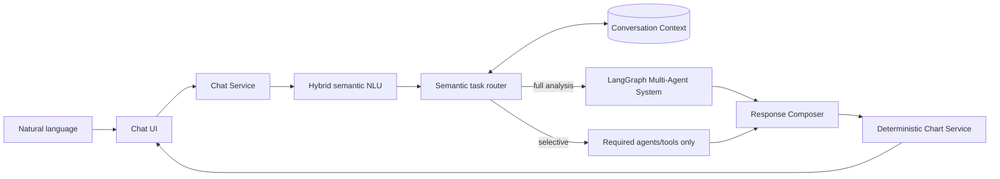
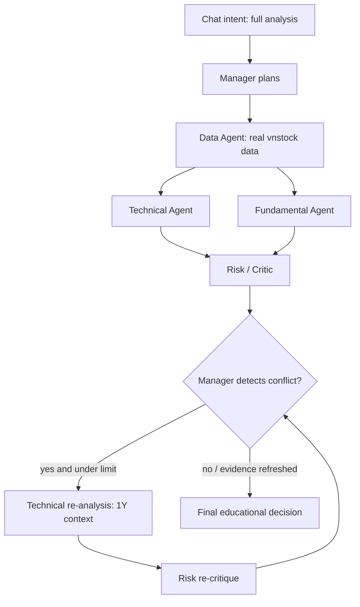

# Stock Multi-Agent Assistant

An educational ChatGPT-like assistant for **Intelligent Agents and Multi-Agent Systems**. Users speak naturally; an intent router selects only the agents/tools needed, while the existing LangGraph supervisor coordinates exactly five specialized agents for full analysis. Data comes from real `vnstock` APIs and the application **never places a trade**.

> Educational analysis only. This is not financial advice, an automated trading system, or a broker integration.

## What the demo shows

- Goal, observation, reasoning summary, planning, action, tool use, and memory/state
- Typed agent-to-agent messages
- Independent Technical and Fundamental agents running as graph branches
- A Risk/Critic agent that can disagree or veto
- A Manager that detects conflict and requests bounded re-analysis
- A visible Observe → Reason → Plan → Act → Observe execution trace
- Real OHLCV and financial data for user-supplied Vietnamese tickers
- Hybrid semantic NLU, bounded conversation memory, positional coreference, comparison and discovery
- Typed `SemanticQuery` with confidence, ambiguity, secondary intents, clarification and parser telemetry
- Bounded typed task plans with dependencies, input/output contracts, timeout/budget and deterministic validation before dispatch
- Deterministic Plotly charts selected from safe `ChartRequest` specifications
- Provenance-first Vietnamese theory Knowledge Base with SQLite FTS5, citations and freshness warnings

## Chat assistant



Examples require no commands:

```text
User: Phân tích FPT cho tôi
Assistant: [full Multi-Agent analysis]

User: Cho tôi biểu đồ 6 tháng
Assistant: [remembers FPT and renders FPT 6M]

User: RSI thế nào?
Assistant: [Data → Technical only, still FPT]

User: So với CMG?
Assistant: [FPT vs CMG comparison]
```

Dynamic routing is visible under **View agent activity**. A chart request does not run Fundamental/Risk; an RSI request does not run all five agents; full analysis and comparison do.

Open **View semantic interpretation** under a response to inspect normalized input, intent, entities, confidence, context resolution and the selected parser. This is an auditable summary, not hidden chain-of-thought.

The local fallback uses semantic similarity against a varied example bank plus deterministic ticker/indicator/period extraction. When `STOCK_AGENT_LLM_PROVIDER=openai` or `ollama`, the same pipeline can use the typed Pydantic `SemanticQuery` schema; provider failure safely returns to the local fallback with an auditable reason and latency. `IntentRouter` then emits only allowlisted, validator-checked task steps—it does not grant the model arbitrary tool access. See [semantic NLU](docs/semantic-nlu.md) and [Phase B](docs/phase-b-semantic-routing.md).

## Research evidence

The research route is hybrid: it first searches locally ingested, provenance-required documents and returns chunk-level citations. On a local miss, a bounded research service keeps the user's subject intact, discovers both official exchange pages and complementary public sources, safely fetches public HTML, extracts text/metadata, and shows quote-level **external evidence** with canonical URL and timestamps. The default `free` discovery chain needs no API key (GDELT news, then Bing RSS compatibility). Failed/unfetched sources remain clearly labelled discovery results—not evidence—and no web content is silently ingested. Set `STOCK_AGENT_WEB_SEARCH_ENABLED=false` to disable web fallback. See [Phase C evidence foundation](docs/phase-c-research-evidence.md).

## Knowledge Base for theory questions

Ask `P/E là gì?`, `roe la gi`, `RSI được tính thế nào?`, or `ATO khác ATC thế nào?`. The parser routes `THEORY` and `CURRENT_RULE` to a deterministic local Knowledge Service, not another LLM agent. SQLite FTS5 works with Vietnamese queries with or without accents; citations preserve publisher, source URL, timestamps, document/chunk IDs and SHA-256. Time-sensitive exchange rules always show a freshness warning.

`MIXED` questions such as `ROE của FPT có tốt không?` combine a KB definition with real provider data without letting KB text decide BUY/SELL. The seed corpus in `knowledge/` contains original Vietnamese educational summaries with declared sources; it does not copy books/articles wholesale. Details and ingestion instructions: [Knowledge Base](docs/knowledge-base.md).

## Architecture



Detailed design: [implementation plan](docs/implementation-plan.md), [core architecture](docs/architecture.md), and [chat architecture](docs/chat-architecture.md).

## The five agents

| Agent | Observation | Tools/actions | Authority |
|---|---|---|---|
| Data | ticker and horizon | vnstock, normalization, validation | Data only; cannot recommend |
| Technical | OHLCV | SMA, RSI, MACD, volatility, volume, support/resistance | Technical signal |
| Fundamental | company ratios | growth/quality/valuation scoring | Independent fundamental signal |
| Risk/Critic | data + both signals | volatility, drawdown, disagreement checks | Warnings and veto |
| Manager | all agent outputs/messages | plan, routing, conflict detection | Final educational decision |

## Setup (all project files on drive D)

The repository rule is to keep the virtualenv, dependency cache, and temporary build files on drive `D:`. From PowerShell in this directory:

```powershell
New-Item -ItemType Directory -Force .tmp,.cache\pip | Out-Null
$env:TEMP = (Resolve-Path .tmp).Path
$env:TMP = $env:TEMP
$env:PYTHONUTF8 = "1"
python -m venv .venv
.\.venv\Scripts\python.exe -m pip install --progress-bar off --cache-dir .cache\pip `
  --extra-index-url https://vnstocks.com/api/simple -e ".[dev]"
```

Copy `.env.example` settings into your environment if you want a vnstock source other than the default `VCI`. No LLM key is required: core reasoning is deterministic and auditable.

## Run

CLI with any valid Vietnamese ticker:

```powershell
.\.venv\Scripts\stock-agents.exe FPT --horizon "3 months"
.\.venv\Scripts\stock-agents.exe VNM --horizon "6 months"
```

Chat UI:

```powershell
.\.venv\Scripts\streamlit.exe run app\streamlit_app.py
```

Tests:

```powershell
.\.venv\Scripts\python.exe -m pytest
```

Knowledge ingestion and its author-created evaluation set:

```powershell
$env:PYTHONPATH = "src"
.\.venv\Scripts\python.exe scripts\ingest_knowledge.py --manifest knowledge\sources.json
.\.venv\Scripts\python.exe scripts\evaluate_knowledge.py
```

Semantic evaluation with per-query error analysis:

```powershell
.\.venv\Scripts\python.exe scripts\evaluate_semantics.py --show-errors
```

## Real-data behavior

The default `VnstockMarketDataProvider` uses vnstock 4.x's current API (not the deprecated `Vnstock().stock` wrapper):

```python
from vnstock.api.quote import Quote
from vnstock.api.financial import Finance

Quote(source="VCI", symbol="FPT").history(start="...", end="...", interval="1D")
Finance(source="VCI", symbol="FPT", period="year").ratio(lang="en", dropna=True)
```

External schemas and upstream availability can change. The provider therefore validates ticker syntax, required OHLCV columns, chronology, row count, and every numeric value. If real data is unavailable, the UI reports the failure; it does not silently substitute canned data. Missing financial fields lead to lower confidence or `UNKNOWN`.

The reliable-data layer also attaches field-group provenance (`as_of`, UTC `fetched_at`, request parameters, schema version and SHA-256), stores immutable raw snapshots, caches normalized data in SQLite, and applies retry/backoff, provider timeout, circuit breaking and deterministic quality checks. Stale or period-less financial evidence is blocked from fundamental scoring rather than being presented as current. See [Phase A data layer](docs/phase-a-data-layer.md).

Inspect real-data quality without running an analysis:

```powershell
.\.venv\Scripts\python.exe scripts\data_quality_report.py FPT VNM HPG
```

vnstock/vnai normally writes first-run notices and configuration under the Windows user profile. The provider scopes its runtime profile to `.runtime/` in this D-drive project and disables optional telemetry by default, so it does not create project data on drive C.

## Optional LLM presentation providers

`LLMProvider` has Mock/deterministic, OpenAI, and Ollama adapters. Mock mode is the default and has no model API charge. OpenAI semantic parsing is optional and incurs API usage when enabled; Ollama runs locally. No LLM owns indicator calculations, risk vetoes, or the final safety policy. Install the OpenAI adapter only when needed:

```powershell
.\.venv\Scripts\python.exe -m pip install --cache-dir .cache\pip -e ".[llm]"
```

## Agent theory mapping

| Theory | Implementation |
|---|---|
| Environment | Real Vietnamese market/company data |
| Sensor | vnstock provider |
| Observation | `MarketData` and specialist result models |
| Goal | Fixed role plus `AgentMessage.task` |
| Reasoning | Auditable scoring policy and public summary |
| Tool | Pure indicator/financial functions |
| Action | Tool call or structured message |
| Memory | `AgentState` |
| Communication | `AgentMessage` |
| Planning | Manager plan + LangGraph conditional edges |
| Conflict | Signal disagreement, Risk critique/veto |
| Multi-Agent | Parallel branches, join, supervisor cycle |

## Suggested presentation script

1. Ask `Phân tích FPT cho tôi` and open **View agent activity**.
2. Point to Manager's plan, Data source/session count, parallel specialists and Risk critique.
3. Ask `Cho tôi biểu đồ 6 tháng`; show that memory resolves FPT and route is only Data → Chart.
4. Ask `RSI thế nào?`; show Data → Technical rather than all five agents.
5. Ask `So với CMG?`, then show the comparison table and per-stock Multi-Agent traces.
6. Ask for market overview and technology discovery; explain unavailable fields and limited watchlist disclosure.

Real data changes over time, so FPT is not forced to produce a particular signal. The test suite uses deterministic in-memory fixtures only to guarantee that the conflict-routing concept remains demonstrable.

## Publishing to GitHub

Repository hygiene, the first-push commands, CI behavior and secret-handling checklist are in [docs/github-publish.md](docs/github-publish.md). Do not commit `.env`, `.runtime`, local caches, raw market snapshots, or broker credentials.
