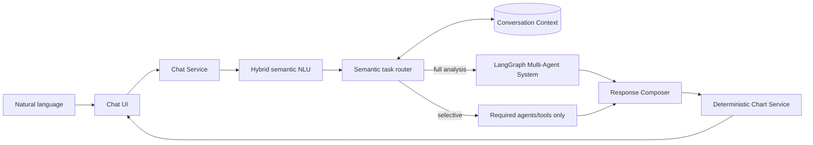
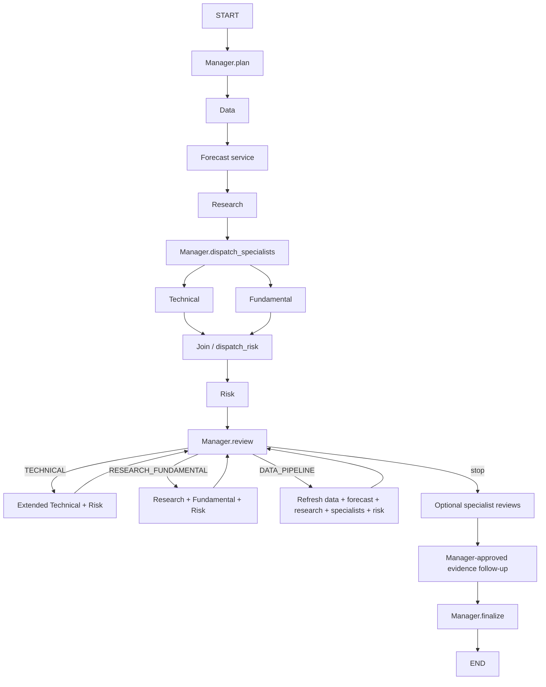

# Stock Multi-Agent Assistant

> Documentation reviewed 23/10/2026 against the working tree: [current project report](docs/project-report.md), [document register](docs/README.md), [role specialization and code](docs/agent-specialization.md). Historical phase test totals describe their original runs.

An educational ChatGPT-like assistant for **Intelligent Agents and Multi-Agent Systems**. Users speak naturally; an intent router selects the agents/tools needed, while the LangGraph supervisor coordinates six roles for full analysis: Data, Research, Technical, Fundamental, Risk and Manager. Data comes from real `vnstock` APIs and the application **never places a trade**.

> Educational analysis only. This is not financial advice, an automated trading system, or a broker integration.

Local-only interactions: [browser navigation, reports, VNDIRECT links and personal watchlist](docs/local-interactions.md). Automatic browsing is **off by default**. Explicit navigation requests ask for confirmation; you can opt in using the sidebar checkbox. No login automation or trade execution. Run with `--server.address 127.0.0.1` on your own machine.

Numeric screening: [RSI/PE/PB/ROE conditions and requested counts](docs/numeric-screening.md), for example `Tìm cho tôi 10 cổ phiếu có RSI > 30`. Calculations and comparisons use Python and sourced market snapshots, not numbers generated by an LLM.

Phase 6–8 engineering update: [implementation and training handoff](docs/phase-6-8-implementation.md), [Qwen3 Colab fine-tuning](docs/llm-finetuning-data-policy.md), [LSTM V3 model card](docs/lstm-v3-model-card.md), and [Quick/Deep/Offline demo runbook](docs/demo-runbook.md). V2 remains the default environment selection; the UI also offers an explicit experimental V4 blend. See [forecast policy](docs/price-forecasting.md). Model training and software tests are separate evidence.

Multi-agent reliability: [contracts, partial results, deadlines and recovery](docs/multi-agent-reliability.md). Compare bounded coordination with single-pass and evaluator-only no-risk ablations using the [offline synthetic contract benchmark](evaluation/coordination/README.md); it does not measure investment returns or calibrated confidence.

## What the demo shows

- Goal, observation, reasoning summary, planning, action, tool use, and memory/state
- Typed agent-to-agent messages
- Independent Technical and Fundamental agents running as graph branches
- A Risk/Critic agent that can disagree or veto
- A Manager that detects conflict and requests bounded re-analysis
- A visible Observe → Reason → Plan → Act → Observe execution trace
- Real OHLCV and financial data for user-supplied Vietnamese tickers
- Hybrid semantic NLU, bounded conversation memory, positional coreference, comparison and discovery
- Typed `SemanticQuery` with confidence, ambiguity, secondary intents, clarification and parser telemetry
- Bounded typed task plans with dependencies, input/output contracts, timeout/budget and deterministic validation before dispatch
- Deterministic Plotly charts selected from safe `ChartRequest` specifications
- Provenance-first Vietnamese theory Knowledge Base with SQLite FTS5, citations and freshness warnings

## Chat assistant



Examples require no commands:

```text
User: Phân tích FPT cho tôi
Assistant: [full Multi-Agent analysis]

User: Cho tôi biểu đồ 6 tháng
Assistant: [remembers FPT and renders FPT 6M]

User: RSI thế nào?
Assistant: [Data → Technical only, still FPT]

User: So với CMG?
Assistant: [FPT vs CMG comparison]
```

Dynamic routing is visible under **View agent activity**. A chart request does not run Fundamental/Risk; an RSI request runs Data and Technical; full analysis and comparison coordinate all six roles.

Open **View semantic interpretation** under a response to inspect normalized input, intent, entities, confidence, context resolution and the selected parser. This is an auditable summary, not hidden chain-of-thought.

The local fallback uses semantic similarity against a varied example bank plus deterministic ticker/indicator/period extraction. When `STOCK_AGENT_LLM_PROVIDER=colab_qwen`, `openai`, or `ollama`, the same pipeline can use typed Pydantic schemas; provider failure safely returns to deterministic behavior with an auditable reason. `IntentRouter` then emits only allowlisted, validator-checked task steps—it does not grant the model arbitrary tool access. See [semantic NLU](docs/semantic-nlu.md) and [Phase B](docs/phase-b-semantic-routing.md).

The new training target and client default are `Qwen/Qwen3-4B-Instruct-2507`; use [the Colab QLoRA notebook](notebooks/finetune_qwen3_4b_lora_v1.ipynb) for interactive training, export and reload. It does not start a server or automatically approve an adapter. Existing `.env` settings and [the legacy Qwen2.5 endpoint notebook](notebooks/serve_qwen25_3b_colab.ipynb) are not silently migrated: an application endpoint must actually serve the configured model, and adapter requests must attest its identity. See [fine-tuning and integration boundaries](docs/llm-finetuning-data-policy.md).

To serve **Qwen3 base** to the agents without retraining, use [the Qwen3 inference notebook](notebooks/serve_qwen3_4b_colab.ipynb) and [connection instructions](docs/qwen3-agent-setup.md). It loads NF4/FP16 weights once, authenticates requests, checks JSON schemas, and does not activate the synthetic NLU adapter. Public publication is opt-in and requires an environment whose hosting policies allow it; Colab Free is not an assured API backend.

Set `STOCK_AGENT_LLM_SPECIALISTS_ENABLED=true` and `STOCK_AGENT_LLM_SPECIALIST_ROLES=technical,fundamental,risk` for the deeper classroom profile, or select fewer roles to reduce calls. LSTM forecasting runs after Data; Qwen can select supplemental technical checks and review specialist evidence, while Python calculates every numeric value. LLM calls use typed schemas and evidence validators, fail back to deterministic results, and cannot directly mutate scores, signals, vetoes, forecasts or the final recommendation. QUICK and OFFLINE use zero LLM calls.

For lower latency, keep `STOCK_AGENT_LLM_SEMANTIC_ENABLED=false` and `STOCK_AGENT_LLM_ANALYST_ENABLED=false`. When separately enabled and allowed by the remaining budget, Manager may make a routing call and a final synthesis call; high-confidence routes can skip routing, while quick screening never invokes the model for all 100 symbols. If Colab is unavailable, both Manager and Technical preserve the deterministic result.

## Research evidence

The research route now implements a complete local RAG loop: question embedding, cosine vector similarity, hybrid FTS5 merge, top-k provenance chunks, and citation-constrained synthesis through the configured LLM provider. The educational KB is additionally projected into Neo4j, where bounded 1–2 hop entity traversal contributes provenance-linked document candidates to hybrid retrieval. On a local miss, a bounded research service keeps the user's subject intact, discovers both official exchange pages and complementary public sources, safely fetches public HTML, extracts text/metadata, and shows quote-level **external evidence** with canonical URL and timestamps. The default `free` discovery chain needs no API key. Failed/unfetched sources remain clearly labelled discovery results—not evidence—and no web content is silently ingested. See [RAG architecture](docs/rag.md), [Neo4j Knowledge Graph](docs/knowledge-graph.md), and [Phase C evidence foundation](docs/phase-c-research-evidence.md).

## Knowledge Base for theory questions

Ask `P/E là gì?`, `roe la gi`, `RSI được tính thế nào?`, or `ATO khác ATC thế nào?`. The parser routes `THEORY` and `CURRENT_RULE` to a deterministic local Knowledge Service, not another LLM agent. SQLite FTS5 works with Vietnamese queries with or without accents; citations preserve publisher, source URL, timestamps, document/chunk IDs and SHA-256. Time-sensitive exchange rules always show a freshness warning.

`MIXED` questions such as `ROE của FPT có tốt không?` combine a KB definition with real provider data without letting KB text decide BUY/SELL. The seed corpus in `knowledge/` contains original Vietnamese educational summaries with declared sources; it does not copy books/articles wholesale. Details and ingestion instructions: [Knowledge Base](docs/knowledge-base.md).

## Architecture



Detailed design: [implementation plan](docs/implementation-plan.md), [core architecture](docs/architecture.md), and [chat architecture](docs/chat-architecture.md).

## The six agents

| Agent | Observation | Tools/actions | Authority |
|---|---|---|---|
| Data | ticker and horizon | vnstock, normalization, validation | Data only; cannot recommend |
| Research | request and verified corpus | bounded hybrid retrieval and sourced evidence | Citation context; cannot issue a trading signal |
| Technical | OHLCV | SMA, RSI, MACD, volatility, volume, support/resistance | Technical signal |
| Fundamental | company ratios | growth/quality/valuation scoring | Independent fundamental signal |
| Risk/Critic | data + both signals | volatility, drawdown, disagreement checks | Warnings and veto |
| Manager | all agent outputs/messages | plan, routing, conflict detection | Final educational decision |

## Setup (all project files on drive D)

The repository rule is to keep the virtualenv, dependency cache, and temporary build files on drive `D:`. From PowerShell in this directory:

```powershell
New-Item -ItemType Directory -Force .tmp,.cache\pip | Out-Null
$env:TEMP = (Resolve-Path .tmp).Path
$env:TMP = $env:TEMP
$env:PYTHONUTF8 = "1"
python -m venv .venv
.\.venv\Scripts\python.exe -m pip install --progress-bar off --cache-dir .cache\pip `
  --extra-index-url https://vnstocks.com/api/simple -e ".[dev]"
```

Copy `.env.example` settings into your environment. Core calculations remain deterministic; the Colab URL/token are required only while using remote Qwen features.

For the free Vnstock Community tier, put `VNSTOCK_API_KEY` in the ignored local `.env`. The provider then changes its own safe pacing from the Guest profile to about 57 requests/minute, below the upstream 60 requests/minute limit. Verify the tier without printing the key with `python scripts/check_vnstock_api_key.py`. See [Vnstock Community API setup](docs/vnstock-community-api.md).

## Run

CLI with any valid Vietnamese ticker:

```powershell
.\.venv\Scripts\stock-agents.exe FPT --horizon "3 months"
.\.venv\Scripts\stock-agents.exe VNM --horizon "6 months"
```

Chat UI:

```powershell
.\.venv\Scripts\python.exe -m streamlit run app\streamlit_app.py
```

Tests:

```powershell
.\.venv\Scripts\python.exe -m pytest
```

Knowledge ingestion and its author-created evaluation set:

```powershell
$env:PYTHONPATH = "src"
.\.venv\Scripts\python.exe scripts\ingest_knowledge.py --manifest knowledge\sources.json
.\.venv\Scripts\python.exe scripts\evaluate_knowledge.py
```

Semantic evaluation with per-query error analysis:

```powershell
.\.venv\Scripts\python.exe scripts\evaluate_semantics.py --show-errors
```

## Real-data behavior

The default `VnstockMarketDataProvider` uses vnstock 4.x's current API (not the deprecated `Vnstock().stock` wrapper):

```python
from vnstock.api.quote import Quote
from vnstock.api.financial import Finance

Quote(source="VCI", symbol="FPT").history(start="...", end="...", interval="1D")
Finance(source="VCI", symbol="FPT", period="year").ratio(lang="en", dropna=True)
```

External schemas and upstream availability can change. The provider therefore validates ticker syntax, required OHLCV columns, chronology, row count, and every numeric value. If real data is unavailable, the UI reports the failure; it does not silently substitute canned data. Missing financial fields lead to lower confidence or `UNKNOWN`.

The reliable-data layer also attaches field-group provenance (`as_of`, UTC `fetched_at`, request parameters, schema version and SHA-256), stores immutable raw snapshots, caches normalized data in SQLite, and applies configured retry/backoff, cooperative deadlines, supported transport timeouts, circuit breaking and deterministic quality checks. Financial evidence retains period/quality limits: current compatible statements can take precedence over stale ratios; other usable stale ratios can receive reduced weight. Missing usable metric/statement evidence yields UNKNOWN. See [current analysis policy](docs/current-architecture.md). See [Phase A data layer](docs/phase-a-data-layer.md).

Inspect real-data quality without running an analysis:

```powershell
.\.venv\Scripts\python.exe scripts\data_quality_report.py FPT VNM HPG
```

vnstock/vnai normally writes first-run notices and configuration under the Windows user profile. The provider scopes its runtime profile to `.runtime/` in this D-drive project and disables optional telemetry by default, so it does not create project data on drive C.

## LLM providers

`LLMProvider` has Colab Qwen, Mock/deterministic, OpenAI, and legacy Ollama adapters. The configured demo path is remote Qwen and needs no paid model API in the code. External API hosting still depends on the chosen runtime's policies and resources; Colab Free restricts primarily external-web-UI usage. No LLM owns indicator calculations, risk vetoes, or the final safety policy. Install the OpenAI adapter only when needed:

```powershell
.\.venv\Scripts\python.exe -m pip install --cache-dir .cache\pip -e ".[llm]"
```

## Agent theory mapping

| Theory | Implementation |
|---|---|
| Environment | Real Vietnamese market/company data |
| Sensor | vnstock provider |
| Observation | `MarketData` and specialist result models |
| Goal | Fixed role plus `AgentMessage.task` |
| Reasoning | Auditable scoring policy and public summary |
| Tool | Pure indicator/financial functions |
| Action | Tool call or structured message |
| Memory | `AgentState` |
| Communication | `AgentMessage` |
| Planning | Manager plan + LangGraph conditional edges |
| Conflict | Signal disagreement, Risk critique/veto |
| Multi-Agent | Parallel branches, join, supervisor cycle |

## Suggested presentation script

Phase 8 adds request-scoped **STANDARD / QUICK / DEEP / OFFLINE** modes, actual node lifecycle events, local-only readiness, checksum-verified full-OHLCV replay bundles, and sanitized Markdown/HTML/audit JSON exports. QUICK disables LLM calls but can fetch market data; OFFLINE denies outbound retrieval and uses explicitly selected private replay/KB data with original dates. Profile selection never rewrites `.env`. See the [5–10 minute demo runbook](docs/demo-runbook.md) for capture commands, budgets, privacy boundaries and rehearsal checks. Model training/validation remains separate from UI readiness; no newly trained artifact is automatically approved.

1. Ask `Phân tích FPT cho tôi` and open **View agent activity**.
2. Point to Manager's plan, Data source/session count, parallel specialists and Risk critique.
3. Ask `Cho tôi biểu đồ 6 tháng`; show that memory resolves FPT and route is only Data → Chart.
4. Ask `RSI thế nào?`; show the selective Data → Technical route.
5. Ask `So với CMG?`, then show the comparison table and per-stock Multi-Agent traces.
6. Ask for market overview and technology discovery; explain unavailable fields and limited watchlist disclosure.

Real data changes over time, so FPT is not forced to produce a particular signal. The test suite uses deterministic in-memory fixtures only to guarantee that the conflict-routing concept remains demonstrable.

## Publishing to GitHub

Repository hygiene, the first-push commands, CI behavior and secret-handling checklist are in [docs/github-publish.md](docs/github-publish.md). Do not commit `.env`, `.runtime`, local caches, raw market snapshots, or broker credentials.
