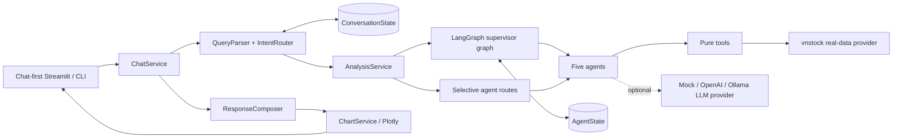
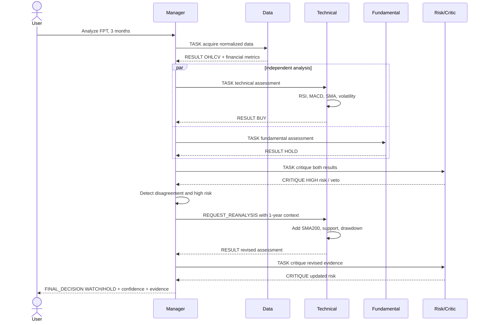

# Architecture

## Overall architecture

The application is an educational conversational decision-support system, not a trading system. `ChatService` parses natural language, resolves bounded conversation context, and selects a minimal route. `AnalysisService` remains the stable core API and can run either the full LangGraph or selected existing agents. No component contains broker credentials or order APIs.

## Conversational routing

| Intent | Route |
|---|---|
| Stock analysis | Data → Technical + Fundamental → Risk → Manager |
| Technical / RSI / MACD | Data → Technical |
| Fundamental | Data → Fundamental |
| Risk | Data → Technical + Fundamental → Risk |
| Chart | Data → deterministic ChartService |
| Market overview | VN-Index Data → market calculation → Manager |
| Discovery | Configured watchlist → Data + Technical → ranking |
| Comparison | Full analysis per ticker → comparison synthesis |

`ConversationState` keeps active tickers, last intent/horizon/chart period, latest analysis, latest stock list, preferences, a bounded message window, and a compact summary of trimmed messages. Raw history is never allowed to grow without limit.

## Agent architecture

Every agent has a fixed role and goal, observes only relevant state, selects tools/policy, produces a public reasoning summary (never hidden chain-of-thought), and acts by returning state updates plus `AgentMessage`/trace records. Tools contain calculations but no BUY/HOLD policy. Providers contain integration details but no analysis policy.

## Multi-agent interaction

Technical and Fundamental run as independent parallel branches after normalized data is available. Their updates merge at a LangGraph join. Risk consumes both results and is explicitly adversarial. Manager owns plan/routing and can ask Technical to revisit a longer horizon. The loop is guarded by `max_iterations`.

## Observe → Reason → Plan → Act mapping

| Stage | Concrete implementation |
|---|---|
| Observe | Read typed fields from `AgentState` |
| Reason | Deterministic, auditable policy producing a short `reasoning_summary` |
| Plan | Manager `current_plan` and conditional route; Technical tool selection |
| Act | Call a tool/provider or emit an `AgentMessage` |
| Observe again | Downstream node receives the merged updated state |

## Agent theory → code mapping

| Agent theory concept | Implementation |
|---|---|
| Environment | Vietnamese stock-market/company data |
| Observation | `MarketData`, `FinancialMetrics`, specialist results |
| Sensor | `MarketDataProvider` through `MarketDataTool` |
| Tool | Indicator and financial toolkit functions |
| Goal | Agent role plus message `task` |
| Reasoning | Agent scoring/selection policy and public summary |
| Action | Provider/tool call, result, warning, critique, or re-analysis request |
| Memory/state | `AgentState` |
| Communication | `AgentMessage` |
| Planning | Manager plan and LangGraph conditional routing |
| Specialization | Five agent classes with non-overlapping authority |
| Conflict/criticism | Signal comparison and Risk veto |
| Multi-agent system | Fan-out/join/cycle in `StockAgentGraph` |

## FPT conflict sequence

## Safety and failure behavior

Real-data failures are surfaced clearly and never replaced with invented analysis. Missing metrics reduce confidence or yield `UNKNOWN`. Deterministic fixtures exist only in tests. Every loop is finite. Final output always carries an educational disclaimer and there is no trade execution action anywhere in the graph.
