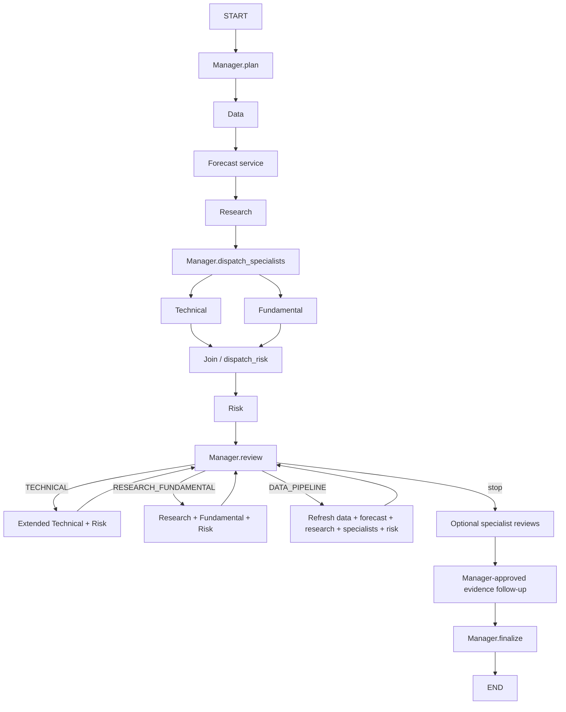

# Architecture

Reviewed against the working tree on 23/10/2026. This document describes implemented
behaviour; [the current project report](project-report.md) includes evidence and
[the documentation register](README.md) distinguishes current guides from historical reports.

## Application layers

Streamlit/CLI → ChatService or AnalysisService → typed contracts → bounded agents,
tools and providers. Chat uses hybrid semantic NLU and IntentRouter to create a
validated RoutingPlan. ChatPlanExecution/PlanExecutor execute the approved tasks,
validate actual output artifacts and retain task status. Full graph and batch
operations remain service-owned composites, not arbitrary generated code/DAGs.

Code: `chat/router.py`, `services/chat_plan_execution.py`, `services/plan_executor.py`,
`services/analysis_service.py`, `graph/stock_agent_graph.py` under `src/stock_multi_agent/`.

## Routes

| Request | Implemented route / boundary |
|---|---|
| Full analysis | Manager → Data → Forecast → Research → parallel Technical/Fundamental → Risk → review → bounded follow-up → finalize |
| Technical / indicator | Data → optional Forecast → Technical; no Fundamental/Risk required |
| Fundamental | Data → Forecast when enabled by caller → Research → Fundamental |
| Risk | Data/benchmark → Forecast → Research → Technical/Fundamental → Risk; selective API executes stages sequentially |
| Chart | Data → deterministic ChartService; no investment specialists required |
| Comparison | Full per-ticker analysis plus field-alignment checks |
| Discovery | Bounded current universe → technical screen → successive halving |
| Recommendation | Cheap screen → bounded full analysis shortlist → qualified buckets and disclosed REFERENCE_ONLY shortfall fallback |
| THEORY / CURRENT_RULE / MIXED | Deterministic KnowledgeService; MIXED also acquires relevant real metrics |
| Research question | Local hybrid RAG; bounded external discovery/fetch/extraction when needed |

## Full-analysis graph

The default re-analysis limit is two; QUICK/OFFLINE initial states set it to zero.
History, evidence fingerprints, deadlines and follow-up approval further bound work.
A risk veto without a recoverable data issue is not an instruction to rerun until BUY.
See [conflict resolution](conflict-resolution.md).

## Specialization and authority

Six role classes declare AgentSpec. Data never calls LLM. Research supplies citations;
Technical/Fundamental own separate analyses; Risk supplies critique/veto; Manager
owns final decision. Selected roles can share one configured LLM provider with
different schemas/prompts. Six roles do not imply six models or six LLM calls.

AgentSpec.allowed_tools documents capability scope. Actual tool selection has
specific allowlists; it is not a Python sandbox. `agent_execution.OUTPUTS` and
`validate_update()` check state writes, message sender, reports and final-decision
authority. Typed context models select relevant inputs but agents still execute
in one process with shared AgentState; this is not process isolation.

Python owns all indicators, scores, signals, veto and recommendation policy.
Technical may ask LLM to select at most two supplemental diagnostics. Fundamental
and Risk can review evidence and propose bounded follow-up; Manager approves it.
Forecast is a model service, Knowledge/RAG/retrieval/chart components are services,
not additional roles. [Role-to-code presentation guide](agent-specialization.md).

## State, failures and persistence

AgentState reducers merge branch messages, trace, reviews, reports, task executions,
completed tasks and histories. Structured messages carry run/task correlation and
input lineage. Specialist failures become typed partial/unavailable results;
initial market data must be valid. Manager retains authoritative risk constraints.

Graph checkpoints/pending writes use local SQLite; `resume_analysis(run_id)` resumes
pending nodes of a compatible workflow. UI conversations also persist in SQLite.
Neither mechanism guarantees exactly-once external I/O or full UI recovery.
Deadlines are cooperative; supported transports receive clamped timeouts.
See [reliability boundaries](multi-agent-reliability.md).

## Evidence and model boundaries

Market data preserves source/as-of/fetch time, raw snapshots, checksum and quality.
Research uses vector+FTS retrieval, period/freshness gates and citation-constrained
synthesis. HTML and text-layer PDF extraction exist; scanned PDF needs OCR, which
is not implemented. Crawler ingestion requires configured source/document policy;
chat discovery alone does not grant full-text storage permission.

V2/V3/V4 forecast adapters exist; environment-aware loading and UI V2/V4 selection
are distinct from bare `AnalysisService()` construction, which injects a baseline
service by default. V4 demo blending is an explicit experimental exception, not
promotion. Shared indicator toolkit serves analysis and charts. See
[forecast policy](price-forecasting.md).

## Evaluation limits

Tests verify implementation contracts, not investment accuracy. The coordination
benchmark compares a six-role single pass against bounded coordination and an
evaluator-only no-Risk ablation; it does not compare one LLM agent against six.
No broker/order execution is implemented. Live upstream availability, independent
retrieval quality, confidence calibration and point-in-time investment performance
require separate evidence.
