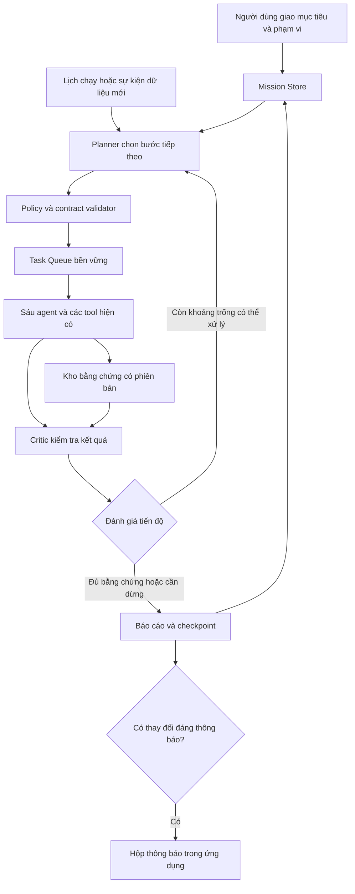

# Kế hoạch tăng tính chủ động cho hệ agent chứng khoán

> Đối chiếu 23/10/2026: đây vẫn là đề xuất cho goal/worker chủ động của sáu role, không phải worker đã triển khai. Crawler tài liệu có cơ chế lịch riêng và không đồng nghĩa autonomous agent goals đã hoạt động.

Ngày lập: 22/10/2026. Phạm vi: sáu agent trong ứng dụng chứng khoán. Đây là kế
hoạch triển khai; chưa bật worker nền, cài lịch chạy hoặc thay đổi hành vi sản phẩm.

## 1. Kết quả người dùng cần nhận được

Người dùng giao một mục tiêu, ví dụ:

> Theo dõi FPT và HPG. Khi có báo cáo mới hoặc bằng chứng làm thay đổi phân tích,
> tự kiểm tra lại, cập nhật hồ sơ nghiên cứu và báo cho tôi điều gì đã thay đổi.

Hệ thống tự chia việc, chọn agent/công cụ, tìm bằng chứng còn thiếu, kiểm tra
kết quả và quyết định bước tiếp theo. Nhiệm vụ theo dõi tiếp tục qua nhiều lần
chạy. Người dùng có thể xem tiến độ, giới hạn ngân sách, tạm dừng và hủy.

Các hành vi cần chứng minh được:

- Thiếu báo cáo tài chính: tự tạo tác vụ tìm báo cáo phù hợp với doanh nghiệp/kỳ.
- Hai nguồn có số liệu khác nhau: tự xác minh đơn vị, kỳ và phạm vi hợp nhất.
- Công cụ lỗi: chọn phương án dự phòng đã được cấp quyền; không lặp vô hạn.
- Dữ liệu không đổi: không gọi lại toàn bộ pipeline hoặc gửi thông báo lặp.
- Có bằng chứng mới: chỉ chạy lại các phần phụ thuộc và giải thích thay đổi.
- Không thể xác minh: kết thúc với kết quả thiếu bằng chứng, ghi rõ lý do.
- Đóng giao diện: worker đã được cấu hình vẫn thực hiện nhiệm vụ đến hạn.

## 2. Nền tảng hiện có và phần còn thiếu

| Nền tảng đang có | Vai trò trong nâng cấp | Phần cần bổ sung |
|---|---|---|
| Sáu agent và graph phân tích song song | Thực thi chuyên môn | Mục tiêu dài hạn và hàng đợi công việc |
| Task plan có validator/executor | Chặn tác vụ sai hợp đồng | Planner chọn bước tiếp theo từ quan sát mới |
| Evidence follow-up có allowlist | Mẫu cho đề xuất tìm thêm bằng chứng | Vòng chủ động nhiều bước có tiêu chí dừng |
| Snapshot, fingerprint, checkpoint/pending writes | Khôi phục và truy xuất nguồn gốc | Liên kết mission với nhiều analysis run |
| SQLite conversation và research workbench | Ngữ cảnh, hồ sơ nghiên cứu | Bộ nhớ nhiệm vụ và giả thuyết chưa kiểm chứng |
| Research crawler/sync và script cài lịch | Cập nhật nguồn đã khai báo | Điều phối theo sự kiện, chống trùng và hạn mức chung |
| Risk veto, analytical sufficiency, deadline | Kiểm soát chất lượng và chi phí | Đánh giá tiến độ theo mục tiêu, ngân sách toàn mission |

Graph hiện tại có luồng cố định và một số nhánh tái phân tích. Lịch crawler hiện
tại chạy tác vụ đồng bộ nguồn; nó chưa tự quản lý một mục tiêu nghiên cứu xuyên
nhiều lượt. Tăng tính chủ động cần một lớp điều phối mục tiêu bên trên các engine
đã có, đồng thời mở rộng quyền đề xuất tác vụ cho từng chuyên gia.

## 3. Kiến trúc đề xuất

Hai chế độ triển khai lần lượt:

1. **Tự hoàn thành nhiệm vụ:** nhận một câu hỏi, tự lập và sửa kế hoạch trong một
   lượt có giới hạn. Có thể kết thúc `SUCCEEDED` hoặc `INSUFFICIENT_EVIDENCE`.
2. **Tự theo dõi mục tiêu:** giữ mission, chờ đến hạn hoặc chờ sự kiện; tạo lượt
   công việc mới khi cần. Một lượt hoàn thành không có nghĩa mission theo dõi đã
   kết thúc. Mission hết hạn, bị hủy hoặc đạt điều kiện cuối mới đóng.

Giai đoạn đầu dùng một worker điều phối hàng đợi, cho phép tối đa hai tác vụ đọc
độc lập chạy song song. LLM dùng hàng đợi với mức đồng thời cấu hình được, mặc
định một lời gọi, phù hợp với endpoint dùng chung. Không thêm agent mới trước
khi đo được nhu cầu; tận dụng sáu vai trò hiện tại.

## 4. Phạm vi tự chủ và trách nhiệm

| Vai trò | Quyền chủ động cần có | Điều kiện kiểm tra |
|---|---|---|
| Manager | Chia mục tiêu thành task, ưu tiên, giao lại, quyết định dừng | Chỉ task/capability hợp lệ; không tự tăng quyền/ngân sách |
| Data | Kiểm tra độ mới, làm mới nhóm dữ liệu cần thiết, đề xuất nguồn dự phòng | Giữ unit/period/provenance; không trộn nguồn khác nghĩa |
| Research | Chọn truy vấn, tìm tài liệu và bằng chứng đối chiếu | Tuân source registry và quyền fetch/storage hiện có |
| Technical | Chọn phép kiểm tra thích hợp với câu hỏi/horizon | Python tính số; phân biệt dự báo một phiên với mục tiêu dài hạn |
| Fundamental | Xác định khoảng trống, yêu cầu lịch sử hoặc kiểm chứng số liệu | Cùng đơn vị, kỳ và phạm vi báo cáo mới được đối chiếu |
| Risk/Critic | Yêu cầu bằng chứng bác bỏ giả thuyết và kiểm tra kết luận | Giữ quyền veto; không coi thiếu dữ liệu là sự kiện xấu đã xác minh |

Các agent phát `TaskProposal` có mục đích, dữ liệu cần, bằng chứng neo, kết quả
mong đợi và điều kiện dừng. Policy tự duyệt đề xuất trong phạm vi mission đã cấp;
không hỏi lại người dùng cho từng truy vấn hợp lệ. Task nhận/thực thi/trả kết quả
qua cùng queue và envelope có correlation. Agent không tự nhận tác vụ ngoài vai
trò hoặc sửa kết luận của agent khác.

LLM được chọn mục tiêu con, công cụ, nguồn trong phạm vi và giải thích giả
thuyết. Python tiếp tục xác minh phép tính, schema, provenance, ngân sách và
quyết định chấp nhận bằng chứng. Nội dung web là dữ liệu không tin cậy, không
được thay chính sách hoặc tạo quyền mới.

MVP tự đọc nguồn đã cho phép, chạy phân tích, lưu hồ sơ và tạo thông báo trong
ứng dụng. Đặt lệnh, đăng nhập tài khoản, gửi email/tin nhắn ra ngoài, tự sửa mã,
tự thay ngưỡng đầu tư hoặc tự kích hoạt model chưa đánh giá nằm ngoài phạm vi.
Thêm một nguồn vào allowlist không tự cấp quyền lưu toàn văn của nguồn đó.

## 5. Hợp đồng dữ liệu và vòng đời

Các model mới đề xuất:

- `ResearchMission`: goal, tickers, horizon, ngày kết thúc, điều kiện hoàn thành,
  trigger, quyền công cụ/nguồn, profile, phiên bản policy và ngân sách tích lũy.
- `AutonomousTask`: mission/task/parent IDs, agent, task kind, dependencies,
  input snapshot IDs, expected outputs, status, priority, lease và retry policy.
- `TaskProposal`: lý do, khoảng trống cần lấp, evidence IDs, chi phí ước tính,
  tiêu chí chấp nhận; chi phí LLM ước tính không được coi là chi phí đã đo.
- `ObservationEvent`: loại thay đổi, ticker, nguồn, kỳ, content hash, thời điểm
  công bố/thu thập và phiên bản bằng chứng.
- `ProgressAssessment`: mục tiêu con đã đạt, khoảng trống còn lại, bằng chứng
  thay đổi, lý do lập lại kế hoạch hoặc dừng.
- `MissionNotification`: thay đổi, ý nghĩa có điều kiện, nguồn, snapshot trước/
  sau, độ thiếu chắc chắn và khóa chống thông báo trùng.

Vòng đời task:

`PENDING → READY → RUNNING → SUCCEEDED | PARTIAL | INSUFFICIENT_EVIDENCE | FAILED`

`WAITING_RETRY` có thời điểm thử lại; `WAITING_EVENT` không chiếm worker.
`NEEDS_AUTHORIZATION` chỉ dùng khi phát sinh phạm vi chưa được cấp.
`PAUSED` và `CANCELLED` là thao tác điều khiển rõ ràng của người dùng.

Một nhiệm vụ theo dõi có thể ở `ACTIVE` trong khi các task của lượt hiện tại đã
xong và chờ sự kiện tiếp theo. Phân biệt thất bại do hạ tầng, thiếu bằng chứng
và hoàn thành có kết quả; không biến một báo cáo `UNKNOWN` thành thành công
phân tích chỉ để đóng task.

## 6. Các giai đoạn triển khai

| Giai đoạn | Thành phần và đầu ra | Điều kiện nghiệm thu |
|---|---|---|
| P0 — Mission và policy | Model mission/task/proposal; quyền theo mission; trạng thái và tiêu chí dừng | Mục tiêu được lưu, đọc lại và hủy; task vượt quyền bị chặn trước side effect |
| P1 — Planner và vòng chủ động | Planner LLM trả schema; fallback deterministic; đánh giá tiến độ; loop có giới hạn | Tự xử lý yêu cầu phân tích có bước tìm thêm bằng chứng, không cần người dùng chỉ từng bước |
| P2 — Chuyên gia tự đề xuất việc | Sáu agent phát đề xuất theo vai trò; queue có dependency, claim/lease, dedupe | Thiếu kỳ hoặc mâu thuẫn tạo đúng task; không chạy trùng hoặc ép đồng thuận giả |
| P3 — Chạy nền và trigger | Worker độc lập Streamlit; schedule/event; resume; ngân sách chung | Đóng UI vẫn chạy khi worker/máy còn hoạt động; restart không mất nhiệm vụ và không reset hạn mức |
| P4 — Bộ nhớ và thông báo | Theo dõi giả thuyết, snapshot diff; chỉ đánh giá lại phần bị ảnh hưởng; inbox | Bằng chứng không đổi không gây chạy lại toàn bộ hoặc thông báo trùng |
| P5 — UI và pilot | Trang mission, activity, pause/resume/cancel, giới hạn; so sánh baseline và thử vận hành | Người dùng thấy agent đang làm gì/vì sao/dừng khi nào; vượt qua kiểm thử chức năng và lỗi |

Phụ thuộc chính: P0 → P1 → P2 → P3. UI cơ bản có thể làm sau P0, phần memory/diff
có thể làm song song P2 sau khi hợp đồng snapshot đã ổn định. Chỉ bật theo dõi tự
động cho pilot sau khi queue, hạn mức và cơ chế dừng của P3 đạt nghiệm thu.

Chưa gắn thời hạn cứng: cần đo quota/latency của nguồn thị trường và LLM thực
tế trước khi ước lượng khả năng chạy nền. Mỗi phase có đầu ra chạy được và được
kiểm thử riêng; không cần chờ hoàn thành toàn bộ mới có tính chủ động hữu ích.

### P0: lưu mục tiêu và ràng buộc

Tạo `models/autonomy.py`, `services/mission_store.py`,
`services/autonomy_policy.py` và `config/autonomy.example.json`.

Dùng SQLite local trong `.runtime/autonomy/` trên D; dựa vào pattern transaction/
lease hiện có. Mission liên kết `run_id` với checkpoint hiện tại, không thay thế
`AgentState` bằng một state khổng lồ chứa toàn bộ lịch sử.

Quyền và ngân sách của mission được chốt ở lúc tạo. Pause/cancel dừng nhận việc
mới; tác vụ I/O đang chạy dừng ở ranh giới hỗ trợ. OFFLINE tiếp tục chặn outbound.

### P1: lập kế hoạch và tự kiểm tra tiến độ

Tạo `services/autonomous_planner.py`, `services/mission_orchestrator.py` và
`services/progress_assessment.py`.

Planner chọn `MissionAction` từ registry đã kiểm tra. Giữ các route chat hiện
tại; thêm entry point mission có contract riêng, không bỏ validator canonical
của `IntentRouter` để chấp nhận mọi plan LLM tạo ra.

Luồng mỗi lượt: đọc goal/snapshot → xác định khoảng trống → đề xuất bước → policy
duyệt → thực thi → Critic kiểm tra → đánh giá tiến độ → tiếp tục hoặc kết thúc.
Mặc định đề xuất tối đa sáu task và hai lần sửa kế hoạch mỗi lượt; hiệu chỉnh
sau đo thực tế. Mọi LLM call của planner cùng tính vào profile budget hiện có.

Nếu LLM không khả dụng, dùng kế hoạch deterministic giới hạn hoặc trả thiếu
khả năng lập kế hoạch; không lặp gọi endpoint đến khi thành công.

### P2: agent tự tạo đề xuất và điều phối tác vụ

Mở rộng envelope của `AgentExecutionReport` hoặc thêm `TaskProposal` riêng;
tránh nhét đề xuất thực thi vào chuỗi văn bản không có schema.

`TaskQueue` chỉ cấp task `READY` cho agent có capability tương ứng. Claim dùng
transaction và lease có hạn. Task con kế thừa quyền, budget, mission ID và input
version; Manager quyết định ưu tiên hoặc từ chối, ghi rõ lý do.

Tái dùng `execute_agent`, typed fallback và input isolation đã có. Quyết định
đầu tư vẫn đi qua Manager/Risk policy. Bất đồng do các horizon khác nhau được
giải thích, không tự động lặp phân tích đến khi hai signal giống nhau.

### P3: worker nền và ngân sách qua nhiều lượt

Tạo `services/autonomous_worker.py`, `scripts/run_autonomous_worker.py` và cấu
hình trigger. Tận dụng research sync và mẫu Windows Scheduled Task hiện có khi
đến bước người dùng bật worker; chưa cài lịch ở giai đoạn lập kế hoạch này.

Trigger đầu tiên: đến hạn làm mới, có tài liệu mới hoặc phiên bản bằng chứng
thay đổi. Dùng lịch/thị trường/timezone cấu hình; cuối tuần, ngày nghỉ và lúc
máy tắt phải có hành vi rõ. Máy tắt không có worker chạy; khi mở lại, gom công
việc quá hạn và tránh gọi dồn tất cả.

Thêm `MissionBudgetLedger` bền vững: limit mỗi lượt, mỗi ngày và toàn mission;
tính cả planner, specialist, retry và fallback. Restart/resume không tự reset
ngân sách tích lũy. Request budget hiện có chỉ là lớp giới hạn bên trong.

Chia sẻ rate limit upstream giữa các mission. Hết quota chờ đến hạn hoặc kết
thúc lượt; không tăng số worker để vượt quota. Deadline vẫn có tính cooperative
với thư viện không hỗ trợ hủy I/O; không hứa hẹn exactly-once cho I/O bên ngoài.

### P4: trí nhớ có bằng chứng và thông báo có ích

Tái dùng `ResearchWorkbench`, thesis và snapshot hiện có. Lưu các mục tiêu con
chưa hoàn tất, giả thuyết, nguồn ủng hộ/phản bác và hạn dùng của bằng chứng.
Giả thuyết của LLM và thông tin đã kiểm chứng phải có trạng thái riêng.

Đối chiếu thay đổi theo ticker, metric, kỳ, source và content hash. Không coi
`fetched_at` mới hoặc văn phong LLM thay đổi là bằng chứng mới. Task có khóa
idempotency từ mission/action/input-version/policy-version.

Thông báo có bản diff và nguồn, được dedupe/coalesce. Khi không có thay đổi đáng
kể, chỉ cập nhật trạng thái nội bộ. MVP hiển thị inbox trong ứng dụng; các kênh
gửi ra ngoài là tính năng riêng cần phạm vi được cấp cụ thể.

### P5: giao diện và kiểm chứng

UI cung cấp tạo mission bằng ngôn ngữ tự nhiên, xem mục tiêu đã hiểu, nguồn được
dùng, giới hạn và điều kiện dừng; bảng task hiện đang chạy; lịch sử bằng chứng;
pause/resume/cancel và xem báo cáo. Cho phép sửa mục tiêu bằng tạo revision rõ
ràng để task cũ không vô tình dùng quyền/ngữ cảnh mới.

Các nhóm kiểm thử bắt buộc:

- Thiếu dữ liệu, báo cáo cũ, mâu thuẫn đơn vị/kỳ, nhiều horizon và thiếu nguồn.
- Prompt injection trong tài liệu không tạo task/quyền ngoài policy.
- Rate limit, endpoint LLM mất kết nối, transport hết deadline và lỗi agent.
- Restart khi task đang chạy, worker tranh lease, sự kiện trùng và đến sai thứ tự.
- Pause/cancel trong lúc chạy; OFFLINE không network; resume không nới quyền.
- Budget tích lũy không bị reset bởi nhiều request/resume hoặc task con.
- Chỉ chạy lại phần phụ thuộc; không dùng snapshot cũ như thông tin hiện tại.
- Dữ liệu không đổi không gửi lại thông báo; task không thể xác minh được đóng
  bằng `INSUFFICIENT_EVIDENCE`, không tạo vô hạn task con.

Đo task success theo mục tiêu/bằng chứng, tỷ lệ cần người dùng can thiệp, số bước
và tool/LLM calls, mức tiến bộ mỗi lần replan, duplicate notification rate và
tỷ lệ vi phạm quyền/ngân sách. So sánh workflow hiện tại với autonomy trên cùng
snapshot, quyền và budget; không dùng lợi nhuận giả lập làm bằng chứng tự chủ.

Pilot đầu tiên gồm tối đa ba mã do người dùng chọn, nguồn đã khai báo và thông
báo trong ứng dụng. Chạy replay/fake clock trước, rồi mới kiểm tra nguồn live và
quota thực tế. Mọi hành động ngoài quyền, vượt ngân sách hoặc thông báo trùng
trong bộ acceptance test đều là lỗi chặn bật tự động.

## 7. Backlog MVP nên bắt đầu

1. Chốt hai loại mission: phân tích có tìm thêm bằng chứng và theo dõi báo cáo mới.
2. Tạo mission/task/proposal contracts cùng state transitions và migration.
3. Lưu mission, profile, quyền và budget ledger trong SQLite trên D.
4. Định nghĩa action registry, policy validator và completion criteria.
5. Tạo bounded planner với deterministic fallback.
6. Tích hợp executor và sáu agent qua task có correlation, không bỏ guard hiện có.
7. Thêm progress evaluator, no-new-evidence stop và quy tắc thiếu bằng chứng.
8. Thêm task queue/lease/dedupe và worker CLI độc lập UI.
9. Nối research sync/snapshot changes vào event trigger.
10. Thêm inbox có diff, chống thông báo trùng và pause/cancel.
11. Tạo acceptance replay benchmark cùng ngân sách với baseline hiện tại.
12. Thực hiện pilot nhỏ trước khi mở rộng số mã, nguồn hoặc mức đồng thời.

Nếu dùng nhóm Codex để triển khai, sau khi chốt contracts có thể chia ba nhánh:
mission/policy/storage; planner/agent proposals; worker/events/UI. Một người tích
hợp sở hữu thay đổi entry point, migration và kiểm thử xuyên luồng để tránh các
nhóm tự tạo ba dạng task/state không tương thích.
