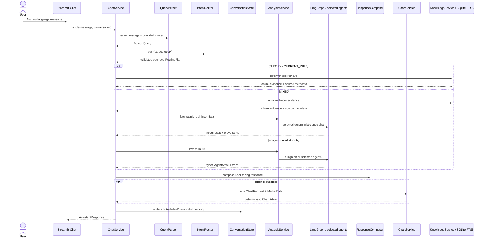

# Conversational assistant architecture

> Đối chiếu code 23/10/2026. Xem [báo cáo hiện trạng](project-report.md), [luồng graph](architecture.md) và [checkpoint/recovery](multi-agent-reliability.md). UI dùng SQLiteConversationStore; bounded context không đồng nghĩa chỉ lưu RAM.

The original keyword-first `QueryParser` is now a compatibility facade over the hybrid semantic NLU documented in [semantic-nlu.md](semantic-nlu.md). Its output remains a typed `ParsedQuery`, extended with confidence, ambiguities, secondary intents, context resolution, clarification and privacy-minimal parser telemetry, and feeds the current six-role workflow. Forecast is a service, not a seventh agent.

## Request lifecycle

## Typed contracts

- `ParsedQuery`: intent, tickers, market, sector, horizon, chart period, requested indicators, freshness requirement and follow-up marker.
- `RoutingPlan`: resolved intent plus allowlisted typed tasks with dependencies, input/output contracts, timeout and bounded budget. It is validated before dispatch; ChatPlanExecution/PlanExecutor execute approved tasks, check actual outputs and record status. Full graph/batch capabilities remain bounded composites, not arbitrary generated DAGs.
- `ConversationState`: a bounded window of messages plus compact context fields. It stores at most 24 messages by default and summarizes evicted messages.
- `AssistantResponse`: display message, response type, tables, charts, trace, sources, warnings, freshness and UI metadata.
- `ChartRequest`: ticker, chart type, period and indicator names. It cannot contain executable code.
- `ChartArtifact`: normalized chart records produced by deterministic application code.
- `KnowledgeSearchResult`: citations linked to document/chunk, retrieval mode, score and freshness behavior.

## Knowledge questions

The semantic layer distinguishes `THEORY`, `CURRENT_RULE` and `MIXED`. Pure theory routes only to `KNOWLEDGE`, so it does not spend a vnstock request. Current-rule answers show publisher, URL, published/effective/retrieved timestamps and a freshness warning. MIXED requests such as `ROE của FPT có tốt không?` retrieve the definition from the local KB and obtain the actual metric from the existing Fundamental service; evidence origins are not merged into one unlabeled claim. See [knowledge-base.md](knowledge-base.md).

## Context resolution

The deterministic bilingual parser first extracts explicit entities. It then resolves omitted entities from memory:

- `Phân tích FPT` sets active ticker `FPT`.
- `Cho tôi biểu đồ 6 tháng` inherits `FPT` and sets chart period `6M`.
- `RSI thế nào?` inherits `FPT` and routes only Data → Technical with the RSI tool.
- `So với CMG?` combines active `FPT` with explicit `CMG`.
- `mã đầu tiên` resolves against the previous discovery result.

An optional configured LLM already augments parsing with typed schemas. Deterministic parsing remains the fallback; neither parsing path owns chart code or arbitrary execution.

## Discovery scope

Discovery uses UniverseService: `config/watchlist.json` supplies the configured default; explicit exchange/current-market universes can use the bounded current listing catalogue. Results always disclose the number and category of configured symbols being screened; the system never presents this fixed set as the whole market. Failed symbols are reported as warnings instead of receiving invented values.

## UI rendering

The Streamlit page delegates to reusable render functions for user/assistant messages, analysis cards, overview metrics, stock/comparison tables, charts, agent status, expandable activity and the disclaimer. Plotly receives only `ChartArtifact` data produced by `ChartService`.
