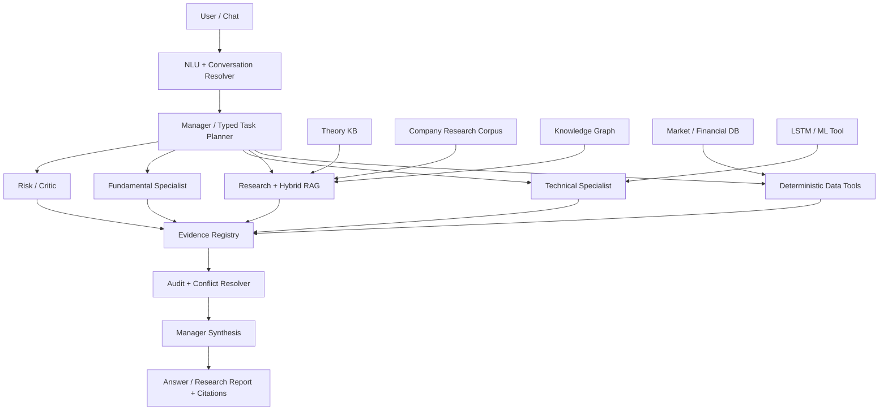

# Kế hoạch nâng cấp toàn diện hệ thống Multi-Agent (ưu tiên công cụ miễn phí)

Theo dõi triển khai ba phase đầu (0–2): [phase-0-2-upgrade-implementation.md](phase-0-2-upgrade-implementation.md). Tài liệu này phân biệt phần code đã có, synthetic regression và các gate thực tế chưa đo.

Cập nhật 18/10/2026:

| Phase | Trạng thái |
|---|---|
| 0–2 | [x] Hoàn thành triển khai; giữ riêng các acceptance gate độc lập/chưa đo |
| 3 | Đã triển khai KB/KG V2, provenance ledger và projection; Graph-RAG opt-in, chờ relational holdout |
| 4 | Đã triển khai gateway/role capabilities/validation; chờ kiểm chứng LLM và P95 Colab thực |
| 5 | Đã triển khai công cụ/chat/report/cache; chờ đo chất lượng và P95 trên data thực |
| 6 | Đã có builder/dataset V3 riêng, feature parity, walk-forward/baselines/registry/shadow; đã có review GPU artifact V3/V4 trong model card riêng; chưa promote V3/qua forward gate, giữ V2 mặc định và V4 experimental opt-in |
| 7 | Đã có notebook Qwen3-4B QLoRA Colab, curation/grouped splits/A-B/adapter registry; chờ human-reviewed data và GPU training/evaluation |
| 8 | Đã triển khai Quick/Deep/Offline, progress thật, replay có checksum, audit export và local health; đã kiểm thử offline/UI, chờ rehearsal/latency live |

Chi tiết code, cách chạy và phần chưa nghiệm thu:
[phase-3-5-upgrade-implementation.md](phase-3-5-upgrade-implementation.md).

Kế hoạch chi tiết Phase 6–8 sau khảo sát bởi ba subagent ChatGPT:
[phase-6-8-execution-plan.md](phase-6-8-execution-plan.md).
Code Phase 6–8 đã triển khai; **đã có artifact/review GPU LSTM V3/V4 lịch sử; chưa có promotion mới từ audit này, Qwen adapter vẫn cần gate riêng**. Notebook dùng `Qwen/Qwen3-4B-Instruct-2507` theo lựa chọn mới, không thay V2. Xem [phase-6-8-implementation.md](phase-6-8-implementation.md) để lấy dataset, chạy Colab và phân biệt các gate còn chờ.

## 1. Mục tiêu và phạm vi

Kế hoạch này nâng cấp hệ thống hiện tại thành một **AI Investment Research Assistant** có thể:

- hiểu câu hỏi tiếng Việt tốt hơn, kể cả câu hỏi nhiều ý, thiếu dấu, có ngữ cảnh hội thoại;
- lập kế hoạch tác vụ rõ ràng và chỉ gọi đúng agent/tool cần thiết;
- truy xuất tài liệu bằng Hybrid RAG có trích dẫn, thời điểm công bố và khả năng từ chối khi thiếu bằng chứng;
- quản lý tri thức lý thuyết, tài liệu doanh nghiệp và quan hệ bằng Knowledge Base/Knowledge Graph;
- dùng LLM cho reasoning, lập kế hoạch, trích xuất và tổng hợp; không giao phép tính xác định cho LLM;
- giữ LSTM như một công cụ dự báo định lượng có kiểm định, không biến dự báo thành sự thật chắc chắn;
- mở rộng các tác vụ: phân tích một mã, so sánh, sàng lọc, nghiên cứu sự kiện, hỏi đáp lý thuyết, theo dõi luận điểm và tạo báo cáo;
- chạy được với ngân sách tiền mặt bằng 0 cho mục đích học tập/demo.

Ngoài phạm vi:

- tự động đặt lệnh hoặc kết nối broker;
- hứa hẹn lợi nhuận hoặc biến kết quả mô hình thành khuyến nghị chắc chắn;
- sao chép toàn bộ FinRobot hoặc thêm agent chỉ để tăng số lượng agent;
- phụ thuộc bắt buộc vào API trả phí.

## 2. Hiện trạng cần giữ và vấn đề cần giải quyết

### 2.1. Nền tảng đã có

- Các vai trò chính: Manager, Data, Research, Technical, Fundamental và Risk/Critic.
- LangGraph điều phối luồng phân tích và vòng xử lý xung đột có giới hạn.
- Data provider, cache, snapshot, kiểm tra chất lượng và metadata nguồn/thời gian.
- Technical, Fundamental, Risk, screening, comparison, backtest và forward evaluation.
- RAG cục bộ dùng SQLite/FTS/vector; Knowledge Base Markdown/SQLite; Neo4j là backend Knowledge Graph tùy chọn.
- LSTM V2 đã có artifact và adapter inference; tín hiệu hiện được đưa vào Technical với trọng số giới hạn.
- LLM provider abstraction hỗ trợ Colab Qwen, Ollama và OpenAI; có fallback deterministic.
- Semantic parser, conversation memory và bộ test tương đối rộng.

### 2.2. Các khoảng trống chính

1. Corpus RAG còn nhỏ, dữ liệu không đồng đều giữa các doanh nghiệp và chưa có pipeline ingest định kỳ đủ mạnh.
2. Retrieval chưa có bộ đánh giá chuẩn cho recall, citation precision, độ mới và khả năng abstain.
3. KB lý thuyết, corpus doanh nghiệp, dữ liệu định lượng và Knowledge Graph chưa dùng chung một hợp đồng provenance.
4. Knowledge Graph mới phù hợp cho quan hệ lý thuyết; quan hệ doanh nghiệp–sự kiện–chỉ tiêu–tài liệu còn hạn chế.
5. LLM provider miễn phí trên Colab không có SLA, URL có thể đổi và latency không ổn định.
6. Vai trò LLM trong từng agent chưa được giới hạn bằng schema, budget và tiêu chí fallback thống nhất.
7. NLU còn dễ nhầm số lượng yêu cầu, mục tiêu BUY/SELL/WATCH, khoảng thời gian và câu hỏi nhiều bước.
8. LSTM V2 chỉ có lợi thế holdout rất nhỏ; dữ liệu điều chỉnh doanh nghiệp và độ tin cậy dự báo còn là điểm yếu.
9. Một số truy vấn sàng lọc có thể quá chậm do phân tích sâu quá nhiều mã và gọi nguồn/LLM không cần thiết.
10. Chưa có bộ evaluation đầu-cuối đủ mạnh để chứng minh một thay đổi thực sự tốt hơn.

## 3. Bài học nên lấy từ FinRobot

Tham khảo kiến trúc công khai của FinRobot, dự án này nên học bốn nguyên tắc:

1. **Typed pipeline**: mỗi tác vụ có input/output schema, validator, retry và trạng thái lỗi rõ ràng.
2. **Deterministic finance, LLM narration**: số liệu, công thức, ranking và kiểm tra phải do code thực hiện; LLM lập kế hoạch, đọc và diễn giải evidence.
3. **Audit operators**: có bước kiểm tra đơn vị tiền, thời điểm dữ liệu, nguồn, phép tính, mâu thuẫn và numeric grounding trước khi trả lời.
4. **Research artifact**: kết quả không chỉ là đoạn chat mà có thể là research brief/report gồm dữ liệu, luận điểm, phản biện và nguồn.

Không nên sao chép:

- debate tự do ở mọi truy vấn;
- nhiều agent viết từng phần nếu một pipeline xác định đã đủ;
- provider/API trả phí;
- stack desktop/web phức tạp không mang thêm giá trị cho demo;
- logic giao dịch tự động.

Nguồn tham khảo chính:

- FinRobot repository: <https://github.com/AI4Finance-Foundation/FinRobot>
- FinRobot Desktop V2: <https://github.com/AI4Finance-Foundation/FinRobot/blob/master/finrobot_desktop/README.md>
- FinRobot Equity V1: <https://github.com/AI4Finance-Foundation/FinRobot/blob/master/finrobot_equity/README.md>

## 4. Nguyên tắc kiến trúc mục tiêu



Các ràng buộc bắt buộc:

- Không agent nào tự sửa số liệu do tool trả về.
- Mọi claim định lượng phải có `evidence_id`, nguồn và `as_of`.
- Mọi LLM output quan trọng phải theo Pydantic/JSON schema và được validate.
- Mỗi request có budget: số tool call, số LLM call, token, thời gian và retry.
- Nếu provider LLM lỗi, pipeline vẫn trả được kết quả deterministic có giới hạn.
- Nếu thiếu bằng chứng, hệ thống hỏi lại hoặc trả `INSUFFICIENT_EVIDENCE`, không bịa.

## 5. Phân vai Agent và LLM

| Thành phần | Công việc xác định bằng code | Công việc phù hợp với LLM | Giới hạn đề xuất |
|---|---|---|---|
| Data Service/Agent | Fetch, cache, schema, timestamp, quality, unit, adjusted-price status | Không cần LLM trong luồng bình thường | 0 LLM call |
| Manager | Validate plan, route theo policy, budget, merge state | Hiểu mục tiêu, tạo typed task plan, tổng hợp evidence | 1 call route + tối đa 1 call synthesis |
| Research Agent | Search, download, parse, dedupe, retrieve, rank | Query decomposition, claim extraction, multi-document synthesis | Tối đa 2 call cho research sâu |
| Technical Agent | RSI, MACD, MA, volatility, support/resistance, score, LSTM inference | Chọn góc kiểm tra, nhận diện mâu thuẫn/regime từ evidence đã tính | 0–1 call; LLM không tự tính chỉ báo |
| Fundamental Agent | Ratios, growth, margins, period alignment, score | Trích xuất facts từ báo cáo, mapping mục kế toán, phân tích narrative | 0–1 call sau retrieval |
| Risk/Critic | Risk rules, data uncertainty, veto, scenario math | Sinh kịch bản, tìm rủi ro bị bỏ sót, phản biện luận điểm | Chỉ gọi khi conflict/độ bất định cao |
| Knowledge Agent | Lookup, graph traversal, citation | Giải thích kiến thức theo trình độ người dùng | 0–1 call |

Không cần tạo sáu mô hình riêng. Nên dùng **một base model Qwen2.5-3B-Instruct**, prompt theo role và schema theo nhiệm vụ. Chỉ fine-tune adapter cho những tác vụ đã chứng minh prompt/RAG chưa đủ.

## 6. Lựa chọn công nghệ miễn phí

| Nhu cầu | Lựa chọn chính | Fallback | Ghi chú |
|---|---|---|---|
| LLM | Qwen2.5-3B-Instruct trên Colab/Kaggle | Qwen 1.5B/local hoặc deterministic | Colab URL/session không ổn định; không coi là production SLA |
| Fine-tune | Hugging Face Transformers + PEFT/QLoRA + TRL trên Kaggle T4 | Colab free | Không full fine-tune |
| Embedding | `intfloat/multilingual-e5-small` | local hash hiện tại | Nhẹ và hỗ trợ đa ngôn ngữ; benchmark trước khi thay |
| Vector storage | SQLite + NumPy/FAISS tùy quy mô | FTS5 BM25 | Chưa cần Qdrant/managed vector DB |
| Keyword retrieval | SQLite FTS5 | BM25 thuần Python | Không tốn dịch vụ |
| Graph | Neo4j Community local | SQLite edge tables | KG phải là optional backend |
| PDF | PyMuPDF/pdfplumber/pypdf | Tesseract OCR khi thật sự cần | OCR chỉ dùng cho trang scan |
| Web search | Brave free quota nếu còn + GDELT/Bing RSS/DDG/HNX/IR | allowlisted site search | Lưu URL/metadata; tôn trọng điều khoản nguồn |
| Market data | vnstock Community + provider fallback/cache | snapshot cục bộ | Tôn trọng rate limit; không fake |
| Tracking/eval | JSON/SQLite + pytest | CSV | Chưa cần dịch vụ MLflow trả phí |

## 7. Roadmap triển khai

Thời lượng dưới đây là ước lượng cho một người làm bán thời gian. Mỗi phase chỉ bắt đầu khi phase trước có baseline và tiêu chí đo.

### Phase 0 — Baseline, contracts và evaluation gate (1–2 tuần) — [x] Hoàn thành triển khai

Trạng thái 17/10/2026: đã triển khai contracts, telemetry, budgets và benchmark.
Kết quả synthetic regression và các chỉ tiêu độc lập chưa đo được phân biệt tại
[báo cáo Phase 0–2](phase-0-2-upgrade-implementation.md); không coi test synthetic là holdout độc lập.

**Vấn đề:** Không thể biết nâng cấp có tốt hơn nếu thiếu benchmark thống nhất.

**Công việc:**

1. Chuẩn hóa các model:
   - `UserIntent`, `TaskPlan`, `ToolCallRequest`, `Evidence`, `AgentFinding`, `Conflict`, `FinalAnswer`;
   - bắt buộc `source_url`, `publisher`, `published_at`, `fetched_at`, `as_of`, `quality_tier` khi phù hợp;
   - tách `confidence`, `data_quality` và `decision`; không hiển thị một phần trăm mơ hồ.
2. Tạo evaluation dataset riêng, không dùng để viết rule:
   - NLU: ít nhất 300 câu tiếng Việt;
   - RAG: 100 câu hỏi có document/chunk đúng;
   - single-stock: 30 case tại các thời điểm khác nhau;
   - screening/count: 50 case yêu cầu đúng 1, 5, 10 mã;
   - conflict: 30 case Technical/Fundamental/Risk bất đồng.
3. Ghi telemetry theo request:
   - latency từng node, số API call, cache hit, token, retry, source count;
   - không ghi API key hoặc nội dung nhạy cảm.
4. Chốt regression test trước khi refactor.

**Tiêu chí hoàn thành:**

- benchmark chạy bằng một lệnh và sinh JSON report;
- mọi output chính validate được bằng schema;
- có baseline accuracy/latency/citation trước khi nâng cấp;
- test cũ vẫn qua.

### Phase 1 — Nâng cấp NLU và Manager typed planning (2–3 tuần) — [x] Hoàn thành triển khai

Đã triển khai NLU/context/cache, intent mở rộng và typed DAG có validation.
Các ngưỡng accuracy trên holdout người dùng độc lập vẫn cần đo riêng.

**Vấn đề:** Câu hỏi tương đương có thể route khác nhau; số lượng, horizon và mục tiêu dễ bị bỏ sót.

**Công việc:**

1. Mở rộng intent taxonomy:
   - theory Q&A, document Q&A, single analysis, compare, screen, recommend, news/event research;
   - forecast, portfolio risk, thesis review, source request, follow-up/correction.
2. Entity extraction:
   - ticker/company alias, exchange, sector, horizon, as-of date, requested count;
   - action preference, risk profile, filters, comparison dimension.
3. Context resolver cho câu hỏi tiếp nối: “còn mã thứ hai?”, “so với VNM?”, “đổi thành 6 tháng”.
4. Tạo `TaskPlan` dạng DAG có dependency, cost estimate và completion condition.
5. Manager LLM chỉ chạy khi parser deterministic có confidence thấp, multi-intent hoặc cần plan phức tạp.
6. Thêm clarification policy: chỉ hỏi lại khi thiếu thông tin làm thay đổi đáng kể kết quả.
7. Cache semantic parse theo normalized query/context signature.

**Tiêu chí hoàn thành:**

- intent accuracy ≥ 92% trên holdout;
- ticker/entity extraction ≥ 98%;
- requested count và horizon ≥ 97%;
- không gọi stock pipeline cho câu hỏi lý thuyết;
- request đơn giản chỉ dùng parser deterministic và hoàn thành dưới 2 giây, không tính I/O mạng.

### Phase 2 — RAG V2: ingest, hybrid retrieval và evidence-grounded answer (3–4 tuần) — [x] Hoàn thành triển khai

Đã triển khai ingest/version/dedupe, hybrid retrieval, grounded synthesis,
crawler/scheduler và nhận diện kỳ dữ liệu/freshness. E5 là tùy chọn; chưa tuyên bố
đạt citation precision trên corpus thực hoặc thắng A/B khi chưa đo.

**Vấn đề:** Corpus nhỏ và retrieval chưa đủ tin cậy cho câu hỏi doanh nghiệp đa dạng.

**Công việc ingest:**

1. Tạo source registry có allowlist, license/usage note, quality tier và lịch cập nhật.
2. Ưu tiên nguồn theo tầng:
   - T1: HNX/HOSE/SSC, website IR doanh nghiệp, báo cáo kiểm toán/công bố chính thức;
   - T2: dữ liệu/provider có provenance rõ;
   - T3: báo chí tài chính hoặc nguồn thứ cấp;
   - T4: nguồn web khác, chỉ dùng làm lead và gắn confidence thấp.
3. Pipeline: discover → fetch → checksum → parse → metadata → chunk → embed → index.
4. Dedupe theo canonical URL, checksum và near-duplicate text.
5. Chunk theo section/table, không cắt cố định làm mất tiêu đề/ngữ cảnh.
6. Version document; giữ correction/revision và period end.
7. Không lưu toàn bài báo có bản quyền nếu không được phép; ưu tiên metadata, đoạn trích ngắn và URL.

**Công việc retrieval:**

1. Query normalization + ticker/company expansion + date/horizon filter.
2. Hybrid retrieval: BM25/FTS + dense vector.
3. Reciprocal Rank Fusion, metadata boost và freshness policy theo intent.
4. MMR/diversity để tránh 5 kết quả cùng một tài liệu.
5. Reranker nhẹ chỉ thêm sau A/B benchmark; không mặc định dùng model nặng.
6. Graph expansion chỉ cho câu hỏi quan hệ, không áp dụng cho mọi query.

**Công việc generation/audit:**

1. Context pack có token budget và evidence IDs.
2. LLM trả structured claims liên kết evidence IDs.
3. Citation validator kiểm tra URL, publisher, thời gian và claim-support.
4. Numeric grounding: số trong câu trả lời phải tồn tại trong evidence/structured tool output.
5. Nếu top evidence dưới threshold, trả thiếu bằng chứng hoặc chuyển sang web fallback.

**Tiêu chí hoàn thành:**

- Recall@5 ≥ 0.85 và MRR ≥ 0.65 trên RAG holdout;
- citation precision ≥ 0.90;
- unsupported-answer abstention ≥ 0.95;
- 100% tài liệu có source URL, publisher và timestamp phù hợp;
- ingest incremental, chạy lại không tạo duplicate;
- câu hỏi không có tài liệu không được tạo citation giả.

### Phase 3 — Knowledge Base và Knowledge Graph V2 (2–3 tuần)

Tiến độ bổ sung: phần code Phase 3–5 và đợt sửa 7 hạn chế được mô tả trong
[phase-3-5-reliability-remediation.md](phase-3-5-reliability-remediation.md).
Các gate relational holdout, chất lượng nhận định thực tế và latency Colab vẫn cần đo riêng.

**Vấn đề:** Các loại tri thức đang dễ bị trộn và KG có nguy cơ trở thành công nghệ trang trí.

**Thiết kế ba lớp:**

1. **Theory KB**: thuật ngữ, công thức, quy tắc giao dịch, rủi ro, giải thích chỉ báo.
2. **Research Corpus**: báo cáo/công bố/news metadata theo doanh nghiệp và thời điểm.
3. **Structured Facts**: giá, financial periods, ratios, events và model outputs.

**Knowledge Graph schema ban đầu:**

- Node: `Company`, `Ticker`, `Exchange`, `Sector`, `Person`, `Document`, `Event`, `Metric`, `Period`, `Topic`, `RiskFactor`.
- Edge: `LISTED_AS`, `IN_SECTOR`, `PUBLISHED`, `MENTIONS`, `REPORTS_METRIC`, `HAS_EVENT`, `EXPOSED_TO`, `RELATED_TO`, `SUPERSEDES`.
- Mỗi node/edge suy ra từ tài liệu phải có `evidence_id`, `valid_from`, `valid_to`, `confidence`.

**Công việc:**

1. Viết ontology/version và mapping từ KB/RAG metadata.
2. Entity resolution: alias công ty, ticker đổi tên, người/tổ chức trùng tên.
3. Deterministic extraction trước; LLM chỉ đề xuất triple, validator duyệt trước khi ghi.
4. Đồng bộ idempotent SQLite → Neo4j.
5. Graph-RAG cho các câu hỏi: quan hệ, chuỗi sự kiện, nguồn nào hỗ trợ một claim, rủi ro lan truyền.
6. Giữ SQLite edge-table fallback để app vẫn chạy khi Neo4j tắt.

**Tiêu chí hoàn thành:**

- không có edge thiếu provenance;
- đồng bộ chạy lại không nhân bản node/edge;
- 20 truy vấn graph chuẩn có answer/citation đúng ≥ 90%;
- Graph-RAG tăng Recall@5 ít nhất 5 điểm phần trăm trên relational subset; nếu không, không đưa vào default route.

### Phase 4 — Tích hợp LLM có kiểm soát cho từng agent (3–4 tuần)

**Vấn đề:** Gọi LLM rộng khắp làm chậm, khó kiểm thử và có thể thay đổi số liệu.

**Công việc nền:**

1. Một `LLMGateway` chung:
   - provider health check, timeout, retry, circuit breaker;
   - schema output, token/call budget, cache;
   - Vietnamese-only validation và fallback;
   - log model/version/prompt hash, không log secret.
2. Prompt contract theo vai trò, lưu version trong source control.
3. Mỗi agent nhận Evidence Pack, không nhận toàn bộ state nếu không cần.
4. LLM result chỉ là proposal; deterministic validator quyết định có chấp nhận không.

**Use case ưu tiên:**

- Manager: intent repair, task planning, concise synthesis.
- Research: query decomposition, claim extraction, contradiction table.
- Fundamental: mapping đoạn báo cáo vào fact schema, giải thích drivers.
- Technical: nhận diện regime/mâu thuẫn từ chỉ báo đã tính; không tự tính RSI/MACD.
- Risk: scenario/risk discovery và critic khi specialists bất đồng.

**Giải quyết xung đột:**

1. Conflict detector xác định loại xung đột: data, time, metric, interpretation hoặc policy.
2. Manager chỉ rerun agent có khả năng sửa nguyên nhân:
   - data conflict → Data/Research;
   - stale/missing fundamental → Research/Fundamental;
   - horizon mismatch → Technical;
   - unsupported conclusion → Critic/Synthesis.
3. Mỗi iteration phải tạo evidence mới hoặc giảm conflict; nếu không thì dừng.
4. `max_iterations` là trần vòng xử lý, không phải mục tiêu phải dùng hết.

**Tiêu chí hoàn thành:**

- simple request tối đa 1 LLM call; standard analysis tối đa 2; deep research tối đa 3;
- provider lỗi vẫn trả deterministic result rõ giới hạn;
- 100% numeric claims qua grounding validator;
- không có agent được thay score/decision trực tiếp qua văn bản LLM;
- single-stock analysis P95 dưới 60 giây khi Colab hoạt động.

### Phase 5 — Nâng cấp analysis tools và tính năng người dùng (3–5 tuần)

**Ưu tiên 1:**

1. Research brief một mã: snapshot, technical, fundamental, risk, events, thesis, evidence.
2. So sánh 2–5 mã theo cùng thời điểm và cùng đơn vị.
3. Screening đúng số lượng yêu cầu, kèm lý do chọn/loại.
4. Event/news impact: sự kiện gì, nguồn nào, tác động có điều kiện, mức chắc chắn.
5. “Vì sao kết luận thay đổi?” dựa trên hai snapshot có timestamp.
6. Hỏi đáp kiến thức cơ bản có citation từ Theory KB.

**Ưu tiên 2:**

1. Earnings/report change analysis giữa hai kỳ.
2. Peer/sector comparison và percentile.
3. Scenario/sensitivity analysis, không phải target price chắc chắn.
4. Thesis tracker: catalyst, risk, evidence mới và trạng thái luận điểm.
5. Portfolio risk cho danh mục người dùng tự nhập; không kết nối broker.
6. Xuất Markdown/HTML research report.

**Tối ưu screening/recommendation:**

1. Stage 1 dùng cache và feature rẻ để lọc 100 mã.
2. Stage 2 tính technical đầy đủ cho shortlist.
3. Stage 3 chỉ gọi fundamental/research/risk cho số mã gần với requested count.
4. Stage 4 dùng LLM một lần để tổng hợp toàn danh sách, không một call/mã.
5. Trả partial result có giải thích nếu không đủ mã đạt ngưỡng; không trả rỗng im lặng.

**Tiêu chí hoàn thành:**

- requested count được tôn trọng hoặc có lý do rõ vì sao thiếu;
- screening 100 mã P95 dưới 120 giây với cache ấm;
- không có phép so sánh khi `as_of`, currency hoặc unit không tương thích;
- mỗi mục report truy ngược được tới tool/evidence.

### Phase 6 — LSTM/ML V3 có kiểm định (3–5 tuần, có thể chạy song song sau Phase 0)

**Vấn đề:** Nhiều dữ liệu không đồng nghĩa mô hình tốt; LSTM V2 chỉ có edge nhỏ và adjustment chưa chắc chắn.

**Dữ liệu:**

1. Tạo dataset version mới, không ghi đè V2.
2. Kiểm tra duplicate, gap, outlier, survivorship bias, corporate actions và adjusted-price status.
3. Split theo thời gian; thêm walk-forward folds và embargo để giảm leakage.
4. Chỉ tính feature bằng dữ liệu có sẵn tại thời điểm dự báo.
5. Ghi dataset manifest: source, build time, tickers, periods, filters, checksum.

**Mô hình/baseline:**

1. Baseline bắt buộc: zero return, persistence, historical mean, linear/ridge và tree model nhẹ.
2. LSTM multihorizon giữ vai trò mô hình demo, so sánh công bằng với baseline.
3. Thử feature theo regime, market/sector return, liquidity, volatility và calendar.
4. Dự báo return/range hoặc quantile thay vì chỉ một giá chính xác giả tạo.
5. Calibrate confidence trên validation; bootstrap confidence interval cho metric.

**Tích hợp:**

- `ForecastTool` trả model version, horizon, prediction, interval, data as-of, metrics và warnings.
- Trọng số tối đa 20% trong Technical chỉ bật khi artifact qua gate.
- Nếu không qua gate, UI vẫn có thể hiển thị `EXPERIMENTAL`, nhưng không làm đổi BUY/SELL/HOLD.
- Không để LLM tự sửa dự báo LSTM; LLM chỉ giải thích điều kiện và giới hạn.

**Gate đề xuất:**

- thắng zero-return MAE trên ít nhất 2 walk-forward folds;
- directional accuracy tốt hơn random/baseline và khoảng tin cậy không bao phủ mức vô nghĩa;
- không thua baseline tree/linear rõ rệt;
- integration test xác nhận đúng feature order, scaler, ticker vocabulary và as-of;
- model card mô tả dữ liệu, hạn chế và phạm vi demo.

### Phase 7 — Fine-tuning LLM tùy chọn (2–4 tuần, chỉ sau Phase 1–4)

**Không fine-tune để “biết giá cổ phiếu”.** Dữ liệu thị trường thay đổi phải đi qua tools/RAG. Fine-tune chỉ phù hợp cho hành vi ổn định:

1. Vietnamese intent/entity extraction.
2. Typed task planning.
3. Trích xuất claim/fact từ báo cáo theo schema.
4. Viết synthesis ngắn, có evidence IDs và biết abstain.

**Quy trình:**

1. Thu thập log đã loại secret/PII; không dùng output lỗi làm nhãn.
2. Tạo 500–2.000 ví dụ chất lượng cao, ưu tiên con người kiểm tra hơn số lượng.
3. Chia train/validation/test theo template, công ty và thời gian để tránh leakage.
4. Dùng QLoRA/PEFT trên Qwen2.5-3B-Instruct bằng Kaggle T4/ google Colab.
5. Lưu adapter, tokenizer, base-model revision, config, seed và evaluation report.
6. A/B với prompt-only baseline.

**Điều kiện được tích hợp:**

- tăng ít nhất 5 điểm phần trăm ở metric tác vụ mục tiêu hoặc giảm đáng kể latency/token;
- không giảm citation/numeric grounding/safety;
- artifact có license phù hợp và kích thước có thể phục vụ miễn phí;
- có deterministic fallback.

Nếu không đạt, giữ prompt + RAG; không ép fine-tune chỉ để có Deep Learning.

### Phase 8 — UX, report, vận hành và đóng gói demo (2–3 tuần)

**Công việc:**

1. UI hiển thị progress theo node thật, không giả tiến độ.
2. Evidence drawer: nguồn, thời điểm, quality tier, đoạn hỗ trợ claim.
3. Chế độ nhanh và research sâu:
   - Quick: cache + deterministic, LLM tùy chọn;
   - Deep Research: web/RAG/KG + critic + report.
4. Health panel cho data provider, LLM endpoint, Neo4j, index và model artifact.
5. Nút export report và downloadable audit JSON.
6. Script setup cho Windows/D drive và script demo offline bằng snapshot được ghi nguồn.
7. Không commit `.env`, API key, raw copyrighted corpus hoặc artifact quá lớn.

**Tiêu chí hoàn thành:**

- app khởi động được khi LLM/Neo4j/Web tắt;
- người dùng phân biệt rõ live, cache, snapshot và model estimate;
- lỗi provider không làm crash toàn request;
- README có demo flow 5–10 phút và architecture diagram.

## 8. Thứ tự triển khai khuyến nghị

```text
Phase 0: Baseline + contracts
   ↓
Phase 1: NLU + typed Manager
   ↓
Phase 2: RAG V2 ───────┐
   ↓                   │
Phase 3: KB/KG V2      │
   ↓                   │
Phase 4: Agent LLM + audit
   ↓
Phase 5: User features + performance
   ↓
Phase 8: Demo/UX hardening

Phase 6: LSTM V3 bắt đầu sau Phase 0 và chỉ tích hợp sau gate
Phase 7: Fine-tune chỉ làm sau khi Phase 1–4 có số đo cho thấy cần thiết
```

Không nên bắt đầu bằng fine-tune hoặc thêm model/agent mới. Hai việc đó tốn compute nhưng không sửa được corpus yếu, nguồn cũ, schema lỏng hoặc routing sai.

## 9. Backlog kỹ thuật theo component

### Models/contracts

- Thêm typed task/evidence/conflict/audit models.
- Version schema và migration cho dữ liệu cũ.
- Tách confidence, uncertainty, quality và decision.

### Graph/orchestration

- Node planner/validator/auditor rõ ràng.
- Conditional edges theo conflict type và missing evidence.
- Budget/deadline trong AgentState.
- Stop condition chứng minh tiến triển qua mỗi vòng.

### RAG/KB/KG

- Source registry, document manifest, incremental ingest.
- Embedding version + reindex command.
- Hybrid retrieval benchmark.
- Evidence-grounded synthesis/audit.
- Graph sync và graph retrieval route.

### Agents

- Data Agent chuyển dần thành deterministic Data Service.
- Specialist output chung theo `AgentFinding`.
- LLM prompt/schema tách khỏi business logic.
- Risk/Critic phản biện theo evidence, không mặc định phạt mạnh vì dữ liệu thiếu.

### ML

- Dataset builder V3, walk-forward evaluation, baseline suite.
- Model registry cục bộ và model card.
- Safe integration gate cho trọng số 20%.

### Tests

- Unit test cho formula/tool.
- Contract test cho provider/LLM schema.
- Golden test cho RAG/NLU.
- Metamorphic test: đổi thứ tự tài liệu không đổi facts; thêm nguồn kém không lấn nguồn chính thức.
- End-to-end test cho quick/deep/offline/provider-failure.

## 10. Ngân sách và giới hạn vận hành

Mục tiêu **0 đồng** vẫn có chi phí phi tiền mặt: thời gian, quota, ổ đĩa, RAM/GPU và độ ổn định.

Giới hạn đề xuất:

- tối đa 2 LLM calls cho phân tích thường, 3 cho deep research;
- tối đa 2.000 output tokens/call trừ report mode;
- cache embedding, retrieval, parsed document và tool output;
- không embed lại tài liệu khi checksum/model version không đổi;
- không download lại nguồn trong TTL;
- chỉ bật Neo4j/embedding model nặng ở deep mode;
- dùng Kaggle/Colab cho training batch, không cho request real-time phụ thuộc vĩnh viễn vào notebook;
- giữ snapshot nhỏ có provenance để demo khi mạng/provider lỗi.

## 11. Definition of Done toàn chương trình

Hệ thống chỉ được xem là nâng cấp thành công khi:

1. Người dùng hỏi đa dạng nhưng route đúng, đúng số lượng và đúng horizon.
2. Mọi dữ liệu thị trường/tài chính quan trọng có nguồn và timestamp.
3. RAG trả citation hỗ trợ được claim hoặc chủ động nói không đủ bằng chứng.
4. KB, corpus, market DB và KG có vai trò khác nhau nhưng dùng chung evidence identity.
5. LLM không làm phép tính tài chính thay code và không tự thay decision/score.
6. LSTM có report walk-forward; chỉ tác động tối đa 20% khi qua gate.
7. Xung đột khiến đúng agent được chạy lại, không chỉ Technical và không lặp vô hạn.
8. Provider LLM/web/Neo4j hỏng không làm app ngừng hoạt động.
9. Latency và số call nằm trong budget đã công bố.
10. Tất cả cải tiến có benchmark trước/sau và regression tests.

## 12. Mốc demo khả thi với nguồn lực hạn chế

### Mốc 1 — Reliable Research Core

- Phase 0 + Phase 1 + phần cốt lõi Phase 2.
- Demo: hỏi lý thuyết, phân tích một mã và document Q&A có citation.

### Mốc 2 — Evidence-aware Multi-Agent

- Phase 3 + Phase 4.
- Demo: Manager lập plan, specialists dùng evidence chung, conflict reroute đúng agent.

### Mốc 3 — Useful Investment Research Assistant

- Phase 5 + Phase 8.
- Demo: screen/compare/report/event analysis với quick/deep modes.

### Mốc 4 — ML Research Extension

- Phase 6; Phase 7 chỉ khi có bằng chứng cần fine-tune.
- Demo: LSTM/model card/walk-forward metrics và tác động có kiểm soát vào Technical.

Ưu tiên thực tế nhất cho đồ án là hoàn thành tốt Mốc 1–3. Mốc 4 nên được trình bày như một nhánh nghiên cứu có kiểm định, không phải bằng chứng rằng hệ thống dự đoán chắc chắn thị trường.
