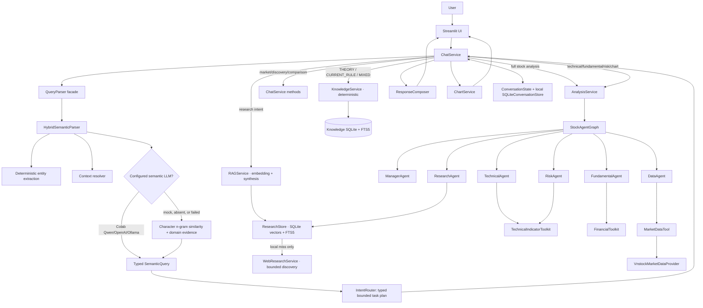
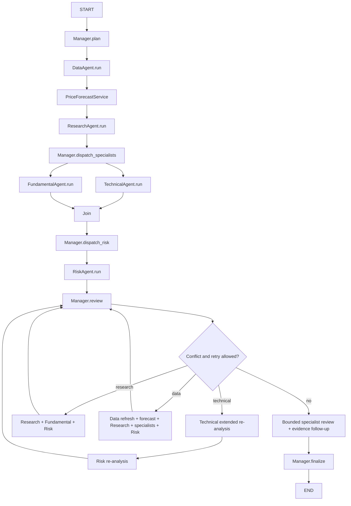

# Kiến trúc hiện tại

> Tài liệu chi tiết hiện hành. Báo cáo tổng hợp, ma trận bằng chứng và kiểm chứng mới: [project-report.md](project-report.md). Cấu hình endpoint, trạng thái Scheduler và corpus live không được xác nhận chỉ từ code.

Tài liệu này mô tả repository được đối chiếu lại với working tree ngày 23/10/2026. Các giới hạn checkpoint, deadline và kết quả partial được trình bày thêm trong [multi-agent reliability](multi-agent-reliability.md).

## 1. Tóm tắt hiện trạng

Hệ thống hiện là một ứng dụng nghiên cứu chứng khoán Việt Nam chạy cục bộ, có giao diện chat Streamlit, NLU hybrid, dữ liệu thật từ `vnstock`, một workflow LangGraph cho phân tích đầy đủ và các route rút gọn cho câu hỏi chuyên biệt. Các mô hình Pydantic được dùng làm contract giữa parser, service, graph, agent và UI.

Phần định lượng tài chính vẫn dùng công thức và ngưỡng deterministic. Provider/model LLM do cấu hình chọn qua adapter Colab Qwen, OpenAI hoặc Ollama. Lỗi hoặc timeout LLM không được thay đổi kết quả deterministic.

Khi bật `STOCK_AGENT_LLM_SPECIALISTS_ENABLED`, các vai trò được chọn có thể gọi structured LLM advisor. Technical có bộ lập kế hoạch công cụ để chọn tối đa hai kiểm tra bổ sung, còn Python tính toàn bộ chỉ báo. Fundamental và Risk có thể review evidence sau vòng conflict; các follow-up được Manager phê duyệt theo allowlist và ngân sách. Manager có thể chọn typed intent và viết bản tổng hợp grounded; recommendation policy vẫn deterministic.

Hệ thống không có broker integration, không có action đặt lệnh và không tự động giao dịch.

## 2. Công nghệ và entry point

| Khu vực | Code hiện tại |
|---|---|
| Runtime | Python 3.11+, Pydantic 2 |
| Orchestration | LangGraph 1.x cho full-analysis graph |
| Market data | `vnstock` 4.x, source mặc định `VCI` |
| Data processing | pandas, NumPy |
| Charts | Plotly |
| UI | Streamlit |
| Tests | pytest, provider giả lập chỉ nằm trong tests |
| CLI | `stock-agents TICKER --horizon ...` gọi full graph |
| Chat | `streamlit run app/streamlit_app.py` |

Project giữ `.venv`, pip cache, runtime data và temp trong workspace ổ D theo `AGENTS.md` và `scripts/setup.ps1`.

## 3. Sơ đồ runtime thực tế

Điểm cần nhấn mạnh:

- `IntentRouter` tạo `RoutingPlan` gồm typed task (`id`, dependency, required input, expected output, timeout, budget). Validator và executor ràng buộc task được chạy với chính plan đã kiểm tra; full-analysis task group dùng LangGraph. Mapping intent → task template vẫn là allowlist cố định, không phải planner tự phát sinh code.
- Chỉ full analysis chạy qua `StockAgentGraph`. Technical, Fundamental và Risk riêng lẻ được `AnalysisService` gọi trực tiếp. Discovery, comparison và market overview được điều phối bằng vòng lặp/method trong `ChatService`.
- `ChatService` hiện là application service lớn nhất: parsing, dispatch, error handling, market overview, screening, comparison, chart composition, explanation và cập nhật memory đều hội tụ tại đây.
- Research route embedding câu hỏi, tìm chunk bằng cosine similarity, hybrid merge với FTS5 rồi dùng structured LLM tổng hợp tối đa hai claim có source ID hợp lệ. Vector normalized float32 nằm trong cùng SQLite và corpus cũ được backfill tự động. Khi local miss có ticker, `WebResearchService` thử trang issuer/disclosure HNX rồi mới dùng web discovery giới hạn. `ResearchOrchestrator` fetch/extract HTML public và trả quote-level external evidence; external result không tự động được ingest hay mang nhãn verified local.
- Knowledge route là `KnowledgeService` deterministic, không phải Agent. Nó dùng database riêng `.runtime/knowledge/knowledge.sqlite3`, exact match + FTS5/BM25 + topic/source/freshness weighting + RRF và citation tới document/chunk. `THEORY` không gọi market provider; `CURRENT_RULE` gắn freshness warning; `MIXED` ghép evidence lý thuyết với dữ liệu thật mà không cho KB điều khiển recommendation.

## 4. Semantic understanding và routing

`QueryParser` chỉ là facade gọi `HybridSemanticParser`. Pipeline hiện có:

1. `VietnameseTextNormalizer` bỏ dấu, chuẩn hóa ký tự/whitespace và một số viết tắt/typo domain.
2. `EntityExtractor` lấy ticker, period, sector, indicator và requested information.
3. `ContextResolver` xử lý active ticker, danh sách mã gần nhất, tham chiếu theo thứ tự, “cả hai” và một số trường hợp mơ hồ.
4. Nếu bật semantic LLM, Colab Qwen/OpenAI/Ollama trả trực tiếp `SemanticQuery` theo schema Pydantic.
5. Nếu không có LLM hoặc provider lỗi, `SemanticSimilarityClassifier` dùng cosine similarity trên character trigram của example bank, cộng các domain evidence regex có trọng số.
6. Parser tạo confidence, ambiguity, clarification, primary intent, secondary intents và telemetry (source, latency, LLM attempted, fallback reason, prompt/example-bank version).
7. `IntentRouter` chọn task template từ allowlist; nếu cần clarification thì task plan chỉ còn `CHAT`. Validator chặn dependency/input/output/budget không hợp lệ trước executor; task timeout được thu hẹp bởi request deadline.

Các intent hiện có: general chat, full stock analysis, technical, fundamental, risk, market overview, discovery, comparison, chart, indicator, research, `THEORY`, `CURRENT_RULE`, `MIXED`, follow-up, explanation, help và unknown.

NLU có dataset 126 câu (evaluator chạy lại 23/10/2026: intent/ticker 126/126, ECE 0.0507) nằm trong `tests/data/semantic_queries.json`. Kết quả 100% là kết quả in-sample trên bộ dữ liệu repository; chưa có holdout độc lập, traffic thật hoặc calibration test đủ để suy ra độ chính xác production.

Lỗi LLM provider vẫn fallback về local parser để giữ availability, đồng thời tạo structured application log, response metadata và một SQLite telemetry record chỉ chứa source/latency/fallback/ambiguity/version (không chứa raw query). `scripts/semantic_telemetry_report.py` tổng hợp counters/latency. Token/cost vẫn là `unknown`: provider adapter hiện không trả usage/cost và hệ thống không được suy đoán các số này.

## 5. Full-analysis LangGraph

Luồng full analysis hiện tại:

`AgentState` chứa ticker, horizon, requested data/indicators, market data, research citations, ba specialist result, messages, trace, plan, completed tasks, iteration flags và final decision. `messages`, `llm_reviews`, `agent_reports`, `trace`, `task_executions` và `completed_tasks` dùng reducer cộng danh sách để merge các nhánh. Mỗi Agent khai báo `AgentSpec`; execution report ghi stage, status, confidence, tool, missing information và số evidence. Runtime task context thêm run/task correlation, input fingerprint và kiểm tra output update.

Re-analysis có ba nhánh typed: Technical, Research → Fundamental và Data → pipeline phân tích. Action history và evidence fingerprint giới hạn vòng lặp, tránh lặp cùng hướng khi không có bằng chứng mới. `max_iterations` là chặn cuối cùng. Specialist/optional-stage lỗi được biểu diễn bằng typed partial/unavailable output; Data đầu vào vẫn phải hợp lệ. Graph có checkpoint local để resume node đang chờ.

## 6. Data layer hiện tại

`VnstockMarketDataProvider` là production/default provider duy nhất:

- Validate ticker bằng regex 2–10 ký tự chữ/số.
- Tải khoảng 550 ngày lịch qua `Quote(...).history(..., interval="1D")`.
- Chuẩn hóa các cột `date/open/high/low/close/volume`, ép kiểu, bỏ duplicate, sort và validate từng `PriceBar`.
- Yêu cầu tối thiểu 50 phiên hợp lệ.
- Khi cần, gọi `Finance(...).ratio(period="year")` và ánh xạ về 10 field trong `FinancialMetrics`.
- Nếu ratios lỗi upstream, giá có thể được trả về cùng warning; `BudgetExceeded` phải dừng fetch tiếp theo và không bị coi là lỗi tài chính thông thường. Fundamental giảm confidence theo chất lượng và abstain khi không có metric/statement dùng được.
- Runtime của vnstock được chuyển vào `.runtime` trên ổ D; telemetry mặc định tắt.
- Mỗi raw response được lưu thành gzip snapshot bất biến với SHA-256; normalized result được cache trong SQLite với TTL.
- Provider có pacing từng attempt, retry/backoff và circuit breaker. Deadline request/task được kiểm tra trước/sau call và wait; timeout chỉ được clamp khi method thật hỗ trợ. vnstock explorer không expose timeout cho mọi method, nên deadline là cooperative, không phải hard wall clock.
- `DataQualityChecker` kiểm tra chronology, freshness, gaps, extreme returns, volume coverage, provenance, adjusted-price status và financial period.

Provenance hiện có ở mức:

- `MarketData.source`, ví dụ `vnstock:VCI`, cùng structured `SourceReference` cho OHLCV và financial ratios.
- `as_of`, timezone-aware `fetched_at`, request parameters, schema version, checksum và raw snapshot ID.
- Mỗi financial metric observation có value, unit, reporting-period label/end và source ID.
- `PriceBar.date`, response data timestamp, quality report và warnings được đưa tới UI.

Provenance vẫn chưa có khi upstream không cung cấp:

- URL/document ID chính thức ngoài provider method ID.
- Published timestamp cho financial ratios.
- Xác nhận adjusted/unadjusted price, corporate-action feed hay revision/restatement history.
- Lineage document/page đầy đủ cho mọi upstream field khi nguồn không cung cấp.

Provider có fallback VCI → KBS cho OHLCV theo cấu hình, vẫn qua cùng thư viện vnstock; đây chưa phải đối soát nguồn độc lập. Financial schema mapping còn dùng heuristic tên row, giữ period và giảm trọng số theo quality/staleness. `EvidenceItem` đã liên kết label/value với input fields/source IDs/as-of; raw snapshots hỗ trợ kiểm tra schema drift. Chưa có quota-aware scheduler phân tán.

Smoke test thật ngày 09/10/2026 cho thấy VCI trả FPT OHLCV current nhưng financial ratios có kỳ 2018. Đó là kết quả lịch sử, không phải smoke test mới của lượt audit này. Code hiện tại ưu tiên statement tương thích còn mới; các ratio cũ khác có thể được dùng với trọng số giảm. Không có metric/statement dùng được thì Fundamental trả `UNKNOWN`.

## 7. Analytical engines hiện tại

### Technical

`TechnicalAgent` gọi toolkit deterministic gồm SMA, EMA, RSI, MACD, volatility, drawdown, support/resistance và volume ratio. Profile short/medium/long thay đổi window chỉ báo và minimum history; benchmark-relative return, liquidity và regime có diagnostics khi đủ dữ liệu. Score khởi đầu 5 và cộng/trừ theo policy version. Requested-indicator route tính các indicator được yêu cầu. Forecast chỉ tham gia blend khi artifact/policy đủ điều kiện; untrained baseline không tham gia score.

UI trì hoãn tải forecast model đến lúc cần forecast; QUICK/OFFLINE dùng baseline và không khởi tạo TensorFlow chỉ để mở giao diện. Cold-load của model được chọn vẫn ảnh hưởng latency lần forecast đầu.

Hạn chế chính:

- Horizon đã thay đổi indicator profile, nhưng threshold và tác động horizon chưa được kiểm chứng độc lập bằng outcome data.
- Threshold và score chưa được backtest/calibrate trên thị trường Việt Nam.
- `ChartService` và Technical dùng chung `TechnicalIndicatorToolkit`; khác biệt window/profile và chart warm-up vẫn cần được giải thích khi so sánh kết quả.
- Liquidity filter, benchmark và regime đã có; corporate-action completeness, official calendar và độ chính xác price scale vẫn phụ thuộc nguồn.

### Fundamental

`FundamentalAgent` dùng normalized metrics, multi-period statement observations và sector template khi xác định được ngành. Growth/cash conversion được tính từ kỳ tương thích khi đủ input; evidence quality điều chỉnh trọng số. Kết quả ghi feature contributions, unavailable metrics và research context.

Hạn chế chính:

- Template theo ngành và quy tắc growth/cash quality còn nhỏ, chưa calibrated hoặc được đối soát bằng bộ financial calculations độc lập.
- Multi-period/basis/consolidation phải được khai báo; thiếu statement không được suy ra TTM/QoQ/YoY tùy ý.
- Chưa có đầy đủ historical valuation bands, dilution, dividend và segment model. Peer-comparison route không đồng nghĩa có peer-normalized valuation engine.
- Research citations có thể hỗ trợ context, nhưng không tự động biến prose thành số tài chính đã xác minh.

### Risk

`RiskAgent` đánh giá theo section market, liquidity, data, business, event/news và portfolio; mỗi section ghi coverage và missing input. Measured issuer risk tách khỏi data uncertainty. Đầu vào danh mục và issuer event được dùng khi có nguồn/context phù hợp.

Hạn chế chính:

- Có volatility, drawdown, liquidity, leverage, issuer event và portfolio concentration khi input tương ứng tồn tại; chưa có beta/correlation đầy đủ, macro/sector exposure hoặc accounting forensic model.
- `RiskAnalysis` tách `issuer_risk_*` khỏi `data_uncertainty_*`; thiếu dữ liệu không còn tự động làm issuer risk tăng cao. Veto chỉ đến từ trading suspension đã xác minh hoặc issuer score cực cao.
- Score/veto chưa được calibration bằng dữ liệu kết quả đầu tư thật.

### Manager

`ManagerAgent` có structured LLM routing/synthesis tùy cấu hình; policy `BUY/HOLD/WATCH/AVOID` vẫn bằng code. BUY yêu cầu hai specialist cùng BUY, không có veto/HIGH data uncertainty, đủ evidence và không còn conflict ERROR về dữ liệu/thời gian/metric/policy. Confidence kết hợp confidence của cả ba specialist rồi giảm theo conflict/coverage; không lấy risk thấp làm confidence cao. Đây là heuristic chưa calibrated.

Recommendation có disclaimer giáo dục nhưng vẫn mang nhãn hành động mạnh. Hệ thống chưa thu thập risk profile, time horizon thực dụng, position context hoặc suitability để các nhãn này đủ tin cậy cho sử dụng đầu tư thật.

## 8. Component nào thực sự cần là Agent?

| Component hiện tại | Reasoning? | Planning? | Action choice? | Đánh giá trung thực | Hướng mục tiêu |
|---|---:|---:|---:|---|---|
| `DataAgent` | Không đáng kể | Không | Chỉ chọn include financials từ state | Wrapper có trace/message quanh `MarketDataTool` | Đổi vai trò logic thành `DataService`; graph node vẫn có thể gọi service |
| `ResearchAgent` | Chọn hai query bounded | Kế hoạch truy xuất ngắn | Dừng sớm khi đủ citation | Agent mỏng quanh hybrid retriever, không sinh signal | Giữ bounded; không cho truy cập web tùy ý hoặc điều khiển score |
| `TechnicalAgent` | Rule-based scoring | LLM có thể chọn tối đa hai tool allowlist | Requested/default/extended | Hybrid agent: LLM chỉ chọn tool; Python tính và chấm điểm | Giữ ranh giới tool-planning này; không cho LLM tự tạo chỉ báo |
| `FundamentalAgent` | Rule-based scoring theo ngành/kỳ | Advisor/follow-up proposal có giới hạn | Không đổi numeric score bằng LLM | Deterministic engine + optional evidence review | Kiểm chứng sector/quality policy và provenance |
| `RiskAgent` | Cross-check nhiều output | Không tạo plan | Veto theo rule | Deterministic risk engine, tách measured risk và data uncertainty | Giữ policy deterministic và đánh giá hai trục riêng biệt |
| `ManagerAgent` | Có tổng hợp/conflict policy | Có plan nhưng hard-code | Re-analyze hoặc finalize | Component agent-like rõ nhất | Giữ làm bounded Supervisor với typed task plan |
| `IntentRouter` | Không | Mapping cố định | Route theo enum | Router/service, không phải agent | Giữ deterministic policy hoặc planner có guardrail |
| `ChartService` | Không | Không | Chọn chart từ typed request | Service deterministic đúng vai trò | Giữ nguyên nguyên tắc |
| `RAGService` / `ResearchStore` / `WebResearchService` | LLM chỉ tổng hợp evidence đã retrieve | Không | Vector+FTS local trước, web discovery khi local miss | Retriever/indexer là deterministic service; generation bị khóa bằng source ID | Giữ là tool/service cho Research Agent và chat research route |

Hiện có sáu vai trò. Ranh giới kiến trúc dựa vào quyền ra quyết định và hợp đồng dữ liệu, không chỉ dựa vào tên class hay việc class có emit message.

## 9. Conversation, UI và persistence

`ConversationState` lưu tối đa 24 message, active tickers, last intent/horizon/chart period, stock list, entity history và một summary cắt chuỗi. UI dùng `SQLiteConversationStore` với object trong `st.session_state` và bản lưu local `.runtime/runs/conversations.sqlite3`; tạo lại store khôi phục hội thoại đã lưu, xóa hội thoại cũng xóa bản lưu. `InMemoryConversationStore` vẫn dùng được cho dependency injection/tests.

Do đó:

- Nội dung đã save tồn tại sau khi session/process kết thúc; trạng thái UI tạm thời không đồng nghĩa được khôi phục toàn bộ.
- Không có user identity, auth, multi-device sync, database migration hay retention policy.
- Summary không phải semantic summarization; nó nối snippet của message bị loại.
- Conversation store local chưa có durable multi-user concurrency control hoặc user isolation; graph checkpoint, research snapshot và telemetry có store riêng.

UI hiển thị card, table, chart, source/date, warning, semantic interpretation, progress và agent trace/task plan. Response metadata có `agent_reports`, `agent_evaluation`, request metrics, citation và hai trục risk/uncertainty. Request telemetry dùng SQLite với metadata allowlist; `token_usage` có thể chưa có, output-token upper bound không phải tokenizer measurement. Checkpoint trong `.runtime/runs/analysis.sqlite3` lưu state/pending writes để `resume(run_id)` tiếp tục workflow tương thích. Resume dùng ngân sách request mới nhưng không được mở rộng execution profile đã lưu hoặc giới hạn caller chặt hơn. Các store local chưa phải phân quyền/retention/backup production.

## 10. Tests và mức assurance hiện tại

Repository có unit/integration tests cho:

- Pydantic contracts và timestamp.
- Reliable-data contracts: provenance bắt buộc, cache SQLite, immutable raw snapshot, retry/circuit breaker, và quality fail-closed.
- Financial period/unit/source preservation và fundamental abstention khi evidence financial stale.
- Indicator calculations và insufficient-data errors.
- Normalization của quote/ratio DataFrame.
- Agent conflict, risk veto, bounded re-analysis và LangGraph completion.
- Chat routing, memory, chart, discovery, comparison và clarification.
- 126 semantic queries cùng structured-LLM fake provider.
- Semantic task-plan dependencies/validation, parser fallback telemetry, privacy-minimal durable telemetry và evaluator calibration/holdout-overlap guard.
- Deadline/rate-limit/retry bằng fake clock, agent failure isolation, decision conflict gates và checkpoint resume.
- [Coordination ablation benchmark offline](../evaluation/coordination/README.md): cùng snapshot/budget, single pass, bounded graph và evaluator-only no-risk. Nhãn synthetic không phải investment outcome labels.

Fixture market data deterministic chỉ nằm trong tests; UI không fallback sang mock data. Smoke script gọi real vnstock.

Khoảng trống test quan trọng:

- Không có provider contract test chạy định kỳ với schema thật hoặc captured raw response đã version hóa.
- Không có load/soak/latency benchmark với upstream thật; resilience, pacing và circuit behavior hiện có unit test.
- Đã có backtesting/forward-evaluation tooling và protocol model; độ đúng point-in-time, dữ liệu revision/corporate actions và independent labels vẫn cần kiểm chứng. Chưa có golden financial calculations toàn diện hoặc independent NLU holdout.
- Có test provenance/citation, hybrid retrieval, PDF có text layer, source policy và document version/supersedes. Chưa có OCR hoặc benchmark recall/faithfulness độc lập đủ lớn trên corpus doanh nghiệp thật.
- Đã có tests persistence/checkpoint và privacy metadata allowlist; chưa có security/auth/multi-user isolation test suite toàn diện.

## 11. Những gì MVP đang làm tốt

- Tách typed model, provider, tool, service, graph và UI tương đối rõ.
- Không fake data khi production provider lỗi; lỗi được đưa ra thay vì bịa kết quả.
- Các phép tính deterministic không bị giao cho LLM.
- Có source label, data date, missing-data warning và disclaimer.
- Full graph có fan-out/join, critic, veto và finite retry.
- Selective routes tránh chạy full graph cho chart/indicator đơn giản.
- NLU có clarification và không fuzzy-correct ticker tùy tiện.
- Test suite nhanh, deterministic và bao phủ các demo flow chính.
- Không có broker/order code.

## 12. Technical debt ưu tiên

### P0 — Data correctness, provenance và source reconciliation

Đã có provenance, period/unit, raw snapshot, cache, pacing/retry/circuit breaker và quality gate. VCI/KBS fallback vẫn qua vnstock; instrument master, exchange calendar, corporate actions và đối soát nguồn chính thức chưa toàn diện.

### P0 — Evidence model

Đã có `EvidenceItem` với input fields/source IDs/as-of và grounded claim anchors cho review. Cần mở rộng lineage đến raw document/page và kiểm tra semantic faithfulness độc lập; field/source linkage không tự chứng minh nhận định đúng.

### P1 — Analytical validity

Score/threshold chưa calibrated; horizon profile, sector templates và risk sections đã có nhưng thiếu outcome validation độc lập. Recommendation chưa dựa trên suitability đầy đủ.

### P1 — Research data gap

Đã có corpus nhỏ từ trang IR chính thức, local citation-first store và web discovery fallback. Đã có PDF có text layer, source domain/path policy và document version/supersedes trong crawler/store; chưa có OCR, coverage toàn thị trường, retrieval benchmark độc lập đủ lớn hay licensed-news coverage. Vì vậy hệ thống vẫn chưa có đủ evidence để giải thích catalyst hoặc thesis ở production.

### P1 — Evaluation và point-in-time discipline

Đã có model/backtest protocols và synthetic contract benchmarks. Còn thiếu kiểm chứng end-to-end bằng point-in-time snapshots độc lập, nhãn review, coverage transaction costs/survivorship và revision tracking đầy đủ.

### P1 — Service boundaries và persistence

`ChatService` vẫn lớn. Conversation SQLite, research evidence/snapshot stores, graph checkpoint và local request/progress telemetry đã có; còn thiếu retention, migration strategy, phân quyền và phục hồi toàn bộ trạng thái UI.

### P2 — NLU production validation

NLU test hiện đạt cao trên dataset cùng repository nhưng chưa có holdout thật hoặc monitoring drift. Calibration report/ECE và durable privacy-minimal telemetry đã có, nhưng threshold chưa được calibrate bằng holdout; chưa có alerting, retention policy hay token/cost usage từ provider.

### P2 — Production operations

Có execution profiles, per-request budgets, structured events và local metrics/checkpoint. Còn thiếu auth, user isolation, distributed quota, alerting và recovery/backup đã kiểm thử cho nhiều người dùng.

## 13. Những gì chưa đáng tin để dùng thật

Hiện chưa nên dựa vào hệ thống để phân bổ vốn vì:

- Không thể chứng minh point-in-time correctness và corporate-action handling.
- Financial values mang period/unit/source, nhưng provider fallback chưa phải đối soát độc lập; payload có thể stale/schema-drift và cần xác minh nguồn chính thức.
- BUY/HOLD/WATCH/AVOID dựa trên heuristic chưa backtest.
- Research store trả citation và web fallback có thể fetch/extract HTML/PDF có text layer thành external evidence. Discovery chưa fetch vẫn chỉ là link; external evidence không tự thành verified local corpus. Coverage catalyst/event/narrative risk còn cần đánh giá độc lập.
- Screening xếp hạng một watchlist cấu hình 100 mã bằng technical quick screen và successive halving; đây vẫn không phải toàn thị trường hay point-in-time universe.
- Comparison chạy từng mã độc lập, chưa chuẩn hóa theo ngành/quy mô/valuation regime.
- Risk có thể nhận portfolio weights để đo concentration; position sizing và suitability/risk tolerance chưa đầy đủ.
- Kết quả test semantic 100% không đồng nghĩa accuracy production.

Giá trị hiện tại tốt nhất là công cụ nghiên cứu sơ bộ, minh họa multi-agent và tạo checklist phân tích; không phải investment decision system.
