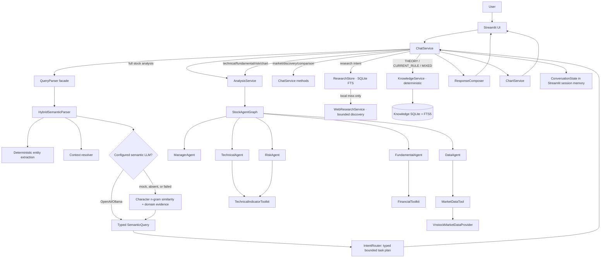
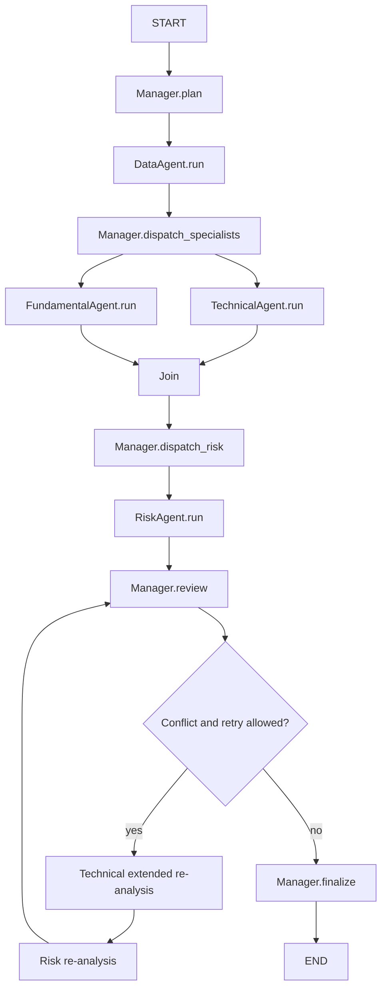

# Kiến trúc hiện tại

Tài liệu này mô tả repository sau cập nhật Knowledge Base ngày 11/10/2026. Nội dung bên dưới phản ánh code đang tồn tại; không mô tả các component dự kiến trong tương lai.

## 1. Tóm tắt hiện trạng

Hệ thống hiện là một ứng dụng nghiên cứu chứng khoán Việt Nam chạy cục bộ, có giao diện chat Streamlit, NLU hybrid, dữ liệu thật từ `vnstock`, một workflow LangGraph cho phân tích đầy đủ và các route rút gọn cho câu hỏi chuyên biệt. Các mô hình Pydantic được dùng làm contract giữa parser, service, graph, agent và UI.

Phần định lượng tài chính vẫn dùng công thức và ngưỡng deterministic. Khi được cấu hình, OpenAI/Ollama có thể tham gia semantic parsing, specialist review và final commentary; mặc định `STOCK_AGENT_LLM_PROVIDER=mock` nên luồng mặc định không phát sinh phí LLM.

Khi bật `STOCK_AGENT_LLM_SPECIALISTS_ENABLED`, Data, Technical, Fundamental, Risk và Manager có thể gọi chung một structured LLM advisor. Các review được lưu riêng trong `AgentState.llm_reviews`; chúng diễn giải, phản biện và chỉ ra dữ liệu thiếu nhưng không thay đổi output định lượng. Forecast chạy sau Data và trước hai specialist song song để Technical, Risk và Manager nhìn thấy cùng một dự báo. Chế độ mặc định vẫn tắt để test, CI và deployment không phụ thuộc LLM.

Hệ thống không có broker integration, không có action đặt lệnh và không tự động giao dịch.

## 2. Công nghệ và entry point

| Khu vực | Code hiện tại |
|---|---|
| Runtime | Python 3.11+, Pydantic 2 |
| Orchestration | LangGraph 1.x cho full-analysis graph |
| Market data | `vnstock` 4.x, source mặc định `VCI` |
| Data processing | pandas, NumPy |
| Charts | Plotly |
| UI | Streamlit |
| Tests | pytest, provider giả lập chỉ nằm trong tests |
| CLI | `stock-agents TICKER --horizon ...` gọi full graph |
| Chat | `streamlit run app/streamlit_app.py` |

Project giữ `.venv`, pip cache, runtime data và temp trong workspace ổ D theo `AGENTS.md` và `scripts/setup.ps1`.

## 3. Sơ đồ runtime thực tế

Điểm cần nhấn mạnh:

- `IntentRouter` tạo `RoutingPlan` gồm typed task (`id`, dependency, required input, expected output, timeout, budget). Plan được deterministic validator kiểm tra trước dispatch. Mapping intent → task template vẫn được viết cố định trong code; đây chưa phải một DAG executor động.
- Chỉ full analysis chạy qua `StockAgentGraph`. Technical, Fundamental và Risk riêng lẻ được `AnalysisService` gọi trực tiếp. Discovery, comparison và market overview được điều phối bằng vòng lặp/method trong `ChatService`.
- `ChatService` hiện là application service lớn nhất: parsing, dispatch, error handling, market overview, screening, comparison, chart composition, explanation và cập nhật memory đều hội tụ tại đây.
- Research route search corpus local đã ingest với URL/publisher/published timestamp/checksum trước. Khi local miss có ticker, `WebResearchService` thử trang issuer/disclosure HNX theo mã trước để xử lý ticker ngắn/đa nghĩa; sau đó mới dùng web discovery giới hạn. `ResearchOrchestrator` fetch/extract HTML public có giới hạn và trả quote-level external evidence với canonical URL/hash/timestamp khi thành công. Kết quả external không được ingest hay mang nhãn verified local; discovery chưa fetch không được dùng tạo claim.
- Knowledge route là `KnowledgeService` deterministic, không phải Agent. Nó dùng database riêng `.runtime/knowledge/knowledge.sqlite3`, exact match + FTS5/BM25 + topic/source/freshness weighting + RRF và citation tới document/chunk. `THEORY` không gọi market provider; `CURRENT_RULE` gắn freshness warning; `MIXED` ghép evidence lý thuyết với dữ liệu thật mà không cho KB điều khiển recommendation.

## 4. Semantic understanding và routing

`QueryParser` chỉ là facade gọi `HybridSemanticParser`. Pipeline hiện có:

1. `VietnameseTextNormalizer` bỏ dấu, chuẩn hóa ký tự/whitespace và một số viết tắt/typo domain.
2. `EntityExtractor` lấy ticker, period, sector, indicator và requested information.
3. `ContextResolver` xử lý active ticker, danh sách mã gần nhất, tham chiếu theo thứ tự, “cả hai” và một số trường hợp mơ hồ.
4. Nếu cấu hình OpenAI/Ollama, provider trả trực tiếp `SemanticQuery` theo schema Pydantic.
5. Nếu không có LLM hoặc provider lỗi, `SemanticSimilarityClassifier` dùng cosine similarity trên character trigram của example bank, cộng các domain evidence regex có trọng số.
6. Parser tạo confidence, ambiguity, clarification, primary intent, secondary intents và telemetry (source, latency, LLM attempted, fallback reason, prompt/example-bank version).
7. `IntentRouter` chọn task template từ allowlist; nếu cần clarification thì task plan chỉ còn `CHAT`. Validator chặn dependency/input/budget không hợp lệ trước dispatch.

Các intent hiện có: general chat, full stock analysis, technical, fundamental, risk, market overview, discovery, comparison, chart, indicator, research, `THEORY`, `CURRENT_RULE`, `MIXED`, follow-up, explanation, help và unknown.

NLU có dataset 120 câu nằm trong `tests/data/semantic_queries.json`. Kết quả 100% là kết quả in-sample trên bộ dữ liệu repository; chưa có holdout độc lập, traffic thật hoặc calibration test đủ để suy ra độ chính xác production.

Lỗi LLM provider vẫn fallback về local parser để giữ availability, đồng thời tạo structured application log, response metadata và một SQLite telemetry record chỉ chứa source/latency/fallback/ambiguity/version (không chứa raw query). `scripts/semantic_telemetry_report.py` tổng hợp counters/latency. Token/cost vẫn là `unknown`: provider adapter hiện không trả usage/cost và hệ thống không được suy đoán các số này.

## 5. Full-analysis LangGraph

Luồng full analysis hiện tại:

`AgentState` chứa ticker, horizon, requested data/indicators, market data, ba specialist result, messages, trace, plan, completed tasks, iteration flags và final decision. `messages`, `trace` và `completed_tasks` dùng reducer cộng danh sách để merge hai nhánh Technical/Fundamental.

Re-analysis thực tế chỉ mở rộng Technical Agent bằng SMA200, support/resistance và max drawdown; Fundamental Agent không được chạy lại. Vòng lặp dừng khi đã extended hoặc hết `max_iterations`.

## 6. Data layer hiện tại

`VnstockMarketDataProvider` là production/default provider duy nhất:

- Validate ticker bằng regex 2–10 ký tự chữ/số.
- Tải khoảng 550 ngày lịch qua `Quote(...).history(..., interval="1D")`.
- Chuẩn hóa các cột `date/open/high/low/close/volume`, ép kiểu, bỏ duplicate, sort và validate từng `PriceBar`.
- Yêu cầu tối thiểu 50 phiên hợp lệ.
- Khi cần, gọi `Finance(...).ratio(period="year")` và ánh xạ về 10 field trong `FinancialMetrics`.
- Nếu ratios lỗi, giá vẫn được trả về cùng warning. Nếu dưới 3 metric, Fundamental Agent giảm confidence hoặc trả `UNKNOWN`.
- Runtime của vnstock được chuyển vào `.runtime` trên ổ D; telemetry mặc định tắt.
- Mỗi raw response được lưu thành gzip snapshot bất biến với SHA-256; normalized result được cache trong SQLite với TTL.
- Provider calls có timeout từ vnstock config, application retry/backoff và circuit breaker.
- `DataQualityChecker` kiểm tra chronology, freshness, gaps, extreme returns, volume coverage, provenance, adjusted-price status và financial period.

Provenance hiện có ở mức:

- `MarketData.source`, ví dụ `vnstock:VCI`, cùng structured `SourceReference` cho OHLCV và financial ratios.
- `as_of`, timezone-aware `fetched_at`, request parameters, schema version, checksum và raw snapshot ID.
- Mỗi financial metric observation có value, unit, reporting-period label/end và source ID.
- `PriceBar.date`, response data timestamp, quality report và warnings được đưa tới UI.

Provenance vẫn chưa có khi upstream không cung cấp:

- URL/document ID chính thức ngoài provider method ID.
- Published timestamp cho financial ratios.
- Xác nhận adjusted/unadjusted price, corporate-action feed hay revision/restatement history.
- Lineage từ từng claim/evidence tới field nguồn.

Provider chưa có secondary/official source hoặc reconciliation. Financial schema mapping vẫn dùng heuristic tên row, nhưng period được chọn theo nhãn thời gian và stale/period-less data bị chặn khỏi Fundamental scoring. Raw snapshots cho phép reproduce schema drift. Cache/retry/timeout/circuit breaker đã có; in-process rate limiter pace từng upstream attempt nhưng chưa phải quota-aware scheduler phân tán.

Smoke test thật ngày 09/10/2026 cho thấy VCI trả FPT OHLCV current nhưng financial ratios có kỳ 2018. Hệ thống giữ nguyên kỳ đó, gắn `STALE_FINANCIALS` và Fundamental trả `UNKNOWN` thay vì coi ratios là hiện tại.

## 7. Analytical engines hiện tại

### Technical

`TechnicalAgent` gọi toolkit deterministic gồm SMA, EMA, RSI, MACD, volatility, drawdown, support/resistance và volume ratio. Full analysis dùng một score khởi đầu 5 và cộng/trừ theo các ngưỡng cố định. Requested-indicator route chỉ tính các indicator được yêu cầu.

Hạn chế chính:

- Horizon chủ yếu được dùng làm label; bộ indicator/parameter mặc định không thật sự thay đổi theo 1M/3M/1Y, ngoại trừ extended re-analysis.
- Threshold và score chưa được backtest/calibrate trên thị trường Việt Nam.
- RSI trong `ChartService` có implementation riêng với toolkit, tạo nguy cơ hai nơi cho kết quả khác nhau.
- Chưa xử lý corporate actions, thanh khoản tối thiểu, gap, benchmark-relative strength hay regime.

### Fundamental

`FundamentalAgent` dùng tối đa 10 metrics và ngưỡng cố định cho growth, ROE/ROA, margin, P/E, P/B, debt/equity, operating cash flow và EPS.

Hạn chế chính:

- Không có multi-period statements, TTM, QoQ/YoY series, quality-of-earnings hoặc sector-specific model.
- Một bộ ngưỡng dùng cho ngân hàng, công nghệ, thép, bán lẻ và bất động sản.
- Operating cash flow là số tuyệt đối nhưng được chấm chỉ theo dấu, không chuẩn hóa theo quy mô.
- Không có peer valuation, historical valuation band, dilution, dividend, segment data hoặc report citations.

### Risk

`RiskAgent` kết hợp 60-session annualized volatility, 252-session max drawdown, disagreement, unknown signal và confidence. Nó có thể phát `veto` theo ngưỡng cố định.

Hạn chế chính:

- Không có liquidity risk, beta/correlation, concentration, event/news risk, accounting risk, macro/sector exposure hay user portfolio context.
- Score/veto chưa được calibration hoặc backtest.
- Risk route luôn cần cả Technical và Fundamental result; chưa có risk decomposition theo câu hỏi.

### Manager

`ManagerAgent` lập một plan cố định, phát message, phát hiện conflict, chọn re-analysis hay finalize và áp policy recommendation `BUY/HOLD/WATCH/AVOID`. Đây là component có action choice rõ nhất, nhưng chưa sinh plan mới từ mục tiêu người dùng; lựa chọn của nó được giới hạn trong các branch viết sẵn.

Recommendation có disclaimer giáo dục nhưng vẫn mang nhãn hành động mạnh. Hệ thống chưa thu thập risk profile, time horizon thực dụng, position context hoặc suitability để các nhãn này đủ tin cậy cho sử dụng đầu tư thật.

## 8. Component nào thực sự cần là Agent?

| Component hiện tại | Reasoning? | Planning? | Action choice? | Đánh giá trung thực | Hướng mục tiêu |
|---|---:|---:|---:|---|---|
| `DataAgent` | Không đáng kể | Không | Chỉ chọn include financials từ state | Wrapper có trace/message quanh `MarketDataTool` | Đổi vai trò logic thành `DataService`; graph node vẫn có thể gọi service |
| `TechnicalAgent` | Rule-based scoring | Chọn tool rất hạn chế | Requested/default/extended | Deterministic analysis engine, chưa phải autonomous agent | `TechnicalAnalysisEngine`; agent chỉ cần nếu sau này phải chọn method theo task/evidence |
| `FundamentalAgent` | Rule-based scoring | Không | Không | Deterministic scoring function | `FundamentalAnalysisEngine` với model theo ngành/kỳ |
| `RiskAgent` | Cross-check nhiều output | Không tạo plan | Veto theo rule | Ranh giới critic hữu ích, nhưng implementation là deterministic risk engine | Giữ `RiskEngine`; có thể thêm Critic Agent để kiểm tra assumption/evidence |
| `ManagerAgent` | Có tổng hợp/conflict policy | Có plan nhưng hard-code | Re-analyze hoặc finalize | Component agent-like rõ nhất | Giữ làm bounded Supervisor với typed task plan |
| `IntentRouter` | Không | Mapping cố định | Route theo enum | Router/service, không phải agent | Giữ deterministic policy hoặc planner có guardrail |
| `ChartService` | Không | Không | Chọn chart từ typed request | Service deterministic đúng vai trò | Giữ nguyên nguyên tắc |
| `ResearchStore` / `WebResearchService` / research route | Không | Không | Local FTS trước, web discovery khi local miss | Deterministic services, không phải agent; web result tách khỏi verified evidence | Giữ retriever là service; chỉ thêm Research Agent nếu sau này cần lập sub-question/evidence plan |

Không cần duy trì đúng năm agent ở kiến trúc sản phẩm. Ranh giới nên dựa vào quyền ra quyết định, không dựa vào tên class hay việc class có emit message.

## 9. Conversation, UI và persistence

`ConversationState` lưu tối đa 24 message, active tickers, last intent/horizon/chart period, stock list, entity history và một summary cắt chuỗi. `InMemoryConversationStore` chỉ giữ object trong `st.session_state`.

Do đó:

- Conversation mất khi Streamlit session/process kết thúc.
- Không có user identity, auth, multi-device sync, database migration hay retention policy.
- Summary không phải semantic summarization; nó nối snippet của message bị loại.
- Chưa có concurrency control hoặc durable audit record.

UI hiển thị card, table, chart, source/date, warning, semantic interpretation (gồm parser latency/fallback) và agent trace/task plan. Error handler tổng quát có thể đưa exception detail vào warning; phù hợp demo/debug hơn production.

## 10. Tests và mức assurance hiện tại

Repository có unit/integration tests cho:

- Pydantic contracts và timestamp.
- Reliable-data contracts: provenance bắt buộc, cache SQLite, immutable raw snapshot, retry/circuit breaker, và quality fail-closed.
- Financial period/unit/source preservation và fundamental abstention khi evidence financial stale.
- Indicator calculations và insufficient-data errors.
- Normalization của quote/ratio DataFrame.
- Agent conflict, risk veto, bounded re-analysis và LangGraph completion.
- Chat routing, memory, chart, discovery, comparison và clarification.
- 120 semantic queries cùng structured-LLM fake provider.
- Semantic task-plan dependencies/validation, parser fallback telemetry, privacy-minimal durable telemetry và evaluator calibration/holdout-overlap guard.

Fixture market data deterministic chỉ nằm trong tests; UI không fallback sang mock data. Smoke script gọi real vnstock.

Khoảng trống test quan trọng:

- Không có provider contract test chạy định kỳ với schema thật hoặc captured raw response đã version hóa.
- Không có load/soak/latency benchmark với upstream thật; resilience, pacing và circuit behavior hiện có unit test.
- Không có point-in-time/backtest, golden financial calculations hay independent NLU holdout.
- Có test provenance/citation cho local ResearchStore và local-miss web fallback; chưa có retrieval recall/faithfulness benchmark, PDF/OCR, document-version hoặc source-quality tests.
- Không có security, privacy, auth hoặc persistence tests.

## 11. Những gì MVP đang làm tốt

- Tách typed model, provider, tool, service, graph và UI tương đối rõ.
- Không fake data khi production provider lỗi; lỗi được đưa ra thay vì bịa kết quả.
- Các phép tính deterministic không bị giao cho LLM.
- Có source label, data date, missing-data warning và disclaimer.
- Full graph có fan-out/join, critic, veto và finite retry.
- Selective routes tránh chạy full graph cho chart/indicator đơn giản.
- NLU có clarification và không fuzzy-correct ticker tùy tiện.
- Test suite nhanh, deterministic và bao phủ các demo flow chính.
- Không có broker/order code.

## 12. Technical debt ưu tiên

### P0 — Data correctness, provenance và source reconciliation

Phase A đã có nền tảng: provenance có cấu trúc, period/unit cho financial metrics, raw snapshot bất biến, SQLite cache, timeout/retry/circuit breaker và quality gate fail-closed. Nhưng hệ thống vẫn chỉ có một upstream vnstock/VCI; chưa có instrument master đầy đủ, Vietnam exchange calendar, adjusted-price/corporate-action feed, hay đối soát với nguồn chính thức/nguồn thứ hai. Đây vẫn là blocker lớn nhất trước khi gọi hệ thống là research assistant dùng thật.

### P0 — Evidence model

`evidence` hiện chỉ là chuỗi do rule engine tạo. Không có `EvidenceItem` liên kết claim → source → as-of → raw field/document/page. Vì vậy “source + timestamp” mới đúng ở cấp response, chưa đúng cho từng nhận định quan trọng.

### P1 — Analytical validity

Score/threshold chưa calibrated, horizon còn mang tính label, fundamental không theo ngành, risk chưa đủ chiều và recommendation chưa dựa trên suitability. Kết quả hiện hữu ích để demo workflow, chưa đủ để ra quyết định vốn thật.

### P1 — Research data gap

Đã có corpus nhỏ từ trang IR chính thức, local citation-first store và web discovery fallback. Nhưng chưa có PDF/OCR, issuer/exchange allowlist, document-version, retrieval benchmark hay licensed news. Vì vậy hệ thống vẫn chưa có đủ evidence để giải thích catalyst hoặc thesis ở production.

### P1 — Evaluation và point-in-time discipline

Chưa có backtest, benchmark, walk-forward, transaction cost, survivorship/look-ahead controls hoặc data revision tracking.

### P1 — Service boundaries và persistence

`ChatService` gánh quá nhiều use case; conversation chỉ in-memory; chưa có durable run/evidence store và observability.

### P2 — NLU production validation

NLU test hiện đạt cao trên dataset cùng repository nhưng chưa có holdout thật hoặc monitoring drift. Calibration report/ECE và durable privacy-minimal telemetry đã có, nhưng threshold chưa được calibrate bằng holdout; chưa có alerting, retention policy hay token/cost usage từ provider.

### P2 — Production operations

Chưa có auth, secret management policy, user isolation, quotas, structured logs, tracing, metrics, deployment profile hoặc recovery plan.

## 13. Những gì chưa đáng tin để dùng thật

Hiện chưa nên dựa vào hệ thống để phân bổ vốn vì:

- Không thể chứng minh point-in-time correctness và corporate-action handling.
- Financial values hiện mang period/unit/source, nhưng vẫn chỉ có một upstream; payload thực tế có thể stale/schema-drift và chưa được đối soát với nguồn chính thức.
- BUY/HOLD/WATCH/AVOID dựa trên heuristic chưa backtest.
- Research store có thể trả citation cho corpus official nhỏ; web fallback chỉ hỗ trợ discovery và không thay thế corpus verified, nên vẫn thiếu catalyst, event và narrative risk coverage.
- Screening chỉ xếp hạng một watchlist tĩnh rất nhỏ, không phải toàn thị trường.
- Comparison chạy từng mã độc lập, chưa chuẩn hóa theo ngành/quy mô/valuation regime.
- Risk không biết portfolio, position size hay risk tolerance của người dùng.
- Kết quả test semantic 100% không đồng nghĩa accuracy production.

Giá trị hiện tại tốt nhất là công cụ nghiên cứu sơ bộ, minh họa multi-agent và tạo checklist phân tích; không phải investment decision system.
