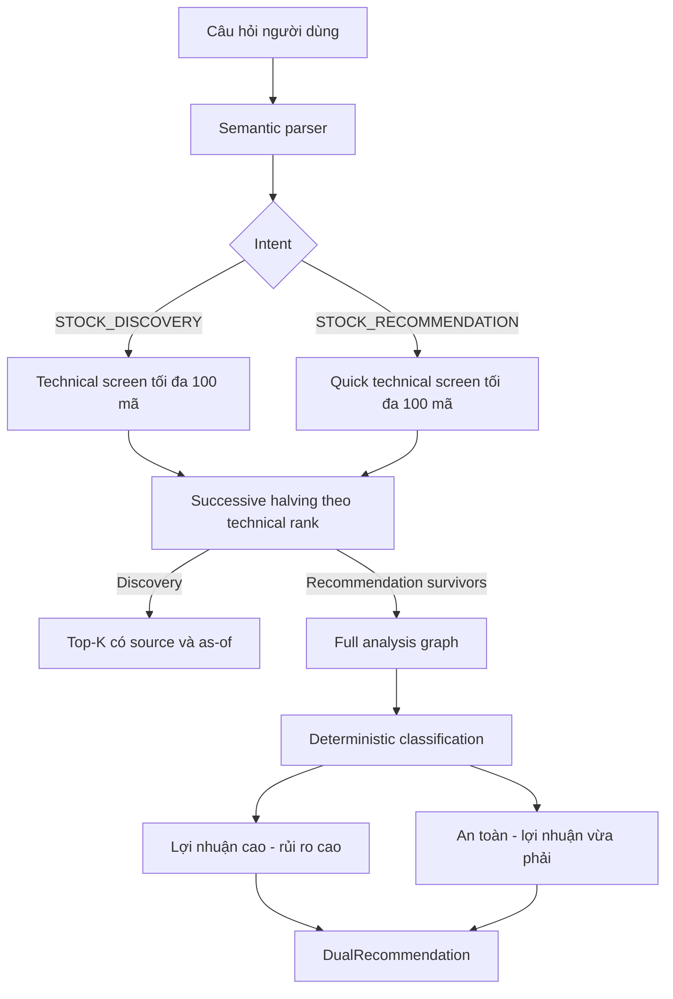

# Kiến trúc Dual Recommendation

## Trạng thái

Đã triển khai. Luồng này phục vụ nghiên cứu/giảng dạy và không đặt lệnh giao dịch.

Hệ thống hiện có hai hành vi riêng:

- `STOCK_DISCOVERY`: sàng lọc kỹ thuật một universe và trả đúng top-K nếu đủ mã đạt chính sách.
- `STOCK_RECOMMENDATION`: sàng lọc nhanh, phân tích sâu các mã sống sót, rồi chia kết quả thành hai nhóm rủi ro/lợi nhuận.

Manager Agent có thể dùng LLM cấu hình để xác nhận hoặc sửa typed intent trước khi lập kế hoạch. LLM chỉ trả về một `QueryIntent`; `IntentRouter` và `RoutingPlanValidator` deterministic vẫn quyết định pipeline executable. Nếu LLM timeout, trả schema sai, chọn intent thiếu ticker hoặc trái với yêu cầu BUY rõ ràng, hệ thống giữ kết quả parser ban đầu.

Watchlist `default` có 100 mã Việt Nam duy nhất tại `config/watchlist.json`. Đây là một universe cấu hình, không phải toàn bộ thị trường và không phải bằng chứng membership lịch sử.

## Luồng thực thi

### Vì sao không dùng binary search thuần

Binary search chỉ đúng khi tập dữ liệu đã được sắp xếp theo khóa tìm kiếm. Universe cổ phiếu ban đầu chưa có thứ hạng, vì vậy bỏ qua một nửa trước khi đánh giá có thể loại nhầm mã tốt nhất.

Hệ thống dùng **successive halving**:

1. Technical Agent đánh giá mỗi mã trong universe bị chặn tối đa 100 đúng một lần.
2. Các mã đạt điều kiện được xếp hạng theo technical score.
3. Mỗi vòng giữ lại `max(K, ceil(N/2))` ứng viên đứng đầu.
4. Lặp lại đến khi còn K ứng viên hoặc không thể giảm thêm.
5. Không gọi lại provider trong các vòng giảm tập.

Cách này giữ đúng ý tưởng “lọc một nửa qua từng vòng” nhưng không giả định universe chưa đánh giá đã được sắp xếp.

## Phase 1 — Quick screen

`ScreeningService.run_progressive()` dùng:

- technical analysis deterministic;
- không gọi LLM planner cho từng mã;
- không chạy LSTM forecast cho từng mã;
- dừng sớm và ghi rõ các mã chưa được đánh giá nếu provider rate-limit;
- chỉ xếp hạng khi ngày giá của các mã có thể so sánh được căn chỉnh.

Chính sách recommendation quick screen:

- technical score tối thiểu: `5.0`;
- signal hợp lệ: `BUY`, `HOLD`;
- universe tối đa: `100`;
- policy: `screen-v3-progressive`.

## Phase 2 — Deep analysis

`RecommendationService` chạy full analysis cho các mã sống sót. Vòng đầu phân tích tối đa `max(10, requested_count * 2)`. Nếu chưa đủ K kết quả hợp lệ, phạm vi được mở rộng gấp đôi qua từng vòng cho đến khi đủ K, cạn danh sách đã qua quick screen, hoặc gặp rate limit. Các giới hạn đã dùng được ghi trong `deep_analysis_limits` để audit. Dịch vụ có thể dừng sớm khi đã có đủ kết quả hợp lệ và đã đại diện được hai bucket (khi yêu cầu từ hai mã trở lên).

Các kết quả lỗi hoặc thiếu dữ liệu không được âm thầm biến thành gợi ý; chúng tạo warning và có thể dẫn đến shortfall.

## Chính sách hai bucket

### Lợi nhuận cao — rủi ro cao

- technical score `>= 7.0`;
- risk score `>= 5.0`;
- annualized volatility `>= 30%`;
- không có risk veto;
- final decision không phải `AVOID`.

Ưu tiên theo tổng technical + fundamental score, sau đó confidence.

### An toàn — lợi nhuận vừa phải

- risk score `< 5.0`;
- data uncertainty không phải `HIGH`;
- fundamental signal thuộc `BUY` hoặc `HOLD`;
- không có risk veto;
- final decision không phải `AVOID`.

Ưu tiên risk score thấp, sau đó fundamental và technical score cao.

Nếu chỉ một bucket có đủ ứng viên, hệ thống dùng ứng viên còn lại của bucket đó để lấp quota. Nếu số mã vượt toàn bộ chính sách vẫn thiếu, hệ thống bổ sung bảng `REFERENCE_ONLY` từ các mã đã phân tích sâu. Các mã này được xếp theo veto, kết luận Manager, rủi ro, tổng điểm và confidence; mỗi mã phải công khai policy gap và không được trình bày như mã đã đạt chuẩn.

Ngày giá không còn phải giống tuyệt đối trên toàn bộ universe. Hệ thống cho phép độ lệch tối đa 3 ngày. Mã quá cũ hoặc thiếu ngày được tải mới đúng một lần bằng cách bypass cache; nếu vẫn cũ thì chỉ mã đó bị loại, còn phần universe đủ mới tiếp tục được xếp hạng.

Nếu quick screen không có đủ survivor nhưng vẫn có các mã đã tính được điểm kỹ thuật, các mã có điểm cao nhất được đưa vào phân tích sâu với tư cách ứng viên dự phòng. Chúng chỉ có thể lấp phần thiếu dưới nhãn `REFERENCE_ONLY`; dữ liệu `UNAVAILABLE` không bao giờ được tự động nâng thành ứng viên.

### Fast recommendation profile

Với câu hỏi chọn mã như `Tôi nên mua cổ phiếu nào hôm nay?`, hệ thống vẫn xếp hạng universe cấu hình 100 mã nhưng ưu tiên dữ liệu cache tối đa 3 ngày. Quick screen không refresh hàng loạt. Chỉ đúng số mã cần trả về được đưa qua full graph; các mã shortlist cũ quá 3 ngày mới bị bypass cache và tải lại. Full graph trong luồng batch đặt `max_iterations=0` và không gọi LLM planner cho từng Technical Agent. Intent `STOCK_RECOMMENDATION` có confidence từ 90% dùng thẳng typed deterministic route; Manager LLM chỉ sửa route mơ hồ và vẫn có thể tổng hợp kết quả một lần ở cuối.

## Thành phần đã triển khai

- `config/watchlist.json`: universe mặc định 100 mã.
- `models/chat.py`: intent `STOCK_RECOMMENDATION`.
- `models/screening.py`: `ProgressiveScreenRound`, `RecommendationBucket`, `RecommendationCandidate`, `DualRecommendation`.
- `services/screening_service.py`: technical quick screen và successive halving.
- `services/recommendation_service.py`: deep analysis, phân loại và chọn đúng số lượng.
- `nlu/*`: nhận diện câu hỏi chọn mã để mua/đầu tư và số lượng top-K.
- `chat/router.py`: task plan `SCREENING -> RECOMMENDATION`.
- `agents/manager_agent.py`: LLM intent selection có schema và guard, fallback deterministic.
- `services/chat_service.py`: dispatch và hai bảng kết quả.
- Streamlit dùng `ResponseTable` sẵn có nên không cần UI renderer riêng.

## Contract đầu ra

`DualRecommendation` công khai:

- universe và kích thước universe;
- số mã qua quick screen;
- số mã được phân tích sâu;
- số lượng yêu cầu và số lượng thực trả;
- chi tiết các vòng successive halving;
- các mốc mở rộng deep analysis;
- source IDs, ngày dữ liệu và warning;
- policy version và disclaimer.

## Giới hạn vận hành

- Quét 100 mã phụ thuộc hạn mức và khả năng truy cập của data provider. Cache giúp giảm request nhưng không bảo đảm tránh rate limit.
- Watchlist hiện tại không phải point-in-time universe, nên không dùng để tuyên bố hiệu suất backtest lịch sử.
- “Đúng K” có thể gồm mã đạt chuẩn và mã `REFERENCE_ONLY`; số lượng từng loại luôn được công khai riêng.
- LLM có thể hỗ trợ semantic parsing nhưng không quyết định điểm số, bucket hoặc trade action.
- Không có broker connection hoặc tự động giao dịch.

## Tiêu chí hoàn thành

- [x] Watchlist mặc định có 100 mã duy nhất.
- [x] Discovery và recommendation hiểu số lượng top-K từ 1 đến 100.
- [x] Successive halving lưu audit trail từng vòng.
- [x] Quick screen không gọi LLM/LSTM theo từng mã.
- [x] Recommendation chạy full analysis chỉ trên survivors.
- [x] Hai bucket dùng chính sách deterministic công khai.
- [x] UI hiển thị hai bảng, source/as-of, số lượng và warning.
- [x] Có test cho NLU, routing, watchlist 100 mã, halving, classification, exact count và shortfall.
