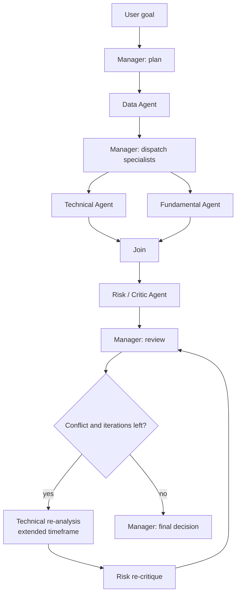

# Implementation plan

## Requirements

Build an educational, non-trading MVP with exactly five specialized agents. It must expose goals, observations, tool use, concise reasoning summaries, typed communication, shared memory, conflict, criticism, supervision, conditional re-analysis, and a finite Observe → Reason → Plan → Act loop. The user-facing flow accepts any valid Vietnamese ticker and uses current market data rather than canned analysis.

## Architecture and responsibilities

- **Data Agent** validates and normalizes OHLCV and company metrics. It never recommends a trade.
- **Technical Agent** observes price/volume, selects indicators for the current horizon, calls indicator tools, and returns a typed signal.
- **Fundamental Agent** independently scores growth, quality, valuation, leverage, and cash flow.
- **Risk/Critic Agent** challenges both analyses, measures volatility/drawdown/disagreement, warns, and may veto.
- **Manager Agent** turns the user goal into a plan, delegates, detects conflict, requests bounded re-analysis, and makes the educational final decision.

Dependencies are injected into agents. Providers acquire data or text; tools perform capabilities; agents decide when to use them; LangGraph owns orchestration.

## State model

`AgentState` contains the request, normalized market/financial data, specialist results, messages, trace events, plan, completed tasks, iteration counters, routing flags, and final decision. Append-only fields use reducers so independent graph branches can merge safely.

## Message model

`AgentMessage` has `sender`, `receiver`, `message_type`, `task`, typed JSON-compatible `payload`, optional `confidence`, and timezone-aware `timestamp`. Message types are `TASK`, `RESULT`, `CRITIQUE`, `REQUEST_REANALYSIS`, `WARNING`, and `FINAL_DECISION`.

## Tool and provider system

- `MarketDataTool` calls the injected `MarketDataProvider` and validates its result.
- `TechnicalIndicatorToolkit` owns SMA, EMA, RSI, MACD, Bollinger Bands, volatility, drawdown, support/resistance, and volume analysis.
- `FinancialToolkit` owns growth and quality scoring helpers.
- `VnstockMarketDataProvider` is the production/default provider. The integration targets the current vnstock 4.x unified API, validates ticker/data availability, and converts unstable external frames into internal models.
- Test-only in-memory providers supply deterministic inputs to unit tests; they are not a user-facing analysis mode.
- `LLMProvider` is a protocol. Colab Qwen, Mock, OpenAI, and legacy Ollama adapters can be swapped without changing graph/agents. Numerical calculations and decision policies remain auditable and deterministic.

## Graph workflow



## Conflict handling

Conflict exists when specialist signals differ, Risk is high/vetoes, confidence is low, or data is insufficient. On the first actionable conflict, Manager emits `REQUEST_REANALYSIS` and changes the plan to a longer technical timeframe. `iteration < max_iterations` is required for every loop. Once evidence is refreshed or the bound is reached, Manager finalizes conservatively.

## Technology choices

- Python 3.11+ and Pydantic 2 for readable typed models.
- LangGraph 1.x for explicit state, fan-out/join, conditional routing, and cycles.
- pandas/numpy only at provider/tool boundaries.
- Streamlit for a presentation-friendly trace UI.
- pytest for unit/integration tests.
- vnstock 4.x as an optional provider, never as a core dependency.

## Folder structure

```text
src/stock_multi_agent/
  agents/       # five roles
  graph/        # LangGraph workflow and routing
  models/       # analysis, messages, state
  providers/    # market and LLM abstractions/adapters
  services/     # public use-case API
  tools/        # capabilities with no agent policy
app/            # Streamlit UI
tests/          # unit + integration + conflict demo
docs/           # plan and architecture
```

## Implementation phases

1. Document architecture and contracts.
2. Implement models, providers, and tools.
3. Implement five agents and LangGraph workflow.
4. Prove the FPT conflict scenario with a test-only deterministic provider.
5. Integrate and validate the real vnstock provider for arbitrary Vietnamese tickers.
6. Add Streamlit execution trace.
7. Run unit/integration tests and document demo steps.
