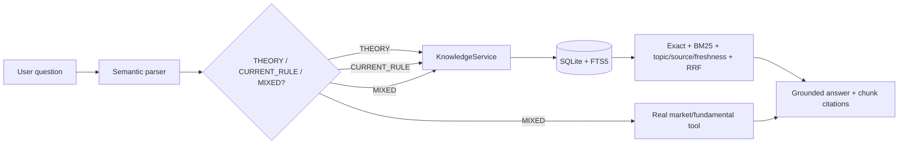

# Knowledge Base chứng khoán

## Mục đích và ranh giới

Knowledge Base (KB) lưu kiến thức chứng khoán có provenance để trả lời câu hỏi lý thuyết tiếng Việt. KB là `KnowledgeStore` + `KnowledgeService`, không phải một LLM Agent: ingestion, tìm kiếm, xếp hạng, freshness và citation đều deterministic. Nội dung KB không tự động quyết định BUY/SELL và không có broker integration.

KB tách khỏi `ResearchStore` hiện có. Research store phù hợp báo cáo/công bố doanh nghiệp vì yêu cầu `published_at`, ticker và document type chuyên biệt. Kiến thức nền có thể không có ngày xuất bản, cần topic/version/usage note/time sensitivity, nên dùng schema riêng giúp Phase C không bị migration phá vỡ. Cả hai cùng trả evidence có document/chunk provenance ở tầng chat.

## Kiến trúc



Embedding là extension point tùy chọn qua `SemanticKnowledgeRetriever`. Neo4j Knowledge Graph bổ sung entity traversal 1–2 hop và đưa các `document_id` liên quan vào hybrid ranking. Không có embedding hoặc Neo4j thì exact/FTS5 vẫn hoạt động đầy đủ. Xem [Knowledge Graph với Neo4j](knowledge-graph.md).

## Storage và schema

Database mặc định: `.runtime/knowledge/knowledge.sqlite3` trong workspace ổ D. Có thể đổi bằng `STOCK_AGENT_KNOWLEDGE_DATABASE`, nhưng policy Windows từ chối đường dẫn ngoài ổ D.

Schema version 1 gồm:

- `kb_schema_migrations`: version và thời điểm migration;
- `knowledge_documents`: title, publisher, URL gốc/canonical, source type, language, published/effective/retrieved timestamp, SHA-256, usage note, verification, topics, version, time-sensitive và active version;
- `knowledge_chunks`: heading, ordinal, text, normalized text và char offsets tới document;
- `knowledge_chunks_fts`: FTS5 `unicode61 remove_diacritics 2` cho tiếng Việt có/không dấu.

Duplicate detection dùng canonical URL + version và `content_sha256`. Cùng nội dung không được lưu lặp; cùng URL có nội dung mới phải tăng version, phiên bản cũ chuyển inactive.

## Ingestion

Pipeline hỗ trợ UTF-8 Markdown, TXT, HTML public và PDF có text. HTML bỏ script/style; Unicode được chuẩn hóa NFC; chunk ưu tiên heading và đoạn văn nên công thức không bị tách khỏi phần giải thích. PDF dùng package optional `pypdf`; OCR ảnh scan chưa được hỗ trợ.

Chạy seed manifest:

```powershell
$env:PYTHONPATH = "src"
.\.venv\Scripts\python.exe scripts\ingest_knowledge.py --manifest knowledge\sources.json
```

PDF support:

```powershell
.\.venv\Scripts\python.exe -m pip install --cache-dir .cache\pip -e ".[knowledge]"
```

Mỗi entry trong manifest phải có `path`, `title`, `publisher`, `source_url`, `source_type`, `language`, `usage_note`, `verification_status`, `topics`, `version`, `time_sensitive`; `published_at` và `effective_at` để `null` nếu nguồn không cung cấp. Không được bịa timestamp. Tài liệu `VERIFIED` thiếu URL/publisher bị từ chối.

## Retrieval

1. Chuẩn hóa tiếng Việt có/không dấu và các term đặc thù như P/E, P/B.
2. Exact finance-term matching.
3. BM25 qua SQLite FTS5.
4. Optional semantic candidates nếu local retriever được cấu hình.
5. Topic match, verification và source-quality weighting.
6. RRF hợp nhất các rank; coverage gate loại kết quả chỉ trùng từ chung.
7. Tài liệu time-sensitive luôn mang cảnh báo đối chiếu bản hiện hành.

Kết quả giữ `document_id`, `chunk_id`, heading, source URL, publisher, timestamp, SHA-256, verification, version, quote, retrieval modes và freshness warning.

## Source policy và seed hiện tại

`knowledge/` chứa các bản tóm tắt giáo dục tiếng Việt do dự án tự biên soạn, không phải bản sao dài của nguồn. Manifest liên kết nguồn chính thức/có uy tín: HOSE, HNX, VSDC/VSD, Investor.gov/SEC, IFRS, Fidelity Learning Center, CFA Institute và OpenStax. Usage note ghi rõ phạm vi sử dụng và yêu cầu kiểm tra điều khoản nguồn.

Không ingest sách lậu, bài báo trả phí, URL giả hoặc snippet chưa fetch như evidence. Quy định HOSE/HNX/VSDC là time-sensitive dù đã VERIFIED/REVIEWED.

## Routing và câu trả lời

- `THEORY`: chỉ gọi `KNOWLEDGE`, không gọi market provider/web.
- `CURRENT_RULE`: gọi KB, hiển thị freshness và URL chính thức.
- `MIXED`: lấy khái niệm từ KB và số thật từ Technical/Fundamental service; hai nguồn được giữ riêng.
- `RESEARCH`: tiếp tục dùng ResearchStore/Internet research Phase C, không bị thay thế.

Khi không có evidence, câu trả lời bắt đầu bằng: `Knowledge Base chưa có đủ tài liệu đã xác minh cho nội dung này.` Ví dụ giả định trong seed được ghi rõ là minh họa. KB không cấp lời khuyên cá nhân hóa.

## Evaluation

Dataset tại `evaluation/knowledge_qa/author-created-v1.json` được gắn nhãn rõ **AUTHOR-CREATED EVALUATION SET**, không phải traffic người dùng. Chạy:

```powershell
$env:PYTHONPATH = "src"
.\.venv\Scripts\python.exe scripts\evaluate_knowledge.py
```

Metrics gồm intent, retrieval hit/refusal, topic hit, citation metadata và freshness. Bộ hiện tại có 56 câu gồm tiếng Việt có/không dấu, multi-concept, current rule, MIXED và local miss. Đây là regression set do tác giả tạo, không phải bằng chứng production accuracy.

## Cập nhật và giới hạn

Để cập nhật tài liệu: sửa/tạo file tóm tắt, tăng `version`, cập nhật manifest bằng URL/timestamp thật, chạy ingestion rồi tests/evaluation. Nội dung cùng URL/version nhưng hash khác bị từ chối để tránh âm thầm ghi đè.

Giới hạn hiện tại: seed nhỏ; không OCR PDF scan; chưa có embedding model; không tự crawl/sync nguồn; current-rule freshness chỉ cảnh báo và dùng timestamp đã lưu, chưa tự xác nhận hiệu lực pháp lý. Nếu mở rộng semantic retrieval sau này, dùng model local miễn phí và giữ lexical fallback làm bắt buộc.
