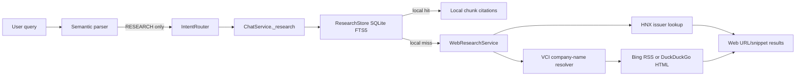

# Phase C — Internet Research Audit

**Audit date:** 2026-10-10  
**Scope:** current repository state only. This document distinguishes implemented behaviour from the target described in the Internet Research / Agentic RAG task.

## Executive finding

The project has a sound **citation-first local document store** and a limited **one-shot web discovery fallback**. It does not yet implement Internet RAG in the sense of *search → fetch source content → extract evidence → evaluate gaps → repeat → synthesize with evidence*. In particular, it never reads a result webpage or PDF after search.

The immediate priority is therefore a small, observable vertical slice for trusted HTML sources—not vector search, a new agent, or a wholesale LangGraph rewrite.

## Actual request path

`ChatService` returns local chunks as verified citations. On a local miss, it returns web result metadata as **not verified evidence**. There is no page fetch, extraction, cross-source comparison, claim generation, or research loop between `W` and the response.

## Working capabilities

| Area | What exists now | Relevant code |
|---|---|---|
| Research routing | `RESEARCH` intent is selected for report/disclosure/filing-style questions and maps to one bounded `RESEARCH` task. | `nlu/intent_classifier.py`, `chat/router.py` |
| Local knowledge base | SQLite tables plus FTS5 index, metadata, chunk offsets, SHA-256, ticker filtering, one best chunk per document, and small Vietnamese–English report aliases. | `services/research_store.py` |
| Provenance | Local documents require source URL, publisher, timezone-aware publication/retrieval times, checksum, type and ticker. | `models/research.py`, `services/research_store.py` |
| Manual ingestion | UTF-8 text/Markdown/HTML can be ingested locally; an explicit approved HTML URL can be fetched by a script. | `scripts/ingest_research_document.py`, `scripts/ingest_research_url.py` |
| Internet discovery | Configurable Bing RSS or DuckDuckGo HTML discovery; short ticker support tries HNX first, then resolves issuer name through VCI. | `services/web_research.py` |
| Safety boundary | Web discovery is modelled separately as `WebCitation`; it has retrieval time but is not presented as a verified local fact. HTTPS destination URLs and bounded response sizes are enforced in search providers. | `models/research.py`, `services/web_research.py`, `services/chat_service.py` |
| Existing tests | Unit tests cover local provenance, empty-store abstention, local-first selection, mocked web fallback, HNX preference, company-name query expansion, and PNG chat routing. | `tests/test_research_store.py`, `tests/test_chat_service.py` |

## Missing capabilities against the requested target

| Target capability | Current status | Consequence |
|---|---|---|
| Semantic research plan / subquestions | Missing | Raw user message is one query; a broad question about outlook is not decomposed into results, guidance, catalysts and risks. |
| Query reformulation / multiple searches | Missing | A failed or ambiguous first query terminates; no bounded recovery strategy exists. |
| Configured production search APIs | Missing | Bing RSS and DuckDuckGo HTML are unauthenticated, markup-sensitive fallbacks. There is no credentialed Tavily/Brave/Google/Bing API adapter or provider failover chain. |
| Real content retrieval | Missing | Search result snippets are not page evidence. The only remote HTML fetch is the separate manual ingestion script. |
| Main-content extraction | Missing | No boilerplate removal, canonical URL resolution, metadata/date extraction or evidence location. |
| PDF / financial report parsing | Missing | `ResearchStore` and ingestion explicitly support only text/Markdown/HTML; no PDF parser, OCR or table extraction exists. |
| External evidence lifecycle | Missing | Retrieved web content is not held in a session-scoped cache/store, fingerprinted, deduplicated, expiry-controlled, or separated by trust tier beyond the UI label. |
| Hybrid semantic/vector retrieval | Missing by design | Local retrieval is lexical FTS5 only; there is no embedding index, hybrid score or reranker. No benchmark currently justifies adding one. |
| Cross-source verification / synthesis | Missing | Responses display local citations or discovery rows only; they do not compare sources, describe conflict, or answer a factual research question. |
| Agentic loop | Missing | `RESEARCH` is a single ChatService call, not a LangGraph node or a Supervisor-controlled multi-step workflow. |
| Operational observability | Insufficient | No structured record of query variations, provider choice, URL fetches, rejection reason, latency, token/API budget or research stop reason. |
| Retrieval evaluation | Insufficient | Tests use mocked providers. There is no versioned Internet-research benchmark, live contract check, citation entailment set, latency or cost report. |

## Root causes of weak/failed searches

1. **A generic RSS result is not a research source.** `BingRssSearchProvider` has no provider-grade entity disambiguation, source-quality ranking, date filtering or fallback. During the PNG investigation, `PNG` was interpreted as the image format and returned unrelated results.
2. **The query planner is only a template.** `_build_search_query` maps a small group of report terms to English phrases, but does not infer research intent, create subquestions, or reformulate after a miss.
3. **The relevance filter deliberately favours precision over recall.** `_is_relevant` discards ticker-only matches. This prevents obvious noise but can produce a false empty result when metadata/snippets are sparse.
4. **Search stops at a link.** `WebResearchService.search()` returns `WebCitation` metadata; it never downloads a chosen result to validate its body, publication date, company/ticker, or claims.
5. **HNX discovery is best-effort.** `HnxIssuerDiscoveryProvider` validates a fixed issuer-page pattern with a single fetch; HNX availability, dynamic rendering and certificate/server behaviour can make this return no result. Failure reason is swallowed rather than exposed in telemetry.
6. **No observable recovery exists.** `ChatService._research()` catches `WebResearchError` and returns an abstention; it does not attempt another provider, query, source class, or follow-up task.

## Current trust and provenance boundary

This boundary is correct and must be preserved during the upgrade:

- **Verified local document:** full locally stored text, original URL, publisher, publication timestamp, retrieval timestamp, checksum, chunk offset and quote.
- **Web discovery result:** title, target URL, domain, provider, result snippet, rank and retrieval timestamp. It has no asserted publication date or publisher and is *not* evidence of a material claim.
- **Structured market data:** handled separately by the Phase A provider/cache/provenance layer.

Future retrieval must add a third category, **session-retrieved external document**, with extracted text, canonical URL, retrieval time, extraction metadata, content hash, source quality and explicit verification status. It must not be silently merged into the verified local corpus.

## Security and data-quality gaps

- `scripts/ingest_research_url.py` accepts an arbitrary URL and follows `urllib` redirects without a public-host/IP validation policy. It has a body limit and HTML MIME check, but no redirect cap, DNS/IP private-range block, canonical URL record, content hash before fetching a redirect, or structured audit log.
- The search providers allow only HTTPS result URLs, but do not fetch those result URLs. A future fetcher needs allowlisted schemes, redirect-by-redirect validation, DNS rebinding resistance, private/link-local IP rejection, response/time limits, charset handling and a user-agent/contact policy.
- HTML text stripping is regex-based. It does not extract main content, protect against prompt-injection instructions in source text, or preserve headings/section locations.
- Licensing, robots/access policy, copyrighted-content retention and a source-quality policy are not enforced in code.
- Broad exception handling in `VnstockCompanyNameResolver` and HNX lookup prevents crashes but hides operational diagnosis.

## Minimal integration strategy

Keep `ResearchStore`, `WebResearchService`, `ChatService` and the typed `EvidenceBundle`. Add services around them; do not turn deterministic retrieval into another LLM agent.

1. **Research planner service.** Convert a `ParsedQuery` into a bounded `ResearchPlan`: goal, entity/ticker, time intent, source preference, 1–3 search queries, maximum searches/fetches/iterations, and explicit stop conditions. Begin deterministic, optionally add the existing typed LLM parser later behind a feature flag.
2. **Search provider interface.** Keep the existing provider protocol but add credentialed adapters (for example, a configured Brave or Tavily API) and a deterministic provider fallback policy. Missing credentials must emit a structured “not configured” result, not a fake live-search success.
3. **Safe content fetcher.** Fetch only selected HTTPS targets after URL validation. Enforce redirect, page count, byte and timeout budgets. Return an immutable `FetchedDocument` with requested/final/canonical URL, headers, retrieval time, status, hash and failure reason.
4. **Extractors.** Start with HTML main-text/metadata extraction. Add PDF text extraction only as an optional, tested dependency; scanned PDFs should report OCR unavailable rather than returning empty evidence.
5. **Evidence evaluator/reranker.** Score query/entity relevance, source tier, recency, publication date availability and duplicate/canonical URL. Keep full score components in audit metadata. Do not use an LLM to calculate these deterministic fields.
6. **Session evidence store and synthesis.** Keep external content ephemeral by default. Only answer material claims with extracted quotes and citations. Synthesis may be an LLM presentation step, but it must cite every material factual claim and surface disagreements.
7. **Bounded orchestrator.** Implement `PLAN → SEARCH → FETCH → EXTRACT → EVALUATE → optional retry → SYNTHESIZE` as a service first. Expose it as a bounded `RESEARCH` task; only integrate it into LangGraph/Supervisor after its contracts and tests are stable.

## Prioritized implementation plan

### P0 — End-to-end trusted HTML vertical slice

- Add typed `ResearchPlan`, `SearchResult`, `FetchedDocument`, `ExtractedDocument`, evidence and failure models.
- Add one credentialed search provider selected by environment, with deterministic fallback to disabled/official issuer lookup; do not depend on scraped search HTML for production reliability.
- Add a safe HTML fetcher/extractor and session-only evidence store.
- Update `ChatService._research()` to render an evidence-grounded answer only when extracted evidence exists; otherwise retain the current honest discovery/abstention response.
- Add tests for source URL/timestamp/hash, redirects, oversized pages, private URLs, HTML extraction and exact citation mapping.

**Completion evidence:** a controlled fixture test performs query → source selection → fetched HTML → extracted quote → cited response without an LLM or external network dependency.

### P1 — Research planning and bounded recovery

- Produce 1–3 query variants from intent/entity/time/source needs.
- Add configurable limits: searches, fetched pages, iterations, elapsed time, body bytes and API-cost units.
- Retry with a source-specific or company-name query only when evidence is absent/irrelevant; record every decision.
- Add source-tier policy: exchange/regulator/issuer before data vendors/news, but evaluate relevance and recency rather than blindly accepting rank.

**Completion evidence:** deterministic tests show an irrelevant first result triggers one planned recovery and that all budgets stop execution.

### P2 — PDFs, cross-source evidence and synthesis

- Add optional PDF text extraction with source/version/page citations; reject scans without OCR support.
- Add canonical URL/content-hash deduplication, publication-date extraction and cross-source contradiction representation.
- Add citation-constrained synthesis and Vietnamese/English research evaluation cases.

**Completion evidence:** a fixture corpus supports a multi-source answer with every factual sentence linked to a quote/page/source; disagreement is displayed rather than hidden.

### P3 — Evaluate vector/hybrid retrieval only with evidence

- Create a versioned retrieval benchmark and measure FTS5 baseline Recall@k/MRR, source quality and citation faithfulness.
- Introduce embeddings/reranking only if a measured improvement justifies the model, disk, latency and operational cost.

## Immediate implementation decision

The next code change should be **P0 only**: typed research plan + configured search adapter contract + safe HTML fetch/extract + session evidence response. It should not yet add a vector database, autonomous background crawler, unrestricted browser automation, new stock-analysis agents, PDF/OCR, or automatic ingestion of web content.

## Post-audit P0 implementation — 2026-10-10

P0 was implemented after this audit without rewriting the existing graph:

- `ResearchPlanner` creates at most three deterministic complementary queries and records search/page/timeout/byte budgets from environment configuration.
- `BraveSearchApiProvider` is available when `BRAVE_SEARCH_API_KEY` is configured; its official structured API supports Vietnam language/country configuration and an optional freshness filter. The default `free` chain uses GDELT DOC 2.0 news discovery and then Bing RSS compatibility, without credentials. Neither free provider replaces official exchange/issuer documents or provides a production SLA.
- `ResearchOrchestrator` performs bounded discovery, URL deduplication, fetch, extraction and relevance selection; its plan, trace and failures are returned in response metadata.
- `SafeContentFetcher` rejects non-HTTPS, credentialed, local/private-IP and oversized sources, validates every redirect, and only accepts HTML/XHTML.
- `HtmlContentExtractor` returns extracted text, title, canonical URL, timezone-aware ISO publication date when available and a SHA-256 content hash. Script/style/navigation/form content is excluded.
- `ChatService` now renders `Extracted external evidence` only when a body was fetched and quote selected. It otherwise preserves the existing discovery/abstain boundary.

This is validated with deterministic fixtures. It is not a claim that Bing RSS/DuckDuckGo HTML is production-grade search, that all real sites are fetchable, or that cross-source synthesis/PDF retrieval is complete.
