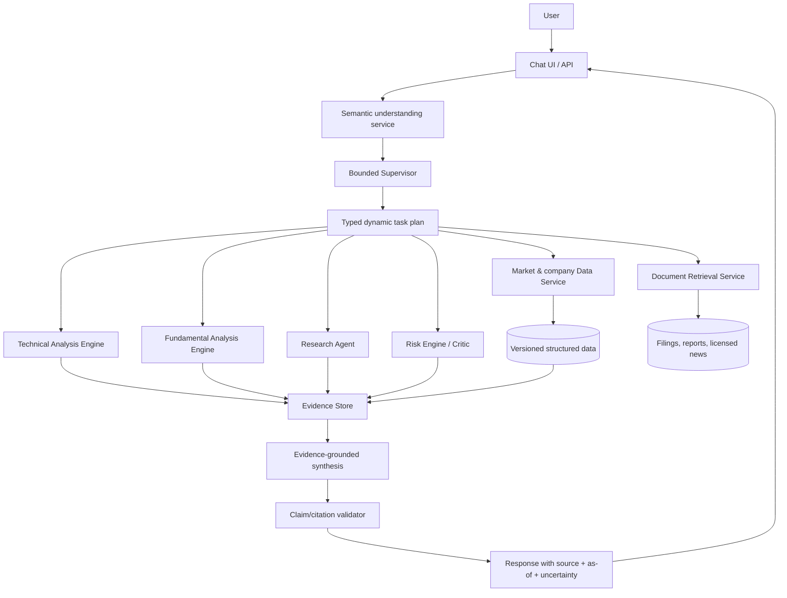

# Product roadmap — AI Investment Research Assistant

## 1. Mục tiêu sản phẩm

Phát triển MVP thành trợ lý nghiên cứu chứng khoán Việt Nam có thể trả lời câu hỏi, phân tích dữ liệu có cấu trúc, đọc tài liệu doanh nghiệp, so sánh luận điểm và trình bày evidence có thể kiểm tra. Sản phẩm hỗ trợ con người nghiên cứu; không đặt lệnh, không kết nối broker và không tự động quản lý danh mục.

Các nguyên tắc xuyên suốt:

- Correctness, provenance và khả năng từ chối quan trọng hơn độ “thông minh” bề ngoài.
- Python/service deterministic xử lý data validation, indicators, ratios, screening và backtest.
- LLM chỉ dùng cho semantic understanding, research decomposition, đọc/tổng hợp văn bản và diễn đạt có citation.
- Mỗi claim quan trọng phải liên kết được tới structured field hoặc document evidence với source và thời gian.
- Không thêm vector database, Deep Learning hay Knowledge Graph trước khi một evaluation chứng minh lợi ích.
- Mọi workflow có timeout, budget, retry giới hạn và audit trail.

## 2. Kiến trúc mục tiêu đề xuất

### Agent boundary mục tiêu

- **Supervisor:** agent-like; phân rã mục tiêu, chọn task, kiểm tra missing evidence và quyết định dừng/hỏi lại.
- **Research Agent:** agent-like khi cần tạo sub-question, chọn retrieval query, đối chiếu nhiều tài liệu và cập nhật thesis. Retriever/indexer bản thân là service.
- **Risk/Critic:** phần tính risk là engine deterministic; critic có thể là agent nếu phải kiểm tra assumption, contradiction và evidence coverage.
- **Technical/Fundamental:** mặc định là analysis engine deterministic. Chỉ thêm lớp agent nếu có use case chọn model/tool theo câu hỏi phức tạp.
- **Data, chart, screening, backtest:** service/tool deterministic, không gọi là agent.
- **Synthesis:** có thể dùng LLM nhưng chỉ nhận evidence đã typed/cited; không có quyền tạo số liệu hoặc thực hiện trade.

Không refactor lớn ngay. Kiến trúc này là đích để định hướng các phase sau khi roadmap được duyệt.

## 3. Thứ tự ưu tiên

1. **P0: Phase A — Reliable Data Layer.** Không có data/provenance đáng tin thì mọi phase khác khuếch đại lỗi.
2. **P0/P1: Phase B — harden semantic routing đang có.** Không xây lại; thêm holdout, calibration và observability.
3. **P1: Phase C — pilot RAG trên filing/report chính thức.** Đây là phần mở rộng user value lớn nhất sau data layer.
4. **P1: Phase D — nâng chất lượng analysis engine.** Dựa trên structured data và evidence đã ổn định.
5. **P1/P2: Phase E — screening/comparison toàn thị trường có point-in-time discipline.**
6. **P0 xuyên suốt, formalize ở Phase F — evaluation/backtesting.** Harness phải xuất hiện từ Phase A, không chờ cuối dự án.
7. **P3: Phase G — ML/Knowledge Graph tùy chọn.** Chỉ mở khi baseline và metric chứng minh nhu cầu.

## Phase A — Reliable Data Layer

**Trạng thái:** foundation, cache/retry/timeout/circuit/rate-limit policy, health telemetry và fail-closed quality gate đã triển khai; secondary/official-source reconciliation, exchange calendar và instrument master đầy đủ vẫn là production gates. Xem [phase-a-data-layer.md](phase-a-data-layer.md).

### Vấn đề đang giải quyết

Provider hiện chỉ có vnstock/VCI, chưa cache, chưa có field-level provenance, financial period metadata, corporate-action policy, schema-version tracking hoặc reconciliation. Schema ratio được normalize bằng heuristic và có thể đổi ngoài kiểm soát.

### User value

Người dùng biết một con số đến từ đâu, có hiệu lực tại thời điểm nào, có đủ mới không và có thể kiểm tra lại. Hệ thống phản hồi ổn định hơn khi upstream chậm, rate-limit hoặc đổi schema.

### Component cần thay đổi

- Tạo canonical contracts: `Instrument`, `PriceSeries`, `FinancialStatement/Metric`, `CorporateAction`, `DataQuality`, `SourceRef` và `EvidenceItem`.
- Tách acquisition/normalization/cache khỏi `DataAgent` thành `DataService` và provider adapters.
- Bổ sung `as_of`, `period_end`, `published_at`, `fetched_at`, timezone, request parameters, source URL/ID, checksum và schema version.
- Lưu raw response bất biến hoặc snapshot có version để debug/reproduce.
- Thêm cache, timeout, bounded retry/backoff, rate-limit policy và circuit breaker.
- Xác định rõ adjusted/unadjusted prices và corporate-action handling.
- Thêm data-quality checks: gaps, duplicates, invalid OHLC, stale series, unit/range checks, period order và cross-field consistency.
- Đánh giá nguồn thứ hai hoặc official-source reconciliation cho các field quan trọng; không tự động trộn nguồn nếu semantics khác nhau.
- Thêm status/health telemetry cho provider, freshness và cache hit.

### Dependency

Không phụ thuộc phase khác. Cần quyết định phạm vi mã hỗ trợ, nguồn được phép sử dụng, terms/licensing và SLA freshness.

### Rủi ro kỹ thuật

- API/schema upstream thay đổi hoặc rate-limit.
- Khác biệt đơn vị/kỳ/adjustment giữa nguồn.
- Dữ liệu lịch sử bị sửa mà không có revision trail.
- Chi phí lưu raw snapshot và nguồn dự phòng.
- “Latest” theo ngày dương lịch có thể sai trong cuối tuần/ngày nghỉ giao dịch.

### Tiêu chí hoàn thành

- 100% field hiển thị cho người dùng có source và `as_of`; mọi fetch có `fetched_at`.
- Không có financial metric nào thiếu reporting period hoặc unit.
- Provider contract tests phát hiện schema drift trước khi đưa dữ liệu vào analysis.
- Cache/retry/timeout/rate-limit behavior có test và metric.
- Corporate-action/price-adjustment policy được viết rõ và có fixture kiểm chứng.
- Có data-quality report cho toàn supported universe và cơ chế fail closed khi field không đáng tin.
- Một analysis run có thể reproduce từ snapshot/version đã lưu.

## Phase B — Semantic Understanding & Dynamic Routing

**Trạng thái:** implementation đã hoàn tất ở mức synthetic acceptance: typed bounded task plan, deterministic validation, parser telemetry/store, evaluator/calibration report và versioning. `synthetic-v1` đạt 40/40 nhưng không phải independent holdout; production calibration/alerting vẫn là operational gate. Xem [phase-b-semantic-routing.md](phase-b-semantic-routing.md).

### Vấn đề đang giải quyết

Khi bắt đầu Phase B, NLU hybrid chỉ được đo trên dataset cùng repository; `IntentRouter` là route map cố định, LLM fallback im lặng và `RoutingPlan` chưa có dependency/output contract. Nền tảng này nay đã được xử lý; các vấn đề holdout và calibration vẫn còn.

### User value

Người dùng hỏi tự nhiên, hệ thống hỏi lại đúng lúc, không chạy agent/tool thừa, không hiểu sai ticker và có hành vi nhất quán qua nhiều turn.

### Component cần thay đổi

- Giữ deterministic ticker/indicator/period extraction và clarification guardrail.
- Tạo holdout dataset do người khác gán nhãn hoặc lấy từ anonymized real queries; tách hoàn toàn khỏi example bank.
- Calibrate confidence theo intent/entity/clarification thay vì dùng một công thức chung.
- Log parser source, latency, fallback reason, ambiguity và token/cost khi dùng LLM.
- Version prompt, example bank và schema; regression-test từng version.
- Nâng `RoutingPlan` thành typed tasks có `id`, dependencies, required inputs, expected output, timeout và budget.
- Supervisor chỉ được tạo task từ allowlist; deterministic validator kiểm tra plan trước execution.
- Thêm explicit route cho research/evidence khi Phase C xuất hiện.

### Dependency

Data contracts từ Phase A giúp task khai báo rõ required data. Không cần vector embedding hoặc model training để hoàn thành phase này.

### Rủi ro kỹ thuật

- Overfit example bank và metric đẹp giả tạo.
- LLM provider drift, latency hoặc cost spike.
- Confidence không calibrated dẫn tới execute sai thay vì hỏi lại.
- Plan động quá tự do làm workflow khó kiểm thử.

### Tiêu chí hoàn thành

- Versioned holdout có đủ formal, colloquial, typo, multi-turn, ambiguous và adversarial queries.
- Trên holdout: intent accuracy ≥90%, ticker accuracy ≥97%, clarification precision/recall ≥90%; tuyệt đối không tự sửa ticker không chắc chắn.
- 100% LLM failure/fallback được ghi metric; không có silent production failure.
- Mỗi plan qua schema validation, allowlist và budget check trước khi chạy.
- Test chứng minh simple request không gọi full graph và ambiguous request không gọi market provider.
- Cost/latency p50/p95 được đo riêng cho local fallback và từng LLM provider.

## Phase C — Research/RAG & Evidence

**Trạng thái:** local RAG end-to-end đã triển khai: provenance-required ingestion, chunk embedding, cosine similarity, FTS5 hybrid retrieval và citation-constrained LLM synthesis. Local citation luôn được ưu tiên. Local miss có vertical slice fetch/extract HTML giới hạn và trả quote-level external evidence, tách khỏi verified corpus. Chưa có production failover, multi-iteration loop, PDF/OCR, source allowlist đầy đủ hay automatic ingestion. Xem [rag.md](rag.md), [phase-c-research-evidence.md](phase-c-research-evidence.md) và [internet research audit](phase-c-internet-research-audit.md).

### Vấn đề đang giải quyết

Hệ thống hiện chỉ biết OHLCV và một số ratio. Nó không đọc filing, báo cáo tài chính, annual report, nghị quyết, IR presentation, management commentary hoặc news; vì vậy không thể đưa ra catalyst, nguyên nhân hay luận điểm có citation.

### User value

Người dùng có thể hỏi “lợi nhuận giảm vì sao?”, “ban lãnh đạo nói gì về kế hoạch năm?”, “rủi ro nào xuất hiện trong báo cáo gần nhất?” và nhận câu trả lời kèm link, ngày, trang/đoạn trích và mức độ chắc chắn.

### Component cần thay đổi

- Bắt đầu với nguồn chính thức/được phép: công bố doanh nghiệp, báo cáo tài chính, annual report, nghị quyết và investor-relations documents. News chỉ thêm khi rõ licensing và chất lượng nguồn.
- Tạo `Document`, `DocumentVersion`, `DocumentChunk`, `Citation`, `Claim` và `EvidenceBundle`.
- Pipeline ingestion: discover → download → checksum/deduplicate → parse/OCR → extract tables/metadata → chunk → index → quality check.
- Metadata bắt buộc: ticker/issuer, document type, reporting period, published time, source URL, page/section, language, checksum và ingestion time.
- Retrieval filter theo ticker, document type và time trước semantic search.
- Khởi đầu bằng metadata database + full-text/BM25. Chỉ thêm vector retrieval nếu evaluation cho thấy tăng recall; reranker cũng là tùy chọn có metric.
- Research Agent tạo sub-question và gọi Retrieval Service; không truy cập raw internet tùy ý.
- Citation validator đảm bảo mọi material claim có evidence, citation tồn tại và thời điểm không vượt quá query as-of.
- Chống prompt injection từ document bằng cách coi nội dung retrieved là untrusted data.

### Dependency

Instrument identity, source/provenance và versioning từ Phase A; typed query entities từ Phase B. Cần quyết định document sources, legal/licensing và retention.

### Rủi ro kỹ thuật

- PDF scan/OCR tiếng Việt, bảng biểu và layout phức tạp.
- Document sửa/re-upload, trùng lặp và timestamp không rõ.
- Retrieval lấy đúng từ nhưng sai kỳ/ticker.
- Prompt injection trong tài liệu, hallucinated citation hoặc citation không support claim.
- Copyright/licensing của news và việc lưu nội dung đầy đủ.
- Look-ahead leakage nếu dùng documents published sau thời điểm nghiên cứu/backtest.

### Tiêu chí hoàn thành

- Pilot trên một tập issuer/document đã chốt, ingestion success và metadata completeness được đo.
- Versioned retrieval benchmark có Recall@k/MRR và temporal-filter tests.
- Mỗi claim trọng yếu trong câu trả lời pilot có citation click được tới source và page/section.
- Citation entailment/faithfulness được đánh giá thủ công trên một golden set; unsupported answer phải abstain.
- Re-ingestion idempotent; duplicate/revision được nhận diện bằng checksum/version.
- Không đưa news vào production nếu licensing/source quality chưa được duyệt.
- Vector search chỉ được giữ nếu cải thiện metric so với BM25/metadata baseline ở mức đáng kể đã thống nhất.

## Phase D — Better Fundamental / Technical / Risk Analysis

**Trạng thái:** implementation criteria của deterministic baseline đã hoàn tất: horizon-aware technical profiles, shared chart/indicator implementation, typed analytical evidence, VCI company-profile/annual-and-quarterly-statement lineage, golden fixtures cho mọi sector template được hỗ trợ, liquidity/regime/data-quality diagnostics, VNINDEX relative return trên các phiên giao dịch đồng bộ, VCI issuer events/corporate actions và portfolio-concentration contract. TTM point-in-time, beta/correlation, historical sector master, reviewed filing/news evidence và calibration/backtest vẫn là external-data/evaluation gate; các phần đó giữ `UNKNOWN` thay vì suy diễn. Xem [phase-d-analysis-engine.md](phase-d-analysis-engine.md).

### Vấn đề đang giải quyết

Các score hiện là heuristic chung, chưa theo ngành, chưa point-in-time calibrated và horizon chưa thực sự chi phối analysis. Risk thiếu portfolio/event/liquidity context; evidence chỉ là text.

### User value

Phân tích sâu hơn, so sánh đúng ngữ cảnh, giải thích được tại sao và không tạo cảm giác chính xác giả từ một score tùy ý.

### Component cần thay đổi

- Technical: một implementation indicator duy nhất cho chart/analysis; parameter theo horizon; adjusted price; liquidity filters; benchmark-relative return; volatility/regime và signal diagnostics.
- Fundamental: statement series nhiều kỳ, TTM, growth decomposition, margin/cash conversion, balance-sheet quality, dilution/dividend và valuation history.
- Tạo analysis template riêng cho ngân hàng, chứng khoán, bảo hiểm, bất động sản và doanh nghiệp phi tài chính; không áp một threshold cho mọi ngành.
- Risk: liquidity, leverage/accounting, event/news, concentration/correlation, scenario và data-quality risk. Portfolio features chỉ chạy khi user chủ động cung cấp holdings.
- Thay evidence string bằng `EvidenceItem` typed, liên kết input fields/documents.
- Tách `BUY/HOLD/...` khỏi raw analytical facts; ưu tiên thesis, counter-thesis, uncertainty và conditions-to-watch. Nếu giữ rating, phải version policy và calibration.
- Research/synthesis có thể dùng LLM; mọi phép tính vẫn deterministic.

### Dependency

Phase A cho data đúng kỳ/đơn vị/provenance; Phase C cho event/document evidence; Phase F cung cấp evaluation harness và point-in-time test.

### Rủi ro kỹ thuật

- Over-engineering score mà không có economic validity.
- Sector model sai hoặc sample nhỏ.
- Data availability không đồng đều giữa mã/kỳ.
- Double counting cùng một risk trong nhiều engine.
- Người dùng hiểu rating như khuyến nghị cá nhân hóa.

### Tiêu chí hoàn thành

- Golden calculation tests khớp hand-calculated fixtures cho từng supported sector.
- Horizon thay đổi thật sự làm thay đổi data window/method và được thể hiện trong output.
- Chart và Technical Engine dùng chung indicator implementation.
- Mỗi score/rating có version, feature contribution, confidence và evidence lineage.
- Missing data tạo `UNKNOWN`/reduced confidence có lý do, không impute tùy tiện.
- Risk output có data, market, business, event và portfolio sections phù hợp với evidence có sẵn.

## Phase E — Stock Screening & Comparison

**Trạng thái:** E2 current-data đã triển khai: `VnstockInstrumentUniverseProvider` lấy catalogue niêm yết hiện tại từ VCI/vnstock, lọc equity, lưu raw snapshot + URL/hash/timestamp, và mở các universe `market_current`/`hose_current`/`hnx_current`/`upcom_current`. `ScreenSpec` versioned, `PASS`/`FAIL`/`UNAVAILABLE`, lý do theo mã, as-of/provenance, missing-data policy, price-date alignment và ranking-withholding đều đã có. `ComparisonSpec` chặn field không cùng currency/price as-of/financial period. Historical universe và fundamental ranking point-in-time vẫn là gate mở vì current catalogue không phải dữ liệu thành viên lịch sử. Xem [phase-e-screening.md](phase-e-screening.md).

### Vấn đề đang giải quyết

Discovery hiện quét watchlist JSON 100 mã, xếp hạng technical và successive-halving về đúng top-K. Dual recommendation tiếp tục chạy full graph trên survivors và phân loại hai bucket deterministic. Comparison vẫn chưa chuẩn hóa đầy đủ ngành, quy mô, kỳ tài chính hoặc valuation context.

### User value

Người dùng có thể sàng lọc một universe công bố rõ, dùng điều kiện có thể giải thích và so sánh các mã cùng nền tảng thay vì nhìn score rời rạc.

### Component cần thay đổi

- Instrument/universe service có exchange, sector, listing status và point-in-time membership.
- Declarative `ScreenSpec` gồm filters, ranking factors, as-of, missing-data policy và universe disclosure.
- Batch data access/cache thay cho gọi tuần tự từng mã.
- Fundamental/technical/risk factor tables đã version hóa; percentile theo sector khi phù hợp.
- `ComparisonSpec` đảm bảo cùng reporting period/currency/unit và hiển thị unavailable fields.
- Screening explanation: vì sao mã pass/fail, data timestamp và caveat.
- Saved screens/watchlists chỉ khi có persistence/user model phù hợp.

### Dependency

Phase A là bắt buộc; Phase D cung cấp factors đáng tin; Phase F cần point-in-time universe để đánh giá. Phase C bổ sung catalyst/news filters nhưng không phải điều kiện cho MVP screening.

### Rủi ro kỹ thuật

- Survivorship bias và universe hiện tại bị dùng cho quá khứ.
- N+1 API calls, rate limit và latency.
- Ranking tạo cảm giác “top picks” dù data thiếu.
- So sánh khác ngành/kỳ dẫn tới kết luận sai.

### Tiêu chí hoàn thành

- Universe, thời điểm và số mã evaluated luôn hiển thị.
- Screen chạy batch, có cache và đáp ứng latency target đã thống nhất.
- Mọi factor có definition/version/as-of; missing-data policy có test.
- Point-in-time universe tests loại survivorship leakage.
- Comparison đảm bảo period/unit alignment hoặc từ chối so sánh field không tương thích.
- Kết quả có pass/fail explanation và evidence, không chỉ một score tổng.

## Phase F — Evaluation & Backtesting

**Trạng thái:** Evaluation/backtest harness đã triển khai theo hướng fail-closed: offline `BacktestDataset` versioned, point-in-time universe/signal/adjusted-price validation, deterministic rank backtest, cost/turnover/benchmark/drawdown/confidence interval, walk-forward windows và evaluation registry dưới `.runtime`. Có thêm free forward-capture path: mỗi ngày ghi nhận dữ liệu thực từ VCI/vnstock để demo sau này, không backfill lịch sử. Không dùng LLM, không giao dịch. Chưa thể tuyên bố hiệu năng lịch sử thị trường Việt Nam vì chưa có nguồn universe/listing-delisting/corporate-action historical point-in-time. Xem [phase-f-evaluation-backtesting.md](phase-f-evaluation-backtesting.md).

### Vấn đề đang giải quyết

Test hiện chứng minh code chạy và policy conflict hoạt động, chưa chứng minh signal hữu ích, confidence calibrated, retrieval faithful hoặc hệ thống ổn định qua thời gian.

### User value

Người dùng và đội phát triển biết tính năng nào đáng tin, sai ở đâu và thay đổi mới có thực sự cải thiện hệ thống hay không.

### Component cần thay đổi

- Evaluation registry lưu dataset/version/config/code revision và kết quả.
- Data contract/schema-drift suite chạy định kỳ.
- NLU holdout, clarification, task-plan correctness và cost/latency metrics.
- RAG retrieval/faithfulness/citation/temporal leakage evaluation.
- Deterministic point-in-time backtest engine; LLM không tham gia tính return.
- Signal snapshots với as-of/published-at, corporate actions, delisting, universe membership và revision policy.
- Benchmark, transaction costs, turnover, drawdown, hit rate, calibration và stability by regime/sector.
- Walk-forward/out-of-sample tests; không tune rồi báo trên cùng sample.
- Production monitoring: failure rate, stale data, provider drift, abstention, latency và cost.

### Dependency

Harness bắt đầu từ Phase A. Backtest tài chính đầy đủ cần Phase A/D/E; RAG eval cần Phase C.

### Rủi ro kỹ thuật

- Look-ahead, survivorship và revision leakage.
- Multiple testing/overfitting và cherry-pick metric.
- Backtest không phản ánh liquidity/cost.
- Dùng performance lịch sử để marketing như bảo đảm tương lai.

### Tiêu chí hoàn thành

- Mỗi release có evaluation report tái lập từ versioned inputs/config.
- Unit, integration, provider contract, NLU, RAG và point-in-time suites chạy trong CI theo tầng phù hợp.
- Backtest ghi rõ benchmark, cost, universe, rebalance, data vintage và confidence interval.
- Walk-forward kết quả được tách khỏi development sample.
- Regression gate chặn release khi data correctness, citation faithfulness hoặc safety giảm dưới threshold.
- Báo cáo nêu cả failure slices, không chỉ aggregate score.

## Phase G — Optional ML / Knowledge Graph

### Vấn đề đang giải quyết

Chỉ mở phase này khi baseline deterministic/RAG đã chỉ ra một failure mode cụ thể mà ML hoặc graph có khả năng giải quyết tốt hơn.

### User value

Có thể cải thiện ranking, anomaly detection, document classification hoặc truy vấn quan hệ phức tạp—nhưng chỉ khi lợi ích được đo và không làm giảm explainability/reliability.

### Component cần thay đổi

Các candidate ML hợp lý trước Deep Learning:

- Learning-to-rank cho screening sau khi có label/point-in-time dataset đáng tin.
- Calibration model cho probability/confidence.
- Anomaly detection cho data quality hoặc accounting changes.
- Document classifier/entity linker cho ingestion.

Knowledge Graph chỉ đáng cân nhắc nếu có nhu cầu lặp lại về quan hệ issuer–subsidiary–executive–sector–event–document mà relational/metadata search không còn đủ. Graph phải giữ source, valid-time và transaction-time cho mỗi edge.

### Dependency

Phase A và F là bắt buộc. Document ML/KG cần Phase C. Ranking model cần Phase E và label definition rõ.

### Rủi ro kỹ thuật

- Sample nhỏ, non-stationarity, data leakage và model decay.
- Black-box score làm giảm trust.
- Graph entity resolution sai tạo quan hệ giả.
- Chi phí vận hành/model registry cao hơn giá trị.
- Deep Learning được thêm vì hình thức thay vì cải thiện metric.

### Tiêu chí hoàn thành

- Có baseline deterministic mạnh và failure analysis chỉ rõ khoảng trống.
- Candidate phải thắng baseline trên out-of-sample metric, sau cost, qua nhiều regime/sector.
- Có model/data version, feature lineage, drift monitor, rollback và explanation.
- KG pilot phải chứng minh query/retrieval quality hoặc analyst time giảm rõ rệt so với relational/metadata baseline.
- Nếu không đạt gate, không đưa ML/KG vào production.

## 4. RAG có nên làm không?

**Có, nhưng theo pilot hẹp và sau nền tảng data/provenance.** Đây là công nghệ có product value rõ cho use case đọc filing/report/news, khác với việc thêm RAG để trang trí kiến trúc.

Thứ tự đề xuất:

1. Official filings và company reports của một nhóm issuer nhỏ.
2. Metadata + BM25/full-text baseline.
3. Golden research questions và citation evaluation.
4. Chỉ thêm embeddings/hybrid retrieval nếu Recall@k hoặc answer faithfulness cải thiện.
5. Thêm licensed news sau khi xử lý legal, dedup, source quality và event timestamp.

Không dùng RAG cho OHLCV, indicator, ratio calculation hoặc backtest. Những phần đó thuộc structured data và deterministic code.

## 5. Backlog ưu tiên ngay sau khi roadmap được duyệt

1. Chốt supported universe, source policy và freshness SLA.
2. Thiết kế `SourceRef`, `EvidenceItem`, financial period/unit và data-quality contracts.
3. Làm provider contract tests + raw snapshot/versioning + cache/retry/timeout.
4. Quyết định adjusted-price/corporate-action policy.
5. Tạo independent NLU holdout và production metrics.
6. Pilot filing ingestion trên phạm vi nhỏ, chưa cần vector database.
7. Hợp nhất indicator implementation và sửa horizon semantics.
8. Xây multi-period/sector-aware fundamental baseline.
9. Tạo point-in-time evaluation harness trước khi mở rộng screening.
10. Sau các gate trên mới quyết định vector retrieval, ML hoặc Knowledge Graph.

## 6. Các quyết định cần review trước implementation

- Supported universe ban đầu: chỉ HOSE hay cả HNX/UPCoM; có bao gồm index không.
- Nguồn dữ liệu được phép dùng, SLA, licensing và ngân sách.
- Mức freshness: end-of-day hay intraday; project hiện chỉ phù hợp EOD research.
- Output policy: giữ `BUY/HOLD/...` hay chuyển sang thesis/risk/conditions-to-watch.
- RAG pilot: loại document, số issuer, ngôn ngữ, OCR và retention.
- Persistence/deployment: local single-user hay service multi-user.
- Evaluation gates và acceptable failure rate trước khi gọi tính năng “production-ready”.

Cho tới khi các quyết định này được duyệt, không nên refactor lớn hoặc thêm hạ tầng vector/ML/KG.
