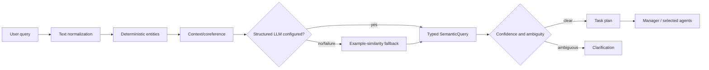

# Hybrid semantic NLU

## Pipeline



The layers are separated from agent reasoning:

- `normalizer.py`: Unicode/case/whitespace, common Vietnamese abbreviations and conservative domain typo handling.
- `entity_extractor.py`: ticker, indicator, sector, period and requested-information extraction. Unknown ticker symbols are accepted when uppercase; ticker fuzzy correction is forbidden.
- `context_resolver.py`: active ticker, prior result lists, positional references, two-stock references and ambiguity detection.
- `intent_examples.py` + `intent_classifier.py`: character n-gram semantic similarity over varied utterances, with bounded evidence from deterministic entities.
- `semantic_parser.py`: optional typed LLM parsing, safe deterministic entity merge, local fallback, confidence and clarification policy.
- `chat/router.py`: converts primary and secondary intents into typed tasks with dependencies, required inputs, expected outputs, timeout and bounded budget. A deterministic validator checks the plan before `ChatService` dispatches.

Knowledge routing extends this contract with three deterministic intents: `THEORY` for timeless concepts, `CURRENT_RULE` for time-sensitive exchange/regulatory questions, and `MIXED` for a concept applied to a real ticker. Their allowlisted plans use `KNOWLEDGE` alone or `KNOWLEDGE → DATA → FUNDAMENTAL/TECHNICAL`; the parser explicitly prevents a weak similarity match from authorizing `MIXED` without both a finance concept and an application request.

## Discovery cardinality and direction

For stock discovery, `requested_result_count` is a typed intent field. The service applies that limit after deterministic screening and records both the requested and returned counts. If fewer symbols qualify, it explicitly reports the shortfall instead of silently returning a shorter list.

`requested_actions` distinguishes BUY from SELL. A BUY screen ranks eligible BUY signals from highest technical score; a SELL screen ranks eligible SELL signals from lowest technical score. A request containing both directions is clarified before any data call because they cannot be combined into one meaningful "best" ranking.

## Structured providers

`STOCK_AGENT_LLM_PROVIDER=mock` is the default and makes no paid model call. The OpenAI adapter uses typed structured output (`responses.parse` with the Pydantic `SemanticQuery` schema). The Ollama adapter sends the same JSON schema to the local server. Provider/network failure falls back to local semantic similarity.

No hidden chain-of-thought is stored or displayed. The debug UI contains only the intent, entities, confidence, resolved references, interpretation, route and bounded task plan.

## Routing safety and observability

Only `RouteStep` enum values in the allowlist can appear in a plan; semantic parsing never grants arbitrary function/tool access. The validator rejects duplicate IDs, forward/self dependencies, missing inputs and plans above the execution budget before dispatch.

`ParsedQuery` records parser source, total/LLM latency, LLM-attempt status, safe fallback reason and prompt/example-bank versions. The parser also emits a structured application log. Token and cost fields are intentionally not reported: current provider adapters return no usage metadata, so the application does not estimate or invent cost.

The task plan is a validated declaration of intended work. It does not yet replace the existing `ChatService` selective methods or the `StockAgentGraph` full-analysis executor with a generic DAG executor.

## Why no sentence-transformers dependency

The local fallback uses character n-gram cosine similarity because it is small, deterministic, typo-tolerant and requires no model download. `sentence-transformers` would add a large PyTorch/model footprint and slow first-time setup. A production deployment can add embeddings behind the same classifier interface if measured accuracy on a larger out-of-sample dataset justifies it.

## Evaluation

Dataset: `tests/data/semantic_queries.json`, 122 queries covering formal and conversational Vietnamese, no-diacritic text, English mixing, abbreviations, mild typos, context references, clarification, multiple intents and explicit screening cardinality/direction. Its indicator-definition expectations now use `THEORY`; Knowledge QA has a separate 56-case author-created set documented in [knowledge-base.md](knowledge-base.md).

| Metric | Before | After |
|---|---:|---:|
| Intent accuracy | 50.0% (60/120) | 100.0% (122/122) |
| Ticker extraction accuracy | 70.8% (85/120) | 100.0% (122/122) |
| Period extraction accuracy | 66.7% (4/6) | 100.0% (6/6) |
| Follow-up resolution accuracy | 25.0% (6/24) | 100.0% (24/24) |
| Clarification accuracy | 0.0% (0/5) | 100.0% (6/6) |
| Multi-intent accuracy | 0.0% (0/5) | 100.0% (5/5) |

These figures describe this repository dataset, not universal Vietnamese-language accuracy. Add new real failure examples to the dataset before changing examples or scoring weights.

Run the evaluator with error analysis:

```powershell
.\.venv\Scripts\python.exe scripts\evaluate_semantics.py --show-errors
```

Run all regression tests:

```powershell
.\.venv\Scripts\python.exe -m pytest
```
